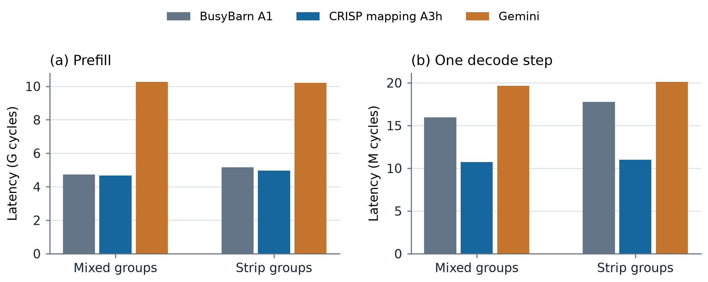
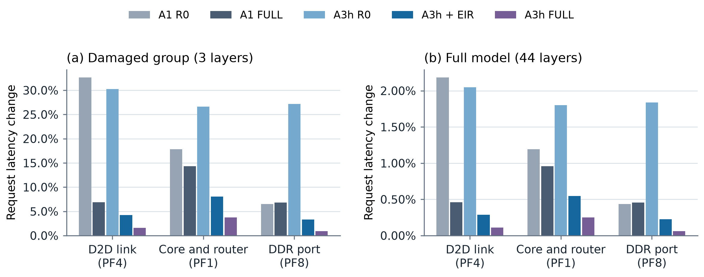

# E 阶段结果：混合分组与 Gemini 基线

2026-11-12，Codex。E 的全部计算与汇总已完成。672 个主候选和 16 个 Gemini 结束状态对照均已下载，完整核对通过。新增搜索 420 次，沿用并重评历史候选 252 个，共 6,880 次后端评估。

A3h 的改善主要来自 decode。混合分组的 44 层模型中，相对 BusyBarn A1，prefill 低 **1.07%**、每步 decode 低 **32.84%**，生成 2048 步的请求时间低 **28.83%**。全条带分组的对应改善为 **3.69%、38.10%、33.83%**。相对 Gemini，两种布局的请求时间分别低 **47.29%、46.47%**。

数值来自算子后端仿真，以及按固定层数、组间传输和 decode 步数组装的模型时间。所有时间以周期表示。主表沿用 B 阶段的层公式，同时保留修正 LN 计数的结果。

## 1. 本阶段实际完成的工作

| 项目 | 完成量 |
|---|---:|
| 1×4 A1、A3h 的新增搜索 | 196 |
| 两种形状的 Gemini 新增搜索 | 224 |
| 历史 A1、A3h 候选重评 | 252 |
| 主候选总数 | 672 |
| Gemini 种子 123 的结束状态对照 | 16 |
| 每状态十种子的后端评估 | 6,880 |
| 主候选最终确定性 CPCM / 随机平局 CPCM | 672 / 6,720 |
| 算子比较表 | 48 行，每行 14 个候选 |
| 故障组装表 | 570 行，19 个故障 × 5 种方案 × 2 种 LN 计数 × G2/G0/G1 三个位置 |
| 最慢组汇总表 | 30 行，三个位置 × 五种方案 × 两种 LN 计数 |
| 容量表 | 28 行，两种布局各 14 组 |

小批完成 40 个主任务和 16 个结束状态对照；正式批次完成其余 632 个任务。每次搜索 1,000 步。工作负载为 GPT W1、batch 16、prefill 长度 2048、decode KV 长度 2048。Gemini prefill MHA 已对齐为八头，每头维度 96；完整层按八份八头任务相加。

A1 使用 g0/g1 × 七组代价权重，A3h 使用 g0/g1 × 七个退火种子，Gemini 使用种子 123、1–13 的十四条退火轨迹。Gemini 初始化种子仍为 123，保留原生移动、hops 目标、温度和 XY 路由。八类 LN/proj 的 LP 分支、不同种子的提议轨迹及种子 123 重放均已验证，见 [小批报告](E_PILOT_SUMMARY.md)。

主表在各方法的十四个候选中选后端平均延迟最小者，每个候选均以种子 1–10 评估。确定性 CPCM、随机平局 CPCM 选中的候选和十四候选中位数另列于算子表。A1/A3h 的历史搜索保留原始快照，E 重评使用同一服务器环境。

## 2. 单层与 44 层结果

主表层公式为 `2 LN + 8 MHA + proj + FFN`。decode FFN 自带一次 LN，因此另给 `fixed` 版本：decode 层公式改为 `LN + 8 MHA + proj + FFN`；prefill 不变。完整数字见 [E_SUMMARY.json](E_SUMMARY.json)。

### 单层时间

| 组形状 | 方法 | Prefill（百万周期） | Decode 一步（千周期） |
|---|---|---:|---:|
| 2×2 | BusyBarn A1 | 105.491 | 355.939 |
| 2×2 | A3h | 104.843 | 242.318 |
| 2×2 | Gemini | 232.996 | 444.879 |
| 1×4 | BusyBarn A1 | 116.689 | 403.867 |
| 1×4 | A3h | 112.368 | 249.904 |
| 1×4 | Gemini | 231.465 | 456.711 |

Gemini 相对 A3h 的 prefill 绝对差主要来自 FFN 和 MHA：两者合计占 2×2 单层差距的 85.33%、1×4 的 91.48%。这是当前原生 Gemini 搜索设置和同工作量仿真的结果。

读取已有快照和实际通信路径后，FFN 的主要现象是计算分配集中：Gemini 在两种形状下最忙 tensorcore 的累计工作均为 **94.37M 周期**，A1/A3h 为 **37.75M 周期**，前者是后者的 2.5 倍；这个计算工作量下界已经高于 A3h 整个 FFN 的 44.00M/45.46M 周期。MHA 则同时存在 DDR 与片内访问集中：Gemini 最忙 DDR 读链的累计工作为 **9.44M/9.46M**，片内链为 **8.86M/8.88M**；A3h 分别为 **2.79M/2.99M**、**2.33M/3.02M**（依次为 2×2/1×4）。

这些累计工作量来自主表选中候选的计算事件和最终广播后通信树。三种方法的总计算量一致；Gemini 原生 `hops_only` 目标没有最忙计算设备和最忙链路负载项，当前结果表现出计算与通信负载集中。`ddr_random` 与 XY 各自的影响没有单独消融，因此本次解释落在已保存映射呈现的资源工作量上。逐项数据见 [gemini_attribution.csv](e/tables/gemini_attribution.csv) 和 [逐资源记录](e/evidence/gemini_attribution.json)；这些是静态工作量，实际逐事件排队时间未在 E 中保存。

### 44 层时间

两种布局都使用 7×8、共 56 个 Die，分成十四个四 Die 组。混合布局的 38 层放在 2×2 组、6 层放在 1×4 组；条带布局的 44 层均放在 1×4 组。两种布局均有十三次相邻组传输，prefill 合计 20,447,492 周期、每步 decode 合计 10,244 周期。

| 布局 | 方法 | Prefill（十亿周期） | Decode 一步（百万周期） | 请求 128（十亿周期） | 请求 512（十亿周期） | 请求 2048（十亿周期） |
|---|---|---:|---:|---:|---:|---:|
| 混合 | BusyBarn A1 | 4.729 | 15.959 | 6.772 | 12.900 | 37.414 |
| 混合 | A3h | 4.679 | 10.718 | 6.051 | 10.166 | 26.629 |
| 混合 | Gemini | 10.263 | 19.656 | 12.779 | 20.327 | 50.518 |
| 条带 | BusyBarn A1 | 5.155 | 17.780 | 7.431 | 14.258 | 41.569 |
| 条带 | A3h | 4.965 | 11.006 | 6.373 | 10.600 | 27.505 |
| 条带 | Gemini | 10.205 | 20.106 | 12.778 | 20.499 | 51.381 |

请求时间为 `P + N × D`，N 是 prefill 后追加的 decode 步数；每步采用同一个 KV 长度 2048 的结果。计算对象为 44 个 Transformer block 及串行组间激活传输。

| 布局 | A3h 相对哪种方法 | Prefill | Decode 一步 | 请求 128 | 请求 512 | 请求 2048 |
|---|---|---:|---:|---:|---:|---:|
| 混合 | A1 | −1.07% | −32.84% | −10.65% | −21.19% | −28.83% |
| 条带 | A1 | −3.69% | −38.10% | −14.23% | −25.66% | −33.83% |
| 混合 | Gemini | −54.41% | −45.47% | −52.65% | −49.99% | −47.29% |
| 条带 | Gemini | −51.35% | −45.26% | −50.12% | −48.29% | −46.47% |

在同一种方法内，混合布局相对条带布局的请求 2048 时间变化为 A1 −10.00%、A3h −3.19%、Gemini −1.68%。A3h 的混合布局 prefill 和 decode 分别低 5.76% 和 2.62%。Gemini 的混合布局 prefill 高 0.57%，请求 128 近乎相同（+0.0049%）。

修正 decode 的重复 LN 后，prefill 和方法排名保持不变。A3h 相对 A1 的 decode 改善变为混合 33.46%、条带 38.70%；请求 2048 的改善变为 29.33%、34.33%。



## 3. 候选选择方式

下表把按 CPCM 选择的候选与后端选出的最佳候选比较。延迟差使用同一候选已完成的十次后端评估均值。

| 方法 | 确定性 CPCM 选中同一候选 | 确定性选优延迟差：中位 / 最大 | 随机平局 CPCM 选中同一候选 | 随机平局选优延迟差：中位 / 最大 |
|---|---:|---:|---:|---:|
| A1 | 13/16 | 0 / +0.704% | 15/16 | 0 / +0.005% |
| A3h | 7/16 | +0.385% / +20.310% | 11/16 | 0 / +0.632% |
| Gemini | 13/16 | 0 / +3.079% | 13/16 | 0 / +2.421% |

随机平局估计显著减小了 A3h 中确定性选优造成的最大延迟差。完整表也保留十四候选的中位数、最小/最大均值，以及所选候选十次后端评估的范围，便于分别观察搜索差异和后端平局波动。

随机平局选优在 48 行中的 39 行达到后端最小均值，最大差来自 1×4 Gemini prefill FFN：随机平局选出的 s12 为 120,567,971.9 周期，后端选出的 s5 为 117,718,579.5 周期（+2.421%）。A3h 的确定性选优最大差出现在 1×4 decode LN，随机平局选优在该行达到后端最小均值。

单候选的估计误差与选优延迟差分别统计。1×4 A3h decode LN 的 g0_s123 随机平局估计均值为 5,177，后端均值为 5,743.6（−9.865%）；同一组离散延迟在两边的十次样本中出现频数不同，详见小批报告。

十六对 Gemini 种子 123 的自身目标最优态与结束态，其 hops 目标值全部相同。最优态的后端均值有六对更低、六对相同、四对更高，相对变化为 −1.512% 至 +4.012%，中位数为 0。五对广播前快照完全一致，其中三对仍出现后端差异，符合此前确认的进程与对象顺序波动。因此这十六对数据没有显示保存自身最好态带来一致的后端改善。逐对数据见 [result_analysis.json](e/evidence/result_analysis.json)。

## 4. 混合布局中的故障

沿用 C 阶段的十九个物理故障，原主表将故障放在混合布局的 G2（2×2，三层）。受影响的三层使用 C 的成对故障前/故障后结果，其余四十一层使用 E 的健康结果；双方使用相同组间传输。下文补充相同局部故障分别落在 G0、G1（均为 2×2、四层）时的解析结果。E 没有新增故障搜索。A3h + EIR 对应 C 的 `L2Gsync 停止档（均值）`，C 的多种子与广播修正见 [C_SUMMARY.md](C_SUMMARY.md)。

以下为生成 2048 步的请求时间相对各自故障前的变化；范围覆盖全部十九个故障。

| 方案 | 故障组三层：中位数 [最小, 最大] | 完整 44 层：中位数 [最小, 最大] |
|---|---:|---:|
| A1 R0 | +12.16% [+1.77%, +37.77%] | +0.81% [+0.12%, +2.53%] |
| A1 FULL | +9.03% [+1.09%, +17.09%] | +0.60% [+0.07%, +1.14%] |
| A3h R0 | +19.70% [+4.00%, +35.48%] | +1.33% [+0.27%, +2.40%] |
| A3h + EIR | +5.66% [+2.48%, +9.63%] | +0.38% [+0.17%, +0.65%] |
| A3h FULL | +2.96% [−2.56%, +6.96%] | +0.20% [−0.17%, +0.47%] |

EIR 相对同一起点的 R0，在十九个故障中的十八个降低请求时间；局部三层的变化中位数为 −11.03%，完整模型为 −0.88%。三层的故障影响在四十四层相加后占比较小，因此图同时展示局部与整模型。

唯一例外为 MF6（仅 PE 故障，局部 Die 0/core 1，路由器保留）：G2 的请求从 1,890,328,832.40 增至 1,904,652,941.82 周期（+0.758%），完整模型增加 14,324,109.42 周期（+0.0536%）。增加量来自 prefill，decode 相同。相对 A3h FULL，EIR 在十八个故障的请求时间略高，完整模型差异中位数为 +0.179%；MF6 是其余一个。



### 四层组受损与理想流水线瓶颈

对每个组先计算 `W_g(N) = n_g × (P_g + N × D_g)`，再计算最慢组周期 `B(N) = max_g W_g(N)`。prefill 和 decode 的最慢组周期也分别列出。请求指标必须在每组内先相加 P 和 N×D，再取最大值。

`1/B` 表示由组工作量决定的理想服务率上限，对应变化为 `B_故障前 / B_故障后 − 1`。这描述连续请求充分占用各组时的计算服务能力；组间通信、流水线填充/排空及自回归反馈调度另有时间需求。原 44 层串行和仍计十三次组间传输，新 B 指标只取组内工作量。

下表为 A3h、原 LN 公式、2048 步请求。数值为十九个故障的中位数；G0 与 G1 在该模型中的数字相同，逐组结果分别保留。

| 受损位置 | 方案 | 44 层串行时间变化 | 最慢组周期（十亿周期） | 最慢组周期变化 | 理想服务率变化 |
|---|---|---:|---:|---:|---:|
| G2，三层 | R0 | +1.333% | 2.40444 | 0% | 0% |
| G2，三层 | EIR | +0.383% | 2.40444 | 0% | 0% |
| G0/G1，四层 | R0 | +1.778% | 2.87693 | +19.651% | −16.423% |
| G0/G1，四层 | EIR | +0.511% | 2.53954 | +5.619% | −5.320% |

故障前 B 为 2.40444G 周期。G2 的 R0 在十九个故障中仅 PCEdge、MCEdge、MCScratch 三个超过健康四层组，B 最大增加 **1.572%**，理想服务率最多降低 **1.547%**；EIR 后十九个均由健康四层组决定 B。四层组受损时，R0 的 B 最大增加 **35.429%**，EIR 后最大增加 **9.591%**。

四层组的改善仍主要来自 decode：prefill 的 B 退化中位数为 R0 **+19.896%**、EIR **+20.013%**；decode 则从 **+19.209%** 降到 **+3.267%**。完整的两阶段、三种请求长度、两种 LN 计数和五种方案见 [pipeline_summary_table.csv](e/tables/pipeline_summary_table.csv)。

C 的健康 2×2 请求时间比 E 重评值低 0.0392%，所以受损前的最慢组是另一健康四层组；计算保留了这一差异。各行的 `paired_before_vs_E_healthy_*` 字段给出 C/E 健康时间差。

“三层组退化超过 33.3%”表示它开始超过健康四层组，之后只将超过部分带入 B。例如同层时间为 t 时，三层组退化 35.48%，`B_后/B_前 = 3×1.3548/4 = 1.0161`，周期增加 1.61%，理想服务率下降 1.5845%。四层瓶颈组的周期增加 20%，对应服务率下降 16.67%。因此周期变化和吞吐变化需要分别计算。

若继续按独立组模型分析多个受损组，串行增量为 `ΔT = Σ_g n_g × (t_g,后 − t_g,前)`。只有层数、单层退化相同且组间传输项不变时，绝对增量才等于 m 倍单组增量；最慢组指标仍取最大值。本次未新增多组并发故障仿真。

## 5. 容量与图表

容量表按逻辑权重、共享历史 KV 和激活缓冲计算。每组有三层或四层；四层组的权重为 3,624,517,632 字节，共享历史 KV 为 192 MiB。每次组间 prefill 激活为 384 MiB、decode 激活为 192 KiB，单缓冲与双缓冲分别列出。SRAM 配置为每核 16 MiB，每组汇总为 1 GiB；DDR 容量按每 Die 32 GiB、每组 128 GiB 的配置注释计算。逐组汇总没有展开逐核同时存活张量的分配。

四张主图和相同内容的 LN 修正版均保存为可编辑文本的 SVG 与 300 dpi PNG：

- [单层时间](e/figures/main/e_layer_latency.svg)
- [44 层 prefill 与 decode](e/figures/main/e_model_latency.svg)
- [请求时间随 decode 步数变化](e/figures/main/e_request_latency.svg)
- [三个代表故障](e/figures/main/e_fault_latency.svg)
- [主图说明](e/figures/main/FIGURE_NOTES.md)、[LN 修正版说明](e/figures/fixed/FIGURE_NOTES.md)

全部逐项数据位于 [E_SUMMARY.json](E_SUMMARY.json) 和 `e/tables/`。其中 `operator_table.csv` 是算子与候选选择表，`model_table.csv` 是整模型表，`fault_model_table.csv` 是 G2/G0/G1 全部故障表，`pipeline_summary_table.csv` 是最慢组汇总，`capacity_table.csv` 是容量表。

## 6. 运行与核对

| 项目 | 记录 |
|---|---|
| 服务器 | ubuntu@119.45.118.66，Ubuntu 22.04，128 逻辑 CPU，约 247 GiB 内存 |
| Python 与依赖 | Python 3.13.18，NumPy 2.5.4，NetworkX 3.7，simanneal 0.5.0 |
| 正式批次 | 632/632，390 搜索 + 242 重评，128 并行，各进程底层线程为 1 |
| 正式批次耗时 | 3,009.45 秒，即 50 分 09.45 秒 |
| 开始 / 完成观察时间 | 北京时间 2026-11-12 20:31:22 / 21:21:48 |
| 采样最低可用内存 | 184.85 GiB |
| 全量单进程报告的最高峰值 | 0.914 GiB |
| 正式批次失败 / OOM kill | 0 / 0 |
| 全量源码提交 | `251cc79942ca2242ff407e97594c72c2d9fd93eb` |
| Artifact 提交 | `299089ef266c54c6a1fa8c2f52df66e6c970b52a` |

全量与小批的科学 runner 相同（输出修复后的 `97df5e8`），SHA-256 为 `753bc2ac00ab3e9fd82b9d7089ead54f3ec020dd4fcefc7de80225e0b9d930ad`。小批七个 A1 任务在计算结束后的 JSON 序列化处失败，均从已有原始输出恢复；原始失败和恢复记录仍保存。正式批次 632 个退出码全部为 0。

核对覆盖全部 688 条结果：清单无缺失或重复，后端种子 1–10 齐全；672 个主候选的快照重载与确定性检查通过；420 个新搜索的动作恢复检查通过；十六类工作量各有四十二个候选，组内指纹一致；十六个 Gemini 结束状态与对应搜索一致。核对报告见 [e/evidence/full_results_check.json](e/evidence/full_results_check.json)。

完整结果包已下载并核对 SHA-256：`e1f5996ca12b2acfcb3c577bf44d7cfeb7947edec6901ea061afb9be5eed79e9`，大小 202,111,146 字节。归档位置为 `e/out/full_remote_archive/E_full_632_results_20261112.tar.gz`，解包数据为 `e/out/full_remote/`，小批为 `e/out/pilot_remote/`。正式包含逐任务结果、日志、spec、原始搜索输出和新搜索快照。

后续四层组与最慢组分析只读取现有结果，原 G2 的 190 行旧字段及其余七张结果表逐项保持一致；公式检查包括零故障、三层组越过四层组、四层瓶颈退化和 P/D 最慢组不同的例子，见 [pipeline_check.json](e/evidence/pipeline_check.json)。Gemini 静态分析核对了十二个候选的快照、最终映射、确定性结果和事件数，并确认各方法总计算量一致、资源工作量下界不超过所存后端总时间。没有新增后端、CPCM 或 SA 运行。

这些耗时含 128 并行时的资源竞争，论文串行计时仍在 J 阶段统一测量。E 的新搜索累计 49.04 进程小时，重评 7.20 进程小时，结束状态评估 0.41 进程小时。

下载和核对后曾按用户要求尝试通过 Chrome 关机。电脑控制工具因无法可靠识别浏览器当前地址而中止，未执行关机；服务器仍需在腾讯云控制台关闭。

## 7. 复算与下一步

在仓库根目录运行以下命令，只读取已完成结果：

```powershell
python -B e2e/e_check.py --pilot-dir e2e/e/out/pilot_remote --full-dir e2e/e/out/full_remote --out e2e/e/out/technical_audit/full_results.json
python -B e2e/e_report.py --inputs e2e/e/out/pilot_remote e2e/e/out/full_remote --out-dir e2e/e/out/postprocess_report
python -B e2e/e_pipeline_check.py
python -B e2e/e_gemini_analysis.py
python -B e2e/e_plot.py --summary e2e/e/out/postprocess_report/summary.json --out-dir e2e/e/figures/main
python -B e2e/e_plot.py --summary e2e/e/out/postprocess_report/summary.json --ln fixed --out-dir e2e/e/figures/fixed
```

本次确认的 E 范围已做齐：两种组形状、三种方法、两种整模型布局、请求长度分析、十九个既有故障的混合布局组装，以及容量表。D 的 1,853 个结果也已重新清点，D5 补充 123 个任务的结果与清单逐项一致，种子 4–10 齐全；`D_SUMMARY.md` 已在本地提交 `88b557a` 中，确认记录见 [d_completion_check.json](e/evidence/d_completion_check.json)。

后续顺序是 F 硬件、G 规模、H Llama、I Qwen3-MoE、J 串行计时。F/G 的具体任务和预计耗时见 [FG_PLAN.md](FG_PLAN.md)，本次只拟方案，尚未启动。
