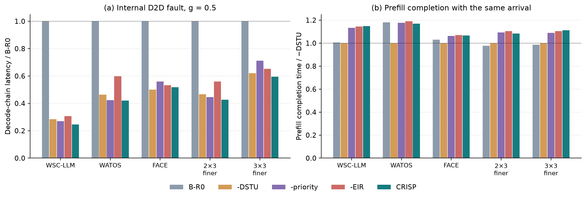
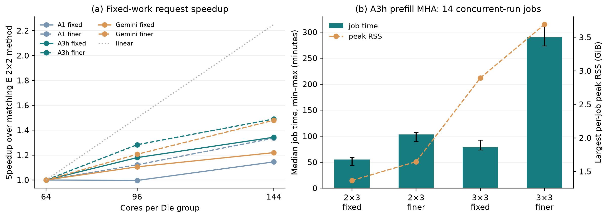

# G 阶段结果：固定工作量下的规模扩展

2026-11-13，Codex。F/G 已完成 6,813/6,813 个调度作业。本文由已保存的候选、故障修复和联合实验结果生成；表中时间采用统一的 1 ns/tick。

两种新增规模、两种切分方式下，A3h 相对 A1 的单层 decode 时间变化为 **-43.78% 至 -39.34%**，固定 KV、生成 2048 步的请求时间变化为 **-39.60% 至 -35.84%**。具体配置、故障和到达相位分别列出。

EIR 的 32 个算子×故障中，13 个比 A3h-R0 更低、16 个相同、3 个更高。完整 CRISP 的 D 延迟降低包含映射与 EIR 的贡献；单独比较是否启用 DSTU，D 在 12/18 行更低，P 完成时间在 18/18 行更高，最大归一化迟约也在 18/18 行更高。

DSTU 的 P 完成时间变化中位数为 **+10.49%**，P 单跑本身的变化中位数为 **+9.54%**。这些结果体现切块和按跳执行的服务时间代价，以及对 D 的优先服务效果；P 的全部变化不能归于与 D 重叠产生的干扰。

本阶段的直接仿真对象是单个算子及相邻 P/D 组上的联合执行；单层和请求时间由算子结果按已确定公式相加。E 的 44 层混合布局见 [E_SUMMARY.md](E_SUMMARY.md)，F/G 的新硬件和 6/9 Die 组采用本阶段实际测量的单组结果。

## 1. 完成内容与固定设置

| 项目 | 数量 |
|---|---|
| 健康搜索 | 1344 |
| PF4 A3h-FULL 搜索 | 224 |
| D2D 带宽重新搜索 | 0 |
| Gemini 结束状态记录 | 32 |
| 联合作业（含带宽子实验） | 234 |
| 配对 P/D 单跑作业 | 124 |
| FFN 无共享资源核对 | 2 |
| 全部调度作业 | 2654 |

F/G 共用队列共 6,813 个调度作业。健康、FULL 与带宽搜索合计 3,024 次；修复档位、配对单跑、停止判断和图构建分别记账。小批结果计入正式清单，Gemini 的 56 个结束状态不另算搜索。

| 项目 | 设定 |
|---|---|
| 工作负载 | GPT W1；batch 16；hidden 6144；prefill 长度 2048；decode KV 长度固定 2048 |
| 头数 | MHA 微图 8 头、每头 96；层组装乘 8，总计 64 头 |
| 层公式 | prefill = 2 LN + 8 MHA + proj + FFN；decode = LN + 8 MHA + proj + FFN |
| LN | decode FFN 自带一次 LN，因此外部只再加一次 LN |
| 请求时间 | T(N) = P + N×D，分别列 N=512/2048，沿用固定 KV 2048 的每步 D |
| A1 | g0/g1 × 7 个既定损失权重；SA 种子 123，14 个候选 |
| A3h | g0/g1 × SA 种子 {123,1,…,6}，14 个候选 |
| Gemini | SA 种子 {123,1,…,13}，14 个候选；保留原生移动、目标、温度与 XY 路由 |
| 搜索预算 | 每候选 1000 步；每保存状态使用后端种子 1–10；随机平局 CPCM 使用种子 1–10 |
| EIR | L1 → L2-Global(+sync)，五个 SA 种子 {123,1,2,3,4}，独立 30/100/300 步 |
| DSTU | 全链路 256 KB 切块＋按跳 C4；联合评估种子 1–3；相位 0.1/0.5/0.9 |

主性能表采用十四候选中的后端均值最小者；候选中位数、随机平局 CPCM 选优和确定性 CPCM 选优另列。后端均值均来自十个种子。一次搜索得到的候选差异与同一候选的后端波动分别统计。

## 2. 规模与切分的实际变化

每 Die 沿用 BusyBarn 参数与 4×4 核。2×2、2×3、3×3 分别对应 64、96、144 核；输入 B/S/H 和 64 个模型头保持一致。固定切分只改变可放置的硬件资源，增长切分进一步细化以下阶段。

| 模板字段 | 2×2 / 固定切分 | 2×3 增长切分 | 3×3 增长切分 |
|---|---|---|---|
| prefill LN | (1,64,1)/(1,8,8) | (1,96,1)/(1,12,8) | (1,144,1)/(1,18,8) |
| decode LN | (1,1,1)/(1,1,1) | 相同 | 相同 |
| MHA | (1,8,1,1) | (1,12,1,1) | (1,18,1,1) |
| prefill proj | (1,8,1,8) | (1,12,1,8) | (1,18,1,8) |
| decode proj | (1,1,8,8) | (1,1,12,8) | (1,1,18,8) |
| prefill FFN | (1,4,1,16) | (1,6,1,16) | (1,9,1,16) |
| decode FFN | (1,1,4,16) | (1,1,6,16) | (1,1,9,16) |

decode MHA 的新增切分主要作用于 QKᵀ 的输出序列维，Q/K/V 投影、softmax 和 PV 的实际并行度逐项保存在工作量表。保存快照表明，四种 G 配置的 prefill MHA 取整乘加量均比有效量高 3.0303%，prefill proj/FFN 的该项增量均为 0。增长切分增加了归约事件：prefill MHA 从128个增至192/288个，FFN从8个增至12/18个。第8节列出所有算子的实际计算量与归约规模。

P/D 联合平台把两个组左右相邻排列：2×3 使用 2×6、192 核；3×3 使用 3×6、288 核。每组 KV 接收目标由 E/F 的 32 个增加到 48/72 个，完整输入与拓扑检查见 [g_structure_checks.json](f/tables/g_structure_checks.json)。

## 3. 健康映射：单层、请求和逐算子结果

| 配置 | 方法 | Prefill / ms | Decode / μs | 请求512 / ms | 请求2048 / ms |
|---|---|---|---|---|---|
| 2×3 固定切分 | A1 | 113.208 | 349.795 | 292.303 | 829.587 |
| 2×3 固定切分 | A3h | 92.835 | 199.338 | 194.896 | 501.078 |
| 2×3 固定切分 | Gemini | 229.022 | 388.294 | 427.828 | 1,024.248 |
| 2×3 增长切分 | A1 | 77.320 | 321.890 | 242.128 | 736.551 |
| 2×3 增长切分 | A3h | 77.516 | 187.104 | 173.314 | 460.706 |
| 2×3 增长切分 | Gemini | 175.509 | 372.575 | 366.267 | 938.542 |
| 3×3 固定切分 | A1 | 89.664 | 308.596 | 247.665 | 721.668 |
| 3×3 固定切分 | A3h | 84.733 | 173.508 | 173.569 | 440.077 |
| 3×3 固定切分 | Gemini | 181.460 | 364.691 | 368.182 | 928.347 |
| 3×3 增长切分 | A1 | 56.745 | 274.289 | 197.181 | 618.489 |
| 3×3 增长切分 | A3h | 56.073 | 166.386 | 141.263 | 396.832 |
| 3×3 增长切分 | Gemini | 121.481 | 314.333 | 282.419 | 765.234 |

Prefill 对应本层 TTFT，decode 对应本层 TPOT。请求时间采用 P+N×D；模型输出头、采样和动态 KV 增长不在这组算子组装项内。

| 配置 | A3h 对 A1：Prefill | Decode | 请求2048 | A3h 对 Gemini：请求2048 |
|---|---|---|---|---|
| 2×3 固定切分 | -18.00% | -43.01% | -39.60% | -51.08% |
| 2×3 增长切分 | +0.25% | -41.87% | -37.45% | -50.91% |
| 3×3 固定切分 | -5.50% | -43.78% | -39.02% | -52.60% |
| 3×3 增长切分 | -1.19% | -39.34% | -35.84% | -48.14% |


### 逐算子后端选优

时间单位为 μs；MHA 一行仍是八头微图，上一张单层表已乘八。

| 配置 | 阶段 | 算子 | A1 | A3h | Gemini | A3h 对 A1 |
|---|---|---|---|---|---|---|
| 2×3 固定切分 | decode | FFN | 179.058 | 98.672 | 140.852 | -44.89% |
| 2×3 固定切分 | decode | LN | 3.804 | 4.774 | 5.493 | +25.50% |
| 2×3 固定切分 | decode | MHA | 17.589 | 10.356 | 27.015 | -41.13% |
| 2×3 固定切分 | decode | PROJ | 26.219 | 13.046 | 25.829 | -50.24% |
| 2×3 固定切分 | prefill | FFN | 61,538.713 | 42,558.746 | 98,500.938 | -30.84% |
| 2×3 固定切分 | prefill | LN | 2,132.734 | 2,108.695 | 2,186.309 | -1.13% |
| 2×3 固定切分 | prefill | MHA | 5,107.383 | 4,943.069 | 14,410.299 | -3.22% |
| 2×3 固定切分 | prefill | PROJ | 6,544.410 | 6,514.062 | 10,865.793 | -0.46% |
| 2×3 增长切分 | decode | FFN | 169.421 | 85.124 | 134.693 | -49.76% |
| 2×3 增长切分 | decode | LN | 3.804 | 4.774 | 5.493 | +25.50% |
| 2×3 增长切分 | decode | MHA | 15.932 | 10.567 | 26.290 | -33.67% |
| 2×3 增长切分 | decode | PROJ | 21.212 | 12.672 | 22.070 | -40.26% |
| 2×3 增长切分 | prefill | FFN | 31,038.596 | 30,620.980 | 74,920.842 | -1.35% |
| 2×3 增长切分 | prefill | LN | 2,052.203 | 2,063.070 | 2,188.408 | +0.53% |
| 2×3 增长切分 | prefill | MHA | 4,650.590 | 4,735.934 | 10,645.341 | +1.84% |
| 2×3 增长切分 | prefill | PROJ | 4,972.238 | 4,881.738 | 11,048.338 | -1.82% |
| 3×3 固定切分 | decode | FFN | 151.015 | 76.845 | 150.225 | -49.11% |
| 3×3 固定切分 | decode | LN | 3.999 | 4.774 | 5.609 | +19.38% |
| 3×3 固定切分 | decode | MHA | 15.955 | 9.974 | 22.865 | -37.49% |
| 3×3 固定切分 | decode | PROJ | 25.939 | 12.100 | 25.939 | -53.35% |
| 3×3 固定切分 | prefill | FFN | 44,895.547 | 42,349.663 | 78,272.237 | -5.67% |
| 3×3 固定切分 | prefill | LN | 2,078.318 | 2,019.731 | 2,129.778 | -2.82% |
| 3×3 固定切分 | prefill | MHA | 4,259.486 | 3,977.827 | 11,045.310 | -6.61% |
| 3×3 固定切分 | prefill | PROJ | 6,536.109 | 6,521.429 | 10,565.615 | -0.22% |
| 3×3 增长切分 | decode | FFN | 128.791 | 67.182 | 115.057 | -47.84% |
| 3×3 增长切分 | decode | LN | 3.999 | 4.774 | 5.609 | +19.38% |
| 3×3 增长切分 | decode | MHA | 15.474 | 10.595 | 22.273 | -31.53% |
| 3×3 增长切分 | decode | PROJ | 17.705 | 9.670 | 15.480 | -45.38% |
| 3×3 增长切分 | prefill | FFN | 21,980.220 | 21,164.253 | 54,421.202 | -3.71% |
| 3×3 增长切分 | prefill | LN | 1,947.518 | 1,946.217 | 2,025.307 | -0.07% |
| 3×3 增长切分 | prefill | MHA | 3,378.008 | 3,392.435 | 6,701.432 | +0.43% |
| 3×3 增长切分 | prefill | PROJ | 3,845.961 | 3,876.564 | 9,397.621 | +0.80% |

单层改善并非每个算子都降低。以下列出 A3h 高于 A1 的健康算子，同时给出绝对差值：

| 配置 | 阶段 | 算子 | A3h相对A1 | 增加/μs |
|---|---|---|---|---|
| 2×3 固定切分 | decode | LN | +25.50% | 0.970 |
| 2×3 增长切分 | decode | LN | +25.50% | 0.970 |
| 2×3 增长切分 | prefill | LN | +0.53% | 10.866 |
| 2×3 增长切分 | prefill | MHA | +1.84% | 85.344 |
| 3×3 固定切分 | decode | LN | +19.38% | 0.775 |
| 3×3 增长切分 | decode | LN | +19.38% | 0.775 |
| 3×3 增长切分 | prefill | MHA | +0.43% | 14.427 |
| 3×3 增长切分 | prefill | PROJ | +0.80% | 30.603 |

### 候选中位数与随机平局 CPCM 选择

| 配置 | 方法 | 选择方式 | Prefill / ms | Decode / μs | 请求2048 / ms |
|---|---|---|---|---|---|
| 2×3 固定切分 | A1 | 十四候选中位数 | 185.591 | 431.578 | 1,069.463 |
| 2×3 固定切分 | A1 | 随机平局 CPCM 选优 | 113.462 | 354.384 | 839.240 |
| 2×3 固定切分 | A1 | 确定性 CPCM 选优（附加） | 113.637 | 354.384 | 839.414 |
| 2×3 固定切分 | A3h | 十四候选中位数 | 123.753 | 260.759 | 657.787 |
| 2×3 固定切分 | A3h | 随机平局 CPCM 选优 | 93.257 | 199.338 | 501.501 |
| 2×3 固定切分 | A3h | 确定性 CPCM 选优（附加） | 93.599 | 200.393 | 504.004 |
| 2×3 固定切分 | Gemini | 十四候选中位数 | 261.138 | 468.110 | 1,219.828 |
| 2×3 固定切分 | Gemini | 随机平局 CPCM 选优 | 229.022 | 388.294 | 1,024.248 |
| 2×3 固定切分 | Gemini | 确定性 CPCM 选优（附加） | 229.022 | 388.294 | 1,024.248 |
| 2×3 增长切分 | A1 | 十四候选中位数 | 150.226 | 404.676 | 979.003 |
| 2×3 增长切分 | A1 | 随机平局 CPCM 选优 | 77.339 | 322.882 | 738.602 |
| 2×3 增长切分 | A1 | 确定性 CPCM 选优（附加） | 78.588 | 321.890 | 737.819 |
| 2×3 增长切分 | A3h | 十四候选中位数 | 112.499 | 250.457 | 625.435 |
| 2×3 增长切分 | A3h | 随机平局 CPCM 选优 | 77.536 | 187.104 | 460.725 |
| 2×3 增长切分 | A3h | 确定性 CPCM 选优（附加） | 78.344 | 188.521 | 464.435 |
| 2×3 增长切分 | Gemini | 十四候选中位数 | 201.246 | 418.150 | 1,057.618 |
| 2×3 增长切分 | Gemini | 随机平局 CPCM 选优 | 175.512 | 372.575 | 938.545 |
| 2×3 增长切分 | Gemini | 确定性 CPCM 选优（附加） | 178.288 | 379.927 | 956.377 |
| 3×3 固定切分 | A1 | 十四候选中位数 | 162.674 | 379.664 | 940.226 |
| 3×3 固定切分 | A1 | 随机平局 CPCM 选优 | 90.111 | 308.596 | 722.115 |
| 3×3 固定切分 | A1 | 确定性 CPCM 选优（附加） | 89.841 | 308.813 | 722.289 |
| 3×3 固定切分 | A3h | 十四候选中位数 | 117.374 | 235.611 | 599.905 |
| 3×3 固定切分 | A3h | 随机平局 CPCM 选优 | 84.974 | 173.508 | 440.318 |
| 3×3 固定切分 | A3h | 确定性 CPCM 选优（附加） | 84.793 | 179.569 | 452.550 |
| 3×3 固定切分 | Gemini | 十四候选中位数 | 192.282 | 406.949 | 1,025.712 |
| 3×3 固定切分 | Gemini | 随机平局 CPCM 选优 | 181.460 | 364.691 | 928.347 |
| 3×3 固定切分 | Gemini | 确定性 CPCM 选优（附加） | 181.734 | 364.691 | 928.622 |
| 3×3 增长切分 | A1 | 十四候选中位数 | 101.622 | 359.098 | 837.055 |
| 3×3 增长切分 | A1 | 随机平局 CPCM 选优 | 56.759 | 274.289 | 618.503 |
| 3×3 增长切分 | A1 | 确定性 CPCM 选优（附加） | 56.759 | 274.289 | 618.503 |
| 3×3 增长切分 | A3h | 十四候选中位数 | 73.233 | 227.141 | 538.418 |
| 3×3 增长切分 | A3h | 随机平局 CPCM 选优 | 56.074 | 166.386 | 396.833 |
| 3×3 增长切分 | A3h | 确定性 CPCM 选优（附加） | 56.734 | 166.679 | 398.094 |
| 3×3 增长切分 | Gemini | 十四候选中位数 | 144.360 | 365.087 | 892.059 |
| 3×3 增长切分 | Gemini | 随机平局 CPCM 选优 | 122.234 | 314.409 | 766.144 |
| 3×3 增长切分 | Gemini | 确定性 CPCM 选优（附加） | 122.258 | 314.333 | 766.012 |

完整十四候选、算子选择和层组装分别见 [candidates.csv](fg/tables/candidates.csv)、[operators.csv](fg/tables/operators.csv)、[layers.csv](fg/tables/layers.csv)。

## 4. 选优差异与后端种子波动

选优延迟差定义为所选候选的后端十种子均值除以后端最佳候选均值，再减 1。下表按健康算子汇总；范围覆盖这些算子。

| 方法 | 算子数 | 随机 CPCM 选中同一候选 | 随机选择差：中位 [最小,最大] | 确定性选择差：中位 [最小,最大] |
|---|---|---|---|---|
| A1 | 32 | 22 | +0.00% [+0.00%, +3.26%] | +0.00% [+0.00%, +3.36%] |
| A3h | 32 | 26 | +0.00% [+0.00%, +1.20%] | +0.00% [+0.00%, +11.18%] |
| Gemini | 32 | 28 | +0.00% [+0.00%, +1.38%] | +0.00% [+0.00%, +3.50%] |

同一候选的种子极差定义为 `(最大值−最小值)/均值`，下面的中位数与范围再跨该方法的全部健康候选统计。它与十四次搜索的候选差异是两类变化。

| 方法 | 候选数 | 十种子相对极差：中位 [最小,最大] |
|---|---|---|
| A1 | 448 | +2.57% [+0.00%, +25.46%] |
| A3h | 448 | +2.74% [+0.00%, +25.11%] |
| Gemini | 448 | +1.43% [+0.00%, +18.56%] |

十四候选均值的四分位数、标准差和最大/最小值见 [candidate_distribution.csv](fg/tables/candidate_distribution.csv)；逐次后端总时间、纯计算和纯通信时间见 [backend_samples.csv](fg/tables/backend_samples.csv)。BusyBarn 的平局顺序受随机种子及进程内对象顺序共同影响，本报告保留十次评估的实际分布。

Gemini 种子 123 的 32 对最好状态与结束状态，结束态相对最好态的后端变化为 **+0.00% [-2.21%, +2.10%]**；10 对保存状态相同而直接复用评估。这里的最好态指 Gemini 自身搜索目标的最好态。

| 配置 | 阶段 | 算子 | 最好态/μs | 结束态/μs | 结束态变化 | 评估方式 |
|---|---|---|---|---|---|---|
| 2×3 固定切分 | prefill | LN | 2,253.554 | 2,248.754 | -0.21% | 独立评估 |
| 2×3 固定切分 | prefill | MHA | 16,036.659 | 15,865.352 | -1.07% | 独立评估 |
| 2×3 固定切分 | prefill | PROJ | 15,576.838 | 15,576.838 | +0.00% | 独立评估 |
| 2×3 固定切分 | prefill | FFN | 121,180.641 | 119,327.614 | -1.53% | 独立评估 |
| 2×3 固定切分 | decode | LN | 6.478 | 6.478 | +0.00% | 复用 |
| 2×3 固定切分 | decode | MHA | 31.773 | 31.773 | +0.00% | 复用 |
| 2×3 固定切分 | decode | PROJ | 25.829 | 25.829 | +0.00% | 复用 |
| 2×3 固定切分 | decode | FFN | 140.852 | 140.867 | +0.01% | 独立评估 |
| 2×3 增长切分 | prefill | LN | 2,210.977 | 2,210.977 | +0.00% | 复用 |
| 2×3 增长切分 | prefill | MHA | 11,208.250 | 11,208.250 | +0.00% | 复用 |
| 2×3 增长切分 | prefill | PROJ | 17,264.481 | 17,239.852 | -0.14% | 独立评估 |
| 2×3 增长切分 | prefill | FFN | 112,588.079 | 110,103.678 | -2.21% | 独立评估 |
| 2×3 增长切分 | decode | LN | 6.478 | 6.478 | +0.00% | 复用 |
| 2×3 增长切分 | decode | MHA | 34.300 | 34.300 | +0.00% | 复用 |
| 2×3 增长切分 | decode | PROJ | 28.371 | 28.371 | +0.00% | 独立评估 |
| 2×3 增长切分 | decode | FFN | 171.744 | 171.744 | +0.00% | 复用 |
| 3×3 固定切分 | prefill | LN | 2,140.018 | 2,138.883 | -0.05% | 独立评估 |
| 3×3 固定切分 | prefill | MHA | 11,743.337 | 11,650.526 | -0.79% | 独立评估 |
| 3×3 固定切分 | prefill | PROJ | 19,936.197 | 19,932.524 | -0.02% | 独立评估 |
| 3×3 固定切分 | prefill | FFN | 102,081.655 | 104,222.214 | +2.10% | 独立评估 |
| 3×3 固定切分 | decode | LN | 6.338 | 6.338 | +0.00% | 独立评估 |
| 3×3 固定切分 | decode | MHA | 33.200 | 33.277 | +0.23% | 独立评估 |
| 3×3 固定切分 | decode | PROJ | 31.525 | 31.549 | +0.08% | 独立评估 |
| 3×3 固定切分 | decode | FFN | 157.960 | 157.960 | +0.00% | 复用 |
| 3×3 增长切分 | prefill | LN | 2,046.939 | 2,044.734 | -0.11% | 独立评估 |
| 3×3 增长切分 | prefill | MHA | 7,845.696 | 7,897.003 | +0.65% | 独立评估 |
| 3×3 增长切分 | prefill | PROJ | 9,648.365 | 9,648.365 | +0.00% | 独立评估 |
| 3×3 增长切分 | prefill | FFN | 54,421.202 | 54,421.202 | +0.00% | 复用 |
| 3×3 增长切分 | decode | LN | 6.338 | 6.338 | +0.00% | 独立评估 |
| 3×3 增长切分 | decode | MHA | 22.853 | 23.075 | +0.97% | 独立评估 |
| 3×3 增长切分 | decode | PROJ | 17.432 | 17.432 | +0.00% | 独立评估 |
| 3×3 增长切分 | decode | FFN | 160.250 | 160.223 | -0.02% | 独立评估 |

完整配对见 [gemini_terminal_pairs.csv](fg/tables/gemini_terminal_pairs.csv)。这些配对来自同一次退火轨迹，不另算搜索候选。

## 5. 同一物理故障下的恢复

每个配置用健康 A3h decode MHA 作为锚定算子，沿用 C 的选点函数。PF4 是一条 D2D 物理连接的双向失效；MF1 为非角落核及路由器；MF6 只关闭 PE、路由器保留；MF8 为 DDR 端口。选中的同一物理位置作用于 P/D 八个算子。G 的故障部分仅使用增长切分，保留 PF4/MF6。

| 配置 | 故障 | 失效节点 | 只坏 PE | 失效有向链 | 组计算比例 | 该Die对D2D比例 | Die DDR 端口比例 |
|---|---|---|---|---|---|---|---|
| 2×3 增长切分 | MF6 | — | [[0, 14]] | — | 1.04% | 0.00% | 0.00% |
| 2×3 增长切分 | PF4 | — | — | [[[0, 11], [1, 8]], [[1, 8], [0, 11]]] | 0.00% | 50.00% | 0.00% |
| 3×3 增长切分 | MF6 | — | [[6, 5]] | — | 0.69% | 0.00% | 0.00% |
| 3×3 增长切分 | PF4 | — | — | [[[0, 11], [1, 8]], [[1, 8], [0, 11]]] | 0.00% | 50.00% | 0.00% |

坐标是单组内的 `(Die,core)`，有向链为端点对；组间联合执行时按左右布局重编号。PF4 删除相邻两个 Die 间两条连接中的一条，所以该 Die 对的连接失效比例为 50%；全组各类型链路的失效带宽另按实际拓扑统计。选点依据、输入候选、各链路类型的失效带宽比例见 [fault_configs.csv](fg/tables/fault_configs.csv)。

### 单层恢复与固定 KV 请求

健康基准采用各方案配对的故障前状态重评。EIR 在 L2 停止时先平均五个 SA 种子的后端均值，在 R0/L1 停止时使用该单一状态，然后按 fixed LN 公式相加。联合实验对 L2 的五状态另取后端均值中位代表，均值相同时取较小的 SA 种子；对 R0/L1 直接使用停止状态。

| 配置 | 故障 | 方案 | Prefill / ms | Decode / μs | 请求2048 / ms | Prefill变化 | Decode变化 | 请求变化 |
|---|---|---|---|---|---|---|---|---|
| 2×3 增长切分 | MF6 | A1-R0 | 88.714 | 318.115 | 740.213 | +14.59% | -1.56% | +0.13% |
| 2×3 增长切分 | MF6 | A3h-R0 | 89.350 | 187.528 | 473.408 | +14.33% | +0.31% | +2.68% |
| 2×3 增长切分 | MF6 | EIR | 89.362 | 187.528 | 473.420 | +14.34% | +0.31% | +2.69% |
| 2×3 增长切分 | PF4 | A1-R0 | 83.776 | 404.200 | 911.578 | +8.21% | +25.08% | +23.31% |
| 2×3 增长切分 | PF4 | A3h-FULL | 77.979 | 195.236 | 477.822 | -0.22% | +4.43% | +3.64% |
| 2×3 增长切分 | PF4 | A3h-R0 | 85.851 | 246.944 | 591.592 | +9.85% | +32.09% | +28.32% |
| 2×3 增长切分 | PF4 | EIR | 81.654 | 194.128 | 479.228 | +4.48% | +3.84% | +3.95% |
| 3×3 增长切分 | MF6 | A1-R0 | 62.839 | 272.470 | 620.858 | +11.02% | -0.57% | +0.49% |
| 3×3 增长切分 | MF6 | A3h-R0 | 62.806 | 167.926 | 406.718 | +12.29% | +1.36% | +2.91% |
| 3×3 增长切分 | MF6 | EIR | 62.789 | 167.926 | 406.701 | +12.26% | +1.36% | +2.90% |
| 3×3 增长切分 | PF4 | A1-R0 | 57.996 | 294.100 | 660.313 | +2.46% | +7.32% | +6.88% |
| 3×3 增长切分 | PF4 | A3h-FULL | 57.428 | 170.242 | 406.084 | +2.67% | +2.76% | +2.75% |
| 3×3 增长切分 | PF4 | A3h-R0 | 58.206 | 188.087 | 443.409 | +4.07% | +13.53% | +12.19% |
| 3×3 增长切分 | PF4 | EIR | 57.075 | 168.152 | 401.451 | +2.04% | +1.50% | +1.58% |

EIR 在 4 个配置×故障的请求2048结果中，3 个低于对应 A3h-R0；变化中位数及范围为 **-4.73% [-18.99%, +0.00%]**。PF4 的 A3h-FULL 是相同 1000 步、十四候选预算下的从头搜索参照。

2×3 增长切分 MF6 的变化为 +0.00265%。

### 停止档、五种子与迁移

R0/L1 的 CPCM 估值回到故障前 +2% 以内就停止；否则进入 L2。30 步档判断恢复目标，100/300 步档同时判断是否达到目标或相邻档改善小于 2%。三档分别从同一 L1 起点独立搜索，逐档累计最多 430 步/种子。

| 停止档 | 原因（结果记录） | 算子×故障数 |
|---|---|---|
| L1 | within_epsilon | 6 |
| R0 | within_epsilon | 16 |
| s100 | tier_gain | 6 |
| s100 | within_epsilon | 1 |
| s30 | within_epsilon | 1 |
| s300 | within_epsilon | 2 |

| 停止原因 | 单元数 | 后端在健康+2%以内 | 后端相对健康：中位 [最小,最大] |
|---|---|---|---|
| tier_gain | 6 | 0 | +21.91% [+2.09%, +36.77%] |
| within_epsilon | 26 | 21 | +0.16% [-1.70%, +5.32%] |

`within_epsilon` 表示 CPCM 估值进入 +2%，上表另按后端均值计算实际达到 +2% 的数量。`tier_gain` 表示相邻独立搜索档改善不足 2%；`budget` 表示 300 步档仍未达到恢复目标、相邻档改善也未触发停止，因此按预算结束。

本阶段的修复档位记录为 480 条，实际执行 105 条，提前停止后复用 375 条。R0/L1 停止的配置只有一个终态；L2 停止的配置保留五个独立 SA 种子。

EIR 后高于 R0 的算子列在下面。停止使用 CPCM 的恢复程度与相邻档改善，最终质量仍由保存状态的后端十种子均值报告。

| 配置 | 故障 | 算子 | EIR对R0 | EIR对健康 | 停止档 | 原因 |
|---|---|---|---|---|---|---|
| 2×3 增长切分 | MF6 | pf_ffn | +0.26% | +32.33% | s100 | tier_gain |
| 3×3 增长切分 | MF6 | pf_proj | +0.07% | +15.72% | s100 | tier_gain |
| 3×3 增长切分 | MF6 | pf_ffn | +0.04% | +28.10% | s100 | tier_gain |

停止后相对健康的最大算子差异是 **2×3 增长切分 pf_proj MF6：+36.77%**，停在 s100（tier_gain）。这行与单层相加后的变化同时保留。

下表保留每个修复配置；迁移量为保存的唯一权重块字节，行为比例统计位置变化。五种子的均值、中位数、范围、CPCM 值和实际步数完整列于附表。

已执行总 L2 步数累加所有到达档位和五个种子，例如运行30与100两档为 `5×(30+100)=650` 步。所选 L2 档决策秒是该档五种子 `t_decision` 的均值，含 R0、L1、标定、该档搜索和终态处理；前面各独立 L2 档时间及离线后端评估另列，它也不是五种子的总用时。R0/L1 的 `t_decision` 分别为 `t_R0` 与 `t_R0+t_L1`，其终态处理和后端评估另列。

| 配置 | 故障 | 算子 | 停止档 | 状态数 | EIR 对 R0 | 权重块均值/MiB | 行为迁移比例 | 选中步数 | 已执行总L2步数 | 所选档决策秒均值 | 联合代表种子 |
|---|---|---|---|---|---|---|---|---|---|---|---|
| 2×3 增长切分 | PF4 | pf_ln | s100 | 5 | -0.94% | 0.019 | 2.67% | 100 | 650 | 408.323 | 4 |
| 2×3 增长切分 | MF6 | pf_ln | R0 | 1 | +0.00% | 0.000 | 0.66% | 0 | 0 | 17.474 | — |
| 2×3 增长切分 | PF4 | pf_mha | s100 | 5 | -6.35% | 1.125 | 1.06% | 100 | 650 | 866.019 | 123 |
| 2×3 增长切分 | MF6 | pf_mha | R0 | 1 | +0.00% | 0.000 | 1.04% | 0 | 0 | 115.533 | — |
| 2×3 增长切分 | PF4 | pf_proj | R0 | 1 | +0.00% | 0.000 | 0.00% | 0 | 0 | 38.440 | — |
| 2×3 增长切分 | MF6 | pf_proj | s100 | 5 | -1.37% | 25.204 | 10.21% | 100 | 650 | 162.680 | 4 |
| 2×3 增长切分 | PF4 | pf_ffn | L1 | 1 | -4.16% | 0.000 | 0.00% | 0 | 0 | 13.953 | — |
| 2×3 增长切分 | MF6 | pf_ffn | s100 | 5 | +0.26% | 144.019 | 7.67% | 100 | 650 | 54.675 | 2 |
| 2×3 增长切分 | PF4 | dc_ln | R0 | 1 | +0.00% | 0.000 | 0.00% | 0 | 0 | 4.618 | — |
| 2×3 增长切分 | MF6 | dc_ln | R0 | 1 | +0.00% | 0.000 | 0.00% | 0 | 0 | 4.766 | — |
| 2×3 增长切分 | PF4 | dc_mha | s300 | 5 | -8.69% | 4.119 | 22.50% | 300 | 2150 | 171.753 | 3 |
| 2×3 增长切分 | MF6 | dc_mha | R0 | 1 | +0.00% | 0.000 | 1.70% | 0 | 0 | 27.306 | — |
| 2×3 增长切分 | PF4 | dc_proj | L1 | 1 | -16.24% | 0.000 | 0.00% | 0 | 0 | 6.357 | — |
| 2×3 增长切分 | MF6 | dc_proj | R0 | 1 | +0.00% | 0.000 | 0.89% | 0 | 0 | 5.037 | — |
| 2×3 增长切分 | PF4 | dc_ffn | s300 | 5 | -32.31% | 81.042 | 21.13% | 300 | 2150 | 91.319 | 123 |
| 2×3 增长切分 | MF6 | dc_ffn | R0 | 1 | +0.00% | 0.000 | 1.21% | 0 | 0 | 5.079 | — |
| 3×3 增长切分 | PF4 | pf_ln | R0 | 1 | +0.00% | 0.016 | 0.00% | 0 | 0 | 106.680 | — |
| 3×3 增长切分 | MF6 | pf_ln | R0 | 1 | +0.00% | 0.000 | 0.51% | 0 | 0 | 53.926 | — |
| 3×3 增长切分 | PF4 | pf_mha | L1 | 1 | -1.45% | 0.000 | 0.00% | 0 | 0 | 1,051.553 | — |
| 3×3 增长切分 | MF6 | pf_mha | L1 | 1 | -0.11% | 0.000 | 0.63% | 0 | 0 | 837.283 | — |
| 3×3 增长切分 | PF4 | pf_proj | R0 | 1 | +0.00% | 0.000 | 0.00% | 0 | 0 | 99.756 | — |
| 3×3 增长切分 | MF6 | pf_proj | s100 | 5 | +0.07% | 0.000 | 0.69% | 100 | 650 | 361.902 | 1 |
| 3×3 增长切分 | PF4 | pf_ffn | L1 | 1 | -3.25% | 0.000 | 0.00% | 0 | 0 | 22.955 | — |
| 3×3 增长切分 | MF6 | pf_ffn | s100 | 5 | +0.04% | 79.211 | 2.84% | 100 | 650 | 66.187 | 4 |
| 3×3 增长切分 | PF4 | dc_ln | R0 | 1 | +0.00% | 0.000 | 0.00% | 0 | 0 | 7.349 | — |
| 3×3 增长切分 | MF6 | dc_ln | R0 | 1 | +0.00% | 0.000 | 0.00% | 0 | 0 | 7.185 | — |
| 3×3 增长切分 | PF4 | dc_mha | s100 | 5 | -13.76% | 1.557 | 3.93% | 100 | 650 | 154.214 | 3 |
| 3×3 增长切分 | MF6 | dc_mha | R0 | 1 | +0.00% | 0.000 | 0.89% | 0 | 0 | 67.977 | — |
| 3×3 增长切分 | PF4 | dc_proj | L1 | 1 | -2.19% | 0.000 | 0.00% | 0 | 0 | 10.385 | — |
| 3×3 增长切分 | MF6 | dc_proj | R0 | 1 | +0.00% | 0.000 | 0.00% | 0 | 0 | 8.155 | — |
| 3×3 增长切分 | PF4 | dc_ffn | s30 | 5 | -8.26% | 13.213 | 2.01% | 30 | 150 | 26.225 | 4 |
| 3×3 增长切分 | MF6 | dc_ffn | R0 | 1 | +0.00% | 0.000 | 0.86% | 0 | 0 | 8.363 | — |

逐算子 [fault_summary.csv](fg/tables/fault_summary.csv)；五种子终态 [fault_seed_results.csv](fg/tables/fault_seed_results.csv)；实际执行与复用档位 [fault_tiers.csv](fg/tables/fault_tiers.csv)；每次停止判断 [fault_stops.csv](fg/tables/fault_stops.csv)；后端逐种子 [fault_backend_samples.csv](fg/tables/fault_backend_samples.csv)；单层组装 [fault_layers.csv](fg/tables/fault_layers.csv)。

## 6. EIR 与 DSTU 的联合效果

P 为 prefill MHA，包含跨组 KV；D 为完整 decode 链，P/D 各占一个组。B-R0 使用 A1-R0 与未切块原后端；CRISP 使用 A3h+EIR、256 KB 切块与 C4；−DSTU 只关闭切块和按跳执行；−priority 保留切块并使用 P1；−EIR 使用 A3h-R0+C4，仅 D 组故障新增运行。

### 公共参照和到达时刻

每个配置冻结健康 A1、原后端的种子1–3均值。D 释放时刻为 `KV_start + g×(KV_end−KV_start)`；同配置的全部方法与故障使用同一时刻。P 期限为 `1.5×T_P,ref`，D 期限为 `τ+1.5×T_D,ref`。实际 KV 窗口仍取各次仿真保存值。

这套公共期限用于结果评价；C4 的排序键沿用自身图的 CPCM 估值构造的 1.5 倍期限。

| 配置 | P参照/μs | D参照/μs | KV开始/μs | KV结束/μs |
|---|---|---|---|---|
| 2×3 增长切分 | 4,683.235 | 324.404 | 525.314 | 3,055.660 |
| 3×3 增长切分 | 3,407.629 | 274.168 | 347.514 | 2,119.101 |

### 三个到达相位的 D 链延迟

单位 μs，单元格为三个后端种子的均值。健康与纯组间故障的 −EIR 复用 CRISP。

| 配置 | 状态 | g | B-R0 | -DSTU | -priority | -EIR | CRISP |
|---|---|---|---|---|---|---|---|
| 2×3 增长切分 | D 组 D2D 故障 | 0.1 | 485.790 | 230.232 | 219.560 | 277.469 | 210.040 |
| 2×3 增长切分 | D 组 D2D 故障 | 0.5 | 476.970 | 222.480 | 212.657 | 267.107 | 203.764 |
| 2×3 增长切分 | D 组 D2D 故障 | 0.9 | 408.519 | 202.457 | 208.462 | 265.178 | 208.343 |
| 2×3 增长切分 | 组间链路故障 | 0.1 | 377.415 | 218.549 | 214.322 | 同 CRISP | 205.740 |
| 2×3 增长切分 | 组间链路故障 | 0.5 | 371.345 | 208.192 | 228.013 | 同 CRISP | 203.875 |
| 2×3 增长切分 | 组间链路故障 | 0.9 | 322.323 | 195.293 | 201.153 | 同 CRISP | 198.293 |
| 2×3 增长切分 | 健康 | 0.1 | 369.589 | 230.857 | 213.811 | 同 CRISP | 208.363 |
| 2×3 增长切分 | 健康 | 0.5 | 365.261 | 211.505 | 218.516 | 同 CRISP | 201.693 |
| 2×3 增长切分 | 健康 | 0.9 | 326.721 | 190.840 | 204.668 | 同 CRISP | 201.964 |
| 3×3 增长切分 | D 组 D2D 故障 | 0.1 | 387.439 | 220.975 | 194.455 | 204.258 | 188.889 |
| 3×3 增长切分 | D 组 D2D 故障 | 0.5 | 350.643 | 217.660 | 249.416 | 228.539 | 208.827 |
| 3×3 增长切分 | D 组 D2D 故障 | 0.9 | 296.026 | 170.380 | 187.427 | 204.828 | 182.910 |
| 3×3 增长切分 | 组间链路故障 | 0.1 | 363.362 | 217.556 | 194.867 | 同 CRISP | 185.230 |
| 3×3 增长切分 | 组间链路故障 | 0.5 | 330.034 | 213.087 | 238.336 | 同 CRISP | 208.593 |
| 3×3 增长切分 | 组间链路故障 | 0.9 | 279.099 | 168.642 | 184.552 | 同 CRISP | 179.058 |
| 3×3 增长切分 | 健康 | 0.1 | 375.863 | 216.898 | 194.401 | 同 CRISP | 186.877 |
| 3×3 增长切分 | 健康 | 0.5 | 324.629 | 211.508 | 237.351 | 同 CRISP | 206.958 |
| 3×3 增长切分 | 健康 | 0.9 | 274.527 | 170.663 | 183.490 | 同 CRISP | 180.424 |

### 各组件带来的 D 延迟变化

下表先对每个配置、状态、相位计算三个种子均值，再将 CRISP 与对应对照相除。−EIR 只统计 D 组内部故障。

| CRISP 相对对照 | 配置×状态×相位数 | CRISP更低的行数 | 变化中位 [最小,最大] |
|---|---|---|---|
| B-R0 | 18 | 18 | -44.20% [-57.28%, -34.28%] |
| -DSTU | 18 | 12 | -3.10% [-14.86%, +7.35%] |
| -priority | 18 | 18 | -3.94% [-16.27%, -0.06%] |
| -EIR | 6 | 6 | -16.07% [-24.30%, -7.52%] |

相对 −DSTU，CRISP 在 6/18 行的 D 延迟更高，其中 6 行位于后段相位 g=0.9。切块与 C4 的增量因此随 KV/D 到达关系而变；映射和 EIR 的收益应与这一增量分别看。各相位对应的 P 完成和迟约也一并保留。

| CRISP相对对照 | 行数 | D降低/相同/升高 | D变化中位 | P完成变化中位 | P单跑变化中位 | L̂max差中位 |
|---|---|---|---|---|---|---|
| -DSTU | 18 | 12/0/6 | -3.10% | +10.49% | +9.54% | 0.104 |
| -EIR | 6 | 6/0/0 | -16.07% | +0.43% | +0.00% | 0.005 |
| -priority | 18 | 18/0/0 | -3.94% | +0.10% | +0.00% | 0.001 |
| B-R0 | 18 | 18/0/0 | -44.20% | +11.59% | +11.76% | -0.069 |

相对 −DSTU，P 完成时间在 18/18 行更高，L̂_max 在 18/18 行更高。P 单跑中位变化 +9.54%，说明启用切块与按跳执行本身已改变 P 的服务时间；配对 ΔP 才衡量在本臂基础上叠加 D 后的变化。L̂_max 为 P/D 两流归一化迟约的最大值，按每个后端种子先取最大再汇总。完整对照分布见 [joint_comparisons.csv](fg/tables/joint_comparisons.csv)、[joint_comparison_summary.csv](fg/tables/joint_comparison_summary.csv)。

按本实验设定的公共 1.5 倍期限，CRISP 与 −DSTU 的两流均在期限前完成；二者 L̂_max 的差异表示提前完成余量不同。下面逐后端种子统计是否至少一流超出期限。

| 方法 | 逐种子运行数 | L̂_max>0次数 | 最小L̂_max | 最大L̂_max |
|---|---|---|---|---|
| B-R0 | 54 | 2 | -0.509 | 0.013 |
| -DSTU | 54 | 0 | -0.537 | -0.450 |
| -priority | 54 | 0 | -0.440 | -0.336 |
| -EIR | 18 | 0 | -0.427 | -0.338 |
| CRISP | 54 | 0 | -0.431 | -0.345 |

### 中间相位的 P 完成、配对干扰与迟约

ΔP = 同种子联合 P 完成时间−本臂本条件 P 单跑时间；负数表示该次联合执行更早完成。自身放大 = 联合 D 延迟 / 本臂 D 单跑；公共比值 = 联合 D 延迟 / 健康 A1 的 D 参照。L̂_D = (D 完成−D 期限)/T_D,ref，负数表示早于期限。

| 配置 | 状态 | 方法 | P完成/μs | ΔP均值 [最小,最大]/μs | L̂_D均值 | D自身放大 | D公共比值 |
|---|---|---|---|---|---|---|---|
| 2×3 增长切分 | D 组 D2D 故障 | -DSTU | 4,766.793 | 4.564 [-161.628, 209.610] | -0.814 | 1.129 | 0.686 |
| 2×3 增长切分 | D 组 D2D 故障 | -EIR | 5,261.200 | 17.669 [-22.652, 57.794] | -0.677 | 1.031 | 0.823 |
| 2×3 增长切分 | D 组 D2D 故障 | -priority | 5,209.216 | -34.314 [-59.937, -18.018] | -0.844 | 1.098 | 0.656 |
| 2×3 增长切分 | D 组 D2D 故障 | B-R0 | 4,659.378 | 13.132 [-74.640, 150.382] | -0.030 | 1.185 | 1.470 |
| 2×3 增长切分 | D 组 D2D 故障 | CRISP | 5,164.974 | -78.557 [-220.605, 52.290] | -0.872 | 1.052 | 0.628 |
| 2×3 增长切分 | 组间链路故障 | -DSTU | 4,786.112 | 67.407 [-63.130, 182.474] | -0.858 | 1.114 | 0.642 |
| 2×3 增长切分 | 组间链路故障 | -priority | 5,247.958 | -25.739 [-101.270, 92.774] | -0.797 | 1.205 | 0.703 |
| 2×3 增长切分 | 组间链路故障 | B-R0 | 4,745.293 | 41.159 [-56.642, 220.925] | -0.355 | 1.145 | 1.145 |
| 2×3 增长切分 | 组间链路故障 | CRISP | 5,299.561 | 25.864 [-23.099, 96.110] | -0.872 | 1.077 | 0.628 |
| 2×3 增长切分 | 健康 | -DSTU | 4,659.715 | -27.339 [-195.448, 60.834] | -0.848 | 1.132 | 0.652 |
| 2×3 增长切分 | 健康 | -priority | 5,173.318 | -60.550 [-108.794, -4.324] | -0.826 | 1.155 | 0.674 |
| 2×3 增长切分 | 健康 | B-R0 | 4,652.703 | -30.532 [-175.158, 70.995] | -0.374 | 1.126 | 1.126 |
| 2×3 增长切分 | 健康 | CRISP | 5,164.634 | -69.234 [-90.616, -48.939] | -0.878 | 1.066 | 0.622 |
| 3×3 增长切分 | D 组 D2D 故障 | -DSTU | 3,400.819 | 8.948 [-54.281, 125.154] | -0.706 | 1.311 | 0.794 |
| 3×3 增长切分 | D 组 D2D 故障 | -EIR | 3,753.593 | 77.287 [-8.878, 121.169] | -0.666 | 1.196 | 0.834 |
| 3×3 增长切分 | D 组 D2D 故障 | -priority | 3,704.104 | 27.798 [-70.443, 95.945] | -0.590 | 1.455 | 0.910 |
| 3×3 增长切分 | D 组 D2D 故障 | B-R0 | 3,352.354 | -3.380 [-23.723, 25.045] | -0.221 | 1.195 | 1.279 |
| 3×3 增长切分 | D 组 D2D 故障 | CRISP | 3,781.727 | 105.421 [-40.901, 272.339] | -0.738 | 1.219 | 0.762 |
| 3×3 增长切分 | 组间链路故障 | -DSTU | 3,479.114 | 14.480 [-159.395, 164.725] | -0.723 | 1.249 | 0.777 |
| 3×3 增长切分 | 组间链路故障 | -priority | 3,714.182 | 56.114 [22.372, 98.635] | -0.631 | 1.391 | 0.869 |
| 3×3 增长切分 | 组间链路故障 | B-R0 | 3,419.952 | 146.891 [-58.479, 305.990] | -0.296 | 1.204 | 1.204 |
| 3×3 增长切分 | 组间链路故障 | CRISP | 3,709.621 | 51.554 [24.082, 72.261] | -0.739 | 1.217 | 0.761 |
| 3×3 增长切分 | 健康 | -DSTU | 3,375.341 | -54.073 [-125.094, 78.793] | -0.729 | 1.240 | 0.771 |
| 3×3 增长切分 | 健康 | -priority | 3,738.768 | 1.895 [-66.239, 37.818] | -0.634 | 1.385 | 0.866 |
| 3×3 增长切分 | 健康 | B-R0 | 3,376.925 | -30.704 [-179.664, 56.377] | -0.316 | 1.184 | 1.184 |
| 3×3 增长切分 | 健康 | CRISP | 3,717.171 | -19.702 [-72.122, 44.039] | -0.745 | 1.208 | 0.755 |

0.1/0.5/0.9 的 P 完成、ΔP、迟约、自身放大、公共比值及各自种子范围全部保存在 [joint_summary.csv](fg/tables/joint_summary.csv)；逐种子的实际 KV/D 起止时刻与重叠见 [joint_runs.csv](fg/tables/joint_runs.csv)。可据此逐种子查看 KV 窗口、联合完成时间及配对 ΔP。

### FFN 结构核对与按跳仲裁

| 配置 | P-D共享链 | KV-D共享链 | 共享计算 | ΔP/μs | D相对单跑 | 仲裁次数 | 非最小键次数 |
|---|---|---|---|---|---|---|---|
| 2×3 增长切分 | 0 | 0 | 0 | 22.829 | -0.13% | 691442 | 0 |
| 3×3 增长切分 | 0 | 0 | 0 | -24.176 | +0.57% | 957966 | 0 |

FFN 核对点的物理资源交集为零；联合与分开运行的残余差异保留为后端平局变化。按跳仲裁逐次核对当前选择的键是否为可服务候选中的最小键。F/G 的 609 个联合运行（含带宽扫描）中，KV 总体起止区间与 D 活动区间均有交叠；保存内容包括图、路径和总体起止窗口，逐链路活动时序未保留。完整图事件、依赖、KV payload、目标数、多播链路字节与共享资源见 [joint_graphs.csv](fg/tables/joint_graphs.csv)；核对点见 [joint_ffn_checks.csv](fg/tables/joint_ffn_checks.csv)。



## 7. 相对 64 核的加速与资源利用

加速比采用同方法、同选择方式的 E 2×2 基线：`S=T_64/T_n`；强扩展效率为 `S/(n/64)`。单位工作量保持不变。

| E基线方法 | Prefill/ms | Decode/μs | 请求2048/ms |
|---|---|---|---|
| A1 | 105.491 | 352.135 | 826.664 |
| A3h | 104.843 | 237.544 | 591.333 |
| Gemini | 232.996 | 439.287 | 1,132.655 |

| 新增配置 | 方法 | Prefill加速 | Decode加速 | 请求2048加速 | 请求强扩展效率 |
|---|---|---|---|---|---|
| 2×3 固定切分 | A1 | 0.932 | 1.007 | 0.996 | 66.43% |
| 2×3 固定切分 | A3h | 1.129 | 1.192 | 1.180 | 78.67% |
| 2×3 固定切分 | Gemini | 1.017 | 1.131 | 1.106 | 73.72% |
| 2×3 增长切分 | A1 | 1.364 | 1.094 | 1.122 | 74.82% |
| 2×3 增长切分 | A3h | 1.353 | 1.270 | 1.284 | 85.57% |
| 2×3 增长切分 | Gemini | 1.328 | 1.179 | 1.207 | 80.45% |
| 3×3 固定切分 | A1 | 1.177 | 1.141 | 1.145 | 50.91% |
| 3×3 固定切分 | A3h | 1.237 | 1.369 | 1.344 | 59.72% |
| 3×3 固定切分 | Gemini | 1.284 | 1.205 | 1.220 | 54.23% |
| 3×3 增长切分 | A1 | 1.859 | 1.284 | 1.337 | 59.40% |
| 3×3 增长切分 | A3h | 1.870 | 1.428 | 1.490 | 66.23% |
| 3×3 增长切分 | Gemini | 1.918 | 1.398 | 1.480 | 65.78% |

同规模下，A3h 的增长切分相对固定切分变化如下：

| 规模 | Prefill变化 | Decode变化 | 请求2048变化 |
|---|---|---|---|
| 2×3 | -16.50% | -6.14% | -8.06% |
| 3×3 | -33.82% | -4.10% | -9.83% |

固定切分增加了可选位置与路径，但原计算分片数不变；增长切分增加计算分片，同时增加部分归约、取整和通信事件。因此核数增加、工作量细分和映射质量分别影响结果。三种选择方式下的全部指标见 [scaling.csv](fg/tables/scaling.csv)。



## 8. 图规模、搜索成本与资源工作量

下面按每类十四个候选统计搜索与完整作业耗时；时间是本次并行服务器运行中测得的墙钟。完整作业用成功 receipt 计时，还含图构建、保存状态、十次后端与十次随机平局 CPCM 评估；Gemini 种子123还包含结束状态的处理与评估。峰值内存同样取完整作业 receipt。

| 配置 | 阶段 | 算子 | 方法 | 搜索分钟：中位 [最小,最大] | 作业分钟：中位 [最小,最大] | 最大峰值GiB |
|---|---|---|---|---|---|---|
| 2×3 固定切分 | decode | FFN | A1 | 1.727 [1.378, 1.997] | 3.203 [2.616, 3.723] | 1.034 |
| 2×3 固定切分 | decode | FFN | A3h | 2.411 [1.784, 2.968] | 3.773 [2.985, 4.394] | 1.032 |
| 2×3 固定切分 | decode | FFN | Gemini | 1.044 [0.847, 1.289] | 2.213 [1.911, 4.085] | 1.012 |
| 2×3 固定切分 | decode | MHA | A1 | 1.974 [1.420, 2.213] | 3.974 [2.951, 4.326] | 1.063 |
| 2×3 固定切分 | decode | MHA | A3h | 5.424 [3.360, 5.992] | 7.639 [5.767, 8.885] | 1.064 |
| 2×3 固定切分 | decode | MHA | Gemini | 1.309 [0.949, 1.650] | 2.767 [2.180, 3.417] | 1.027 |
| 2×3 固定切分 | prefill | FFN | A1 | 2.952 [2.204, 3.933] | 4.762 [3.655, 5.868] | 1.038 |
| 2×3 固定切分 | prefill | FFN | A3h | 3.480 [2.503, 4.394] | 5.314 [4.023, 6.228] | 1.036 |
| 2×3 固定切分 | prefill | FFN | Gemini | 1.173 [0.839, 1.271] | 2.565 [1.911, 4.054] | 1.013 |
| 2×3 固定切分 | prefill | MHA | A1 | 9.431 [6.841, 12.152] | 17.369 [13.513, 21.024] | 1.361 |
| 2×3 固定切分 | prefill | MHA | A3h | 45.658 [36.179, 50.190] | 55.033 [44.152, 59.027] | 1.366 |
| 2×3 固定切分 | prefill | MHA | Gemini | 5.474 [4.220, 5.951] | 9.221 [7.645, 11.138] | 1.201 |
| 2×3 增长切分 | decode | FFN | A1 | 1.802 [1.127, 2.606] | 3.434 [2.516, 4.318] | 1.050 |
| 2×3 增长切分 | decode | FFN | A3h | 3.925 [3.047, 4.329] | 5.526 [4.728, 6.189] | 1.047 |
| 2×3 增长切分 | decode | FFN | Gemini | 1.620 [1.263, 1.845] | 3.263 [2.720, 3.651] | 1.026 |
| 2×3 增长切分 | decode | MHA | A1 | 2.518 [1.759, 2.786] | 4.589 [3.434, 5.065] | 1.073 |
| 2×3 增长切分 | decode | MHA | A3h | 5.663 [5.030, 7.131] | 7.846 [7.180, 9.017] | 1.081 |
| 2×3 增长切分 | decode | MHA | Gemini | 1.551 [1.313, 1.966] | 3.111 [2.584, 3.752] | 1.034 |
| 2×3 增长切分 | prefill | FFN | A1 | 3.893 [2.891, 4.846] | 6.171 [4.896, 7.683] | 1.063 |
| 2×3 增长切分 | prefill | FFN | A3h | 4.440 [3.438, 5.276] | 6.615 [5.676, 8.672] | 1.059 |
| 2×3 增长切分 | prefill | FFN | Gemini | 1.584 [1.351, 2.008] | 3.196 [2.618, 5.291] | 1.024 |
| 2×3 增长切分 | prefill | MHA | A1 | 15.158 [10.402, 16.992] | 31.009 [23.847, 39.975] | 1.584 |
| 2×3 增长切分 | prefill | MHA | A3h | 82.472 [71.873, 88.215] | 103.163 [89.741, 107.601] | 1.645 |
| 2×3 增长切分 | prefill | MHA | Gemini | 8.466 [7.907, 10.044] | 21.572 [18.925, 25.530] | 1.338 |
| 3×3 固定切分 | decode | FFN | A1 | 1.795 [0.869, 2.267] | 4.906 [3.857, 5.749] | 2.412 |
| 3×3 固定切分 | decode | FFN | A3h | 2.759 [2.407, 3.441] | 6.298 [6.025, 6.955] | 2.412 |
| 3×3 固定切分 | decode | FFN | Gemini | 1.312 [1.052, 1.517] | 4.580 [4.201, 4.921] | 2.392 |
| 3×3 固定切分 | decode | MHA | A1 | 2.441 [2.194, 2.927] | 6.915 [6.398, 7.664] | 2.452 |
| 3×3 固定切分 | decode | MHA | A3h | 9.043 [6.362, 10.447] | 14.155 [10.047, 15.654] | 2.462 |
| 3×3 固定切分 | decode | MHA | Gemini | 1.333 [1.209, 1.526] | 4.643 [3.921, 7.497] | 2.410 |
| 3×3 固定切分 | prefill | FFN | A1 | 5.988 [4.529, 7.183] | 9.865 [8.059, 11.362] | 2.419 |
| 3×3 固定切分 | prefill | FFN | A3h | 5.037 [3.559, 5.556] | 8.964 [7.501, 9.599] | 2.421 |
| 3×3 固定切分 | prefill | FFN | Gemini | 1.257 [0.974, 1.436] | 4.526 [4.233, 7.397] | 2.390 |
| 3×3 固定切分 | prefill | MHA | A1 | 13.788 [8.056, 15.591] | 35.119 [23.313, 38.993] | 2.858 |
| 3×3 固定切分 | prefill | MHA | A3h | 62.595 [57.057, 75.722] | 78.455 [73.699, 92.707] | 2.893 |
| 3×3 固定切分 | prefill | MHA | Gemini | 6.316 [6.117, 6.669] | 14.483 [13.725, 16.042] | 2.639 |
| 3×3 增长切分 | decode | FFN | A1 | 2.733 [1.523, 3.480] | 6.960 [5.025, 7.945] | 2.460 |
| 3×3 增长切分 | decode | FFN | A3h | 6.779 [5.484, 8.021] | 10.746 [9.385, 13.244] | 2.461 |
| 3×3 增长切分 | decode | FFN | Gemini | 2.380 [1.902, 2.902] | 5.846 [4.989, 8.894] | 2.415 |
| 3×3 增长切分 | decode | MHA | A1 | 3.833 [3.050, 4.651] | 9.279 [7.815, 10.467] | 2.497 |
| 3×3 增长切分 | decode | MHA | A3h | 11.340 [9.230, 13.329] | 16.776 [14.440, 19.602] | 2.511 |
| 3×3 增长切分 | decode | MHA | Gemini | 1.788 [1.611, 2.664] | 4.718 [4.381, 8.867] | 2.428 |
| 3×3 增长切分 | prefill | FFN | A1 | 7.629 [5.848, 9.941] | 13.732 [10.603, 17.212] | 2.477 |
| 3×3 增长切分 | prefill | FFN | A3h | 10.131 [7.293, 11.345] | 16.216 [12.556, 20.149] | 2.470 |
| 3×3 增长切分 | prefill | FFN | Gemini | 2.217 [1.962, 3.124] | 5.584 [5.432, 7.597] | 2.423 |
| 3×3 增长切分 | prefill | MHA | A1 | 29.189 [21.967, 33.786] | 122.777 [86.191, 141.887] | 3.633 |
| 3×3 增长切分 | prefill | MHA | A3h | 204.896 [192.594, 245.926] | 290.492 [273.665, 314.148] | 3.692 |
| 3×3 增长切分 | prefill | MHA | Gemini | 16.725 [14.809, 17.740] | 75.353 [65.403, 137.897] | 3.122 |

### A3h 所选图的大小与一次 CPCM 计算

| 配置 | 阶段 | 算子 | 事件 | 依赖边 | 通信MiB | 路由链GiB | 平均路径跳数 | 编译ms | 推演ms |
|---|---|---|---|---|---|---|---|---|---|
| 2×3 固定切分 | decode | FFN | 632 | 676 | 590.520 | 2.559 | 5.958 | 15.099 | 9.612 |
| 2×3 固定切分 | decode | LN | 28 | 28 | 1.524 | 0.070 | 6.375 | 2.289 | 0.521 |
| 2×3 固定切分 | decode | MHA | 634 | 738 | 40.795 | 0.223 | 8.077 | 54.307 | 27.836 |
| 2×3 固定切分 | decode | PROJ | 300 | 292 | 75.480 | 0.371 | 5.948 | 9.689 | 4.707 |
| 2×3 固定切分 | prefill | FFN | 654 | 650 | 18,360.234 | 200.621 | 6.170 | 14.192 | 10.584 |
| 2×3 固定切分 | prefill | LN | 4019 | 4915 | 3,055.490 | 149.564 | 6.032 | 113.917 | 158.361 |
| 2×3 固定切分 | prefill | MHA | 3184 | 4144 | 16,485.270 | 148.312 | 8.915 | 277.569 | 266.167 |
| 2×3 固定切分 | prefill | PROJ | 959 | 895 | 4,794.094 | 154.228 | 6.918 | 886.005 | 160.582 |
| 2×3 增长切分 | decode | FFN | 903 | 977 | 593.457 | 2.894 | 6.374 | 30.278 | 17.765 |
| 2×3 增长切分 | decode | LN | 28 | 28 | 1.524 | 0.070 | 6.375 | 2.016 | 0.437 |
| 2×3 增长切分 | decode | MHA | 824 | 992 | 40.787 | 0.216 | 8.261 | 63.493 | 35.818 |
| 2×3 增长切分 | decode | PROJ | 468 | 460 | 76.230 | 0.371 | 5.693 | 16.580 | 8.055 |
| 2×3 增长切分 | prefill | FFN | 992 | 986 | 19,856.414 | 249.918 | 7.167 | 26.530 | 20.411 |
| 2×3 增长切分 | prefill | LN | 6469 | 8000 | 3,049.439 | 153.291 | 6.010 | 1,803.454 | 872.279 |
| 2×3 增长切分 | prefill | MHA | 5548 | 7756 | 17,014.234 | 155.392 | 9.077 | 2,784.931 | 721.005 |
| 2×3 增长切分 | prefill | PROJ | 1432 | 1336 | 5,056.125 | 156.208 | 6.936 | 136.932 | 415.008 |
| 3×3 固定切分 | decode | FFN | 634 | 678 | 590.613 | 2.946 | 6.391 | 23.068 | 11.603 |
| 3×3 固定切分 | decode | LN | 28 | 28 | 1.524 | 0.120 | 7.761 | 3.295 | 0.645 |
| 3×3 固定切分 | decode | MHA | 639 | 743 | 40.834 | 0.274 | 10.053 | 56.189 | 35.285 |
| 3×3 固定切分 | decode | PROJ | 300 | 292 | 75.480 | 0.395 | 7.192 | 22.422 | 7.998 |
| 3×3 固定切分 | prefill | FFN | 654 | 650 | 18,432.234 | 296.588 | 7.675 | 25.631 | 17.384 |
| 3×3 固定切分 | prefill | LN | 4012 | 4908 | 3,055.483 | 256.294 | 7.333 | 249.558 | 481.804 |
| 3×3 固定切分 | prefill | MHA | 3182 | 4142 | 16,498.277 | 215.466 | 10.399 | 424.940 | 424.910 |
| 3×3 固定切分 | prefill | PROJ | 958 | 894 | 4,788.094 | 260.342 | 8.329 | 93.880 | 128.952 |
| 3×3 增长切分 | decode | FFN | 1313 | 1432 | 597.884 | 3.330 | 7.596 | 70.733 | 33.782 |
| 3×3 增长切分 | decode | LN | 28 | 28 | 1.524 | 0.120 | 7.761 | 3.510 | 0.762 |
| 3×3 增长切分 | decode | MHA | 1117 | 1381 | 41.007 | 0.285 | 9.769 | 69.742 | 36.940 |
| 3×3 增长切分 | decode | PROJ | 694 | 686 | 77.379 | 0.467 | 6.394 | 24.054 | 11.906 |
| 3×3 增长切分 | prefill | FFN | 1491 | 1482 | 21,632.637 | 401.507 | 8.720 | 52.941 | 38.312 |
| 3×3 增长切分 | prefill | LN | 9687 | 11975 | 3,060.267 | 262.813 | 7.413 | 406.088 | 1,633.914 |
| 3×3 增长切分 | prefill | MHA | 10050 | 15090 | 17,819.637 | 242.628 | 11.027 | 1,020.605 | 1,932.535 |
| 3×3 增长切分 | prefill | PROJ | 2160 | 2016 | 5,520.211 | 282.850 | 8.834 | 315.506 | 1,530.480 |

事件数、依赖边数、通信字节、路径长度、CPCM 编译与推演时间见 [graph_metrics.csv](fg/tables/graph_metrics.csv)。有效乘加量为 TensorCore 事件的 `2×M×K×N` 之和，取整量按原 128×64 grain 计算；matmac 的额外偏置加法另于乘加量之外。归约事件数和输入元素见 [workload.csv](fg/tables/workload.csv)。

| 配置 | 阶段 | 算子 | Tensor有效GFLOP | Tensor取整GFLOP | 取整增加 | 归约事件 | 归约输入元素 |
|---|---|---|---|---|---|---|---|
| 2×3 固定切分 | prefill | LN | 0.000 | 0.000 | — | 128 | 402653184 |
| 2×3 固定切分 | prefill | MHA | 1,133.871 | 1,168.231 | +3.03% | 128 | 1073741824 |
| 2×3 固定切分 | prefill | PROJ | 2,473.901 | 2,473.901 | +0.00% | 64 | 402653184 |
| 2×3 固定切分 | prefill | FFN | 19,791.209 | 19,791.209 | +0.00% | 8 | 3623878656 |
| 2×3 固定切分 | decode | LN | 0.000 | 0.000 | — | 2 | 196608 |
| 2×3 固定切分 | decode | MHA | 0.554 | 0.570 | +3.03% | 16 | 524288 |
| 2×3 固定切分 | decode | PROJ | 1.208 | 1.208 | +0.00% | 16 | 983040 |
| 2×3 固定切分 | decode | FFN | 9.664 | 9.664 | +0.00% | 26 | 3538944 |
| 2×3 增长切分 | prefill | LN | 0.000 | 0.000 | — | 192 | 402653184 |
| 2×3 增长切分 | prefill | MHA | 1,133.871 | 1,168.231 | +3.03% | 192 | 1073741824 |
| 2×3 增长切分 | prefill | PROJ | 2,473.901 | 2,473.901 | +0.00% | 96 | 402653184 |
| 2×3 增长切分 | prefill | FFN | 19,791.209 | 19,791.209 | +0.00% | 12 | 3623878656 |
| 2×3 增长切分 | decode | LN | 0.000 | 0.000 | — | 2 | 196608 |
| 2×3 增长切分 | decode | MHA | 0.554 | 0.571 | +3.12% | 16 | 524288 |
| 2×3 增长切分 | decode | PROJ | 1.208 | 1.208 | +0.00% | 16 | 1376256 |
| 2×3 增长切分 | decode | FFN | 9.664 | 9.664 | +0.00% | 30 | 4325376 |
| 3×3 固定切分 | prefill | LN | 0.000 | 0.000 | — | 128 | 402653184 |
| 3×3 固定切分 | prefill | MHA | 1,133.871 | 1,168.231 | +3.03% | 128 | 1073741824 |
| 3×3 固定切分 | prefill | PROJ | 2,473.901 | 2,473.901 | +0.00% | 64 | 402653184 |
| 3×3 固定切分 | prefill | FFN | 19,791.209 | 19,791.209 | +0.00% | 8 | 3623878656 |
| 3×3 固定切分 | decode | LN | 0.000 | 0.000 | — | 2 | 196608 |
| 3×3 固定切分 | decode | MHA | 0.554 | 0.570 | +3.03% | 16 | 524288 |
| 3×3 固定切分 | decode | PROJ | 1.208 | 1.208 | +0.00% | 16 | 983040 |
| 3×3 固定切分 | decode | FFN | 9.664 | 9.664 | +0.00% | 26 | 3538944 |
| 3×3 增长切分 | prefill | LN | 0.000 | 0.000 | — | 288 | 402653184 |
| 3×3 增长切分 | prefill | MHA | 1,133.871 | 1,168.231 | +3.03% | 288 | 1073741824 |
| 3×3 增长切分 | prefill | PROJ | 2,473.901 | 2,473.901 | +0.00% | 144 | 402653184 |
| 3×3 增长切分 | prefill | FFN | 19,791.209 | 19,791.209 | +0.00% | 18 | 3623878656 |
| 3×3 增长切分 | decode | LN | 0.000 | 0.000 | — | 2 | 196608 |
| 3×3 增长切分 | decode | MHA | 0.554 | 0.572 | +3.27% | 16 | 524288 |
| 3×3 增长切分 | decode | PROJ | 1.208 | 1.359 | +12.50% | 16 | 1966080 |
| 3×3 增长切分 | decode | FFN | 9.664 | 10.277 | +6.35% | 36 | 5505024 |

八类算子的 TensorCore 有效乘加量在七个 F/G 配置中逐类一致；LN 的向量运算与新增归约另列于工作量表，头数与输入形状也已从快照核对。见 [workload_checks.csv](fg/tables/workload_checks.csv)。

### 后端时间构成

| 配置 | 阶段 | 算子 | 方法 | 总时间/μs | 纯计算占比 | 纯通信占比 | 重叠占比 |
|---|---|---|---|---|---|---|---|
| 2×3 固定切分 | decode | FFN | A1 | 179.058 | 3.64% | 35.34% | 61.02% |
| 2×3 固定切分 | decode | FFN | A3h | 98.672 | 11.18% | 20.88% | 67.94% |
| 2×3 固定切分 | decode | FFN | Gemini | 140.852 | 2.96% | 21.34% | 75.70% |
| 2×3 固定切分 | decode | MHA | A1 | 17.589 | 1.48% | 28.63% | 69.89% |
| 2×3 固定切分 | decode | MHA | A3h | 10.356 | 3.25% | 45.86% | 50.89% |
| 2×3 固定切分 | decode | MHA | Gemini | 27.015 | 0.00% | 23.63% | 76.37% |
| 2×3 固定切分 | prefill | FFN | A1 | 61,538.713 | 72.54% | 3.22% | 24.24% |
| 2×3 固定切分 | prefill | FFN | A3h | 42,558.746 | 39.96% | 5.15% | 54.89% |
| 2×3 固定切分 | prefill | FFN | Gemini | 98,500.938 | 33.11% | 2.04% | 64.85% |
| 2×3 固定切分 | prefill | MHA | A1 | 5,107.383 | 3.69% | 4.01% | 92.30% |
| 2×3 固定切分 | prefill | MHA | A3h | 4,943.069 | 4.97% | 4.04% | 90.99% |
| 2×3 固定切分 | prefill | MHA | Gemini | 14,410.299 | 3.11% | 1.84% | 95.05% |
| 2×3 增长切分 | decode | FFN | A1 | 169.421 | 3.33% | 36.75% | 59.92% |
| 2×3 增长切分 | decode | FFN | A3h | 85.124 | 5.12% | 40.33% | 54.55% |
| 2×3 增长切分 | decode | FFN | Gemini | 134.693 | 3.64% | 21.18% | 75.18% |
| 2×3 增长切分 | decode | MHA | A1 | 15.932 | 6.50% | 30.06% | 63.43% |
| 2×3 增长切分 | decode | MHA | A3h | 10.567 | 1.48% | 44.49% | 54.03% |
| 2×3 增长切分 | decode | MHA | Gemini | 26.290 | 5.96% | 22.78% | 71.26% |
| 2×3 增长切分 | prefill | FFN | A1 | 31,038.596 | 69.88% | 11.34% | 18.78% |
| 2×3 增长切分 | prefill | FFN | A3h | 30,620.980 | 70.83% | 10.14% | 19.03% |
| 2×3 增长切分 | prefill | FFN | Gemini | 74,920.842 | 33.74% | 1.79% | 64.47% |
| 2×3 增长切分 | prefill | MHA | A1 | 4,650.590 | 4.15% | 2.90% | 92.95% |
| 2×3 增长切分 | prefill | MHA | A3h | 4,735.934 | 3.88% | 2.84% | 93.28% |
| 2×3 增长切分 | prefill | MHA | Gemini | 10,645.341 | 1.05% | 1.50% | 97.45% |
| 3×3 固定切分 | decode | FFN | A1 | 151.015 | 3.19% | 30.78% | 66.03% |
| 3×3 固定切分 | decode | FFN | A3h | 76.845 | 8.13% | 36.28% | 55.60% |
| 3×3 固定切分 | decode | FFN | Gemini | 150.225 | 2.24% | 16.94% | 80.82% |
| 3×3 固定切分 | decode | MHA | A1 | 15.955 | 1.17% | 33.10% | 65.73% |
| 3×3 固定切分 | decode | MHA | A3h | 9.974 | 7.17% | 47.26% | 45.57% |
| 3×3 固定切分 | decode | MHA | Gemini | 22.865 | 3.87% | 22.46% | 73.67% |
| 3×3 固定切分 | prefill | FFN | A1 | 44,895.547 | 77.63% | 11.14% | 11.23% |
| 3×3 固定切分 | prefill | FFN | A3h | 42,349.663 | 40.90% | 5.62% | 53.48% |
| 3×3 固定切分 | prefill | FFN | Gemini | 78,272.237 | 40.39% | 2.26% | 57.35% |
| 3×3 固定切分 | prefill | MHA | A1 | 4,259.486 | 7.31% | 4.70% | 87.99% |
| 3×3 固定切分 | prefill | MHA | A3h | 3,977.827 | 6.21% | 5.02% | 88.77% |
| 3×3 固定切分 | prefill | MHA | Gemini | 11,045.310 | 1.47% | 2.07% | 96.47% |
| 3×3 增长切分 | decode | FFN | A1 | 128.791 | 2.05% | 23.47% | 74.48% |
| 3×3 增长切分 | decode | FFN | A3h | 67.182 | 2.75% | 34.56% | 62.69% |
| 3×3 增长切分 | decode | FFN | Gemini | 115.057 | 1.59% | 21.58% | 76.83% |
| 3×3 增长切分 | decode | MHA | A1 | 15.474 | 3.80% | 33.30% | 62.90% |
| 3×3 增长切分 | decode | MHA | A3h | 10.595 | 4.63% | 44.88% | 50.49% |
| 3×3 增长切分 | decode | MHA | Gemini | 22.273 | 6.02% | 22.37% | 71.61% |
| 3×3 增长切分 | prefill | FFN | A1 | 21,980.220 | 30.24% | 13.11% | 56.66% |
| 3×3 增长切分 | prefill | FFN | A3h | 21,164.253 | 31.43% | 9.83% | 58.73% |
| 3×3 增长切分 | prefill | FFN | Gemini | 54,421.202 | 31.33% | 1.90% | 66.77% |
| 3×3 增长切分 | prefill | MHA | A1 | 3,378.008 | 3.22% | 2.87% | 93.91% |
| 3×3 增长切分 | prefill | MHA | A3h | 3,392.435 | 2.64% | 2.72% | 94.63% |
| 3×3 增长切分 | prefill | MHA | Gemini | 6,701.432 | 1.33% | 2.27% | 96.41% |

后端记录的三个数是总延迟、未被掩盖的纯计算、未被掩盖的纯通信；重叠时间由总延迟减后两项得到。按资源累加的计算、DDR、片内网络和 D2D 工作量由保存映射和通信路径提取，表示资源所承担的服务量。逐链路排队时间未保存。分解结果见 [backend_components.csv](fg/tables/backend_components.csv)。


### Prefill 映射中的资源负载

下表给各资源类型中最忙的单个资源所承担的累计服务时间，单位 μs；最后两列是该最大值除以全部对应资源的平均值。计算采用保存映射、实际路径和本配置硬件服务公式。

| 配置 | 算子 | 方法 | 最忙计算核 | 最忙DDR读链 | 最忙片内链 | 最忙D2D链 | 计算最大/平均 | DDR最大/平均 |
|---|---|---|---|---|---|---|---|---|
| 2×3 固定切分 | FFN | A1 | 37,748.736 | 2,556.554 | 4,128.815 | 4,522.336 | 1.500 | 3.382 |
| 2×3 固定切分 | FFN | A3h | 37,748.736 | 2,359.596 | 3,686.539 | 4,030.884 | 1.500 | 3.113 |
| 2×3 固定切分 | FFN | Gemini | 75,497.472 | 13,592.378 | 11,157.551 | 7,225.932 | 3.000 | 18.028 |
| 2×3 固定切分 | MHA | A1 | 1,769.472 | 2,200.502 | 2,070.281 | 2,187.472 | 1.191 | 2.732 |
| 2×3 固定切分 | MHA | A3h | 2,228.224 | 2,003.844 | 2,071.844 | 2,142.281 | 1.500 | 2.488 |
| 2×3 固定切分 | MHA | Gemini | 3,801.088 | 9,519.178 | 12,429.459 | 7,158.153 | 2.559 | 11.818 |
| 2×3 增长切分 | FFN | A1 | 25,178.112 | 2,195.794 | 4,151.482 | 5,733.496 | 1.000 | 2.576 |
| 2×3 增长切分 | FFN | A3h | 25,178.112 | 2,195.794 | 4,151.482 | 5,446.216 | 1.000 | 2.576 |
| 2×3 增长切分 | FFN | Gemini | 62,963.712 | 9,791.600 | 8,524.450 | 7,556.104 | 2.502 | 11.469 |
| 2×3 增长切分 | MHA | A1 | 1,967.616 | 1,966.830 | 1,969.944 | 2,049.947 | 1.325 | 2.413 |
| 2×3 增长切分 | MHA | A3h | 2,012.672 | 1,968.366 | 1,772.621 | 2,145.465 | 1.355 | 2.415 |
| 2×3 增长切分 | MHA | Gemini | 3,315.456 | 9,422.352 | 8,789.552 | 6,883.026 | 2.232 | 11.561 |
| 3×3 固定切分 | FFN | A1 | 18,874.368 | 1,868.176 | 6,094.878 | 4,325.860 | 1.125 | 3.717 |
| 3×3 固定切分 | FFN | A3h | 37,748.736 | 1,966.330 | 3,317.770 | 3,097.080 | 2.250 | 3.880 |
| 3×3 固定切分 | FFN | Gemini | 56,623.104 | 13,371.292 | 11,108.433 | 8,725.000 | 3.375 | 26.458 |
| 3×3 固定切分 | MHA | A1 | 1,179.648 | 1,413.870 | 1,568.908 | 1,876.274 | 1.191 | 2.633 |
| 3×3 固定切分 | MHA | A3h | 1,769.472 | 1,413.870 | 1,493.114 | 1,592.048 | 1.787 | 2.633 |
| 3×3 固定切分 | MHA | Gemini | 3,211.264 | 9,440.043 | 6,405.509 | 5,358.524 | 3.243 | 17.580 |
| 3×3 增长切分 | FFN | A1 | 16,809.984 | 2,027.084 | 3,550.155 | 4,845.908 | 1.002 | 3.040 |
| 3×3 增长切分 | FFN | A3h | 16,809.984 | 2,027.084 | 3,689.327 | 4,385.500 | 1.002 | 3.040 |
| 3×3 增长切分 | FFN | Gemini | 50,393.088 | 6,224.236 | 6,045.948 | 4,945.700 | 3.004 | 9.336 |
| 3×3 增长切分 | MHA | A1 | 1,079.808 | 1,316.384 | 1,558.000 | 1,785.494 | 1.090 | 2.381 |
| 3×3 增长切分 | MHA | A3h | 1,224.960 | 1,397.106 | 1,649.332 | 1,980.355 | 1.237 | 2.527 |
| 3×3 增长切分 | MHA | Gemini | 2,417.664 | 4,276.602 | 6,012.077 | 5,077.852 | 2.441 | 7.736 |

以3×3 增长切分为例，prefill FFN 的 Gemini 最忙 TensorCore 累计工作为 50.393 ms，A3h 为 16.810 ms，最大值/平均值分别为 3.004 与 1.002。prefill MHA 的 Gemini 最忙 DDR 读链与片内链分别承担 4.277 / 6.012 ms，A3h 为 1.397 / 1.649 ms。保存映射中同时出现计算和通信负载集中，与其较长的 prefill 后端时间相对应。

这些值是服务工作量，不含排队等待。Gemini 的原生 hops 目标、DDR 分配与 XY 路由一同保留，表格描述的是其最终映射呈现的负载分布；DDR 策略与路由各自的因果贡献没有在本阶段拆开测量。各类型的总量、最大值、资源数量和源快照见 [resource_loads.csv](fg/tables/resource_loads.csv)。

并行运行中的耗时包含资源争用，适合说明此次计算开销和排队需求；论文所需的串行优化时延在 J 阶段统一测量。控制器各次接续、逐任务耗时与失败重试分别见 [controller_timing.csv](fg/tables/controller_timing.csv)、[job_timing.csv](fg/tables/job_timing.csv)、[retry_attempts.csv](fg/tables/retry_attempts.csv)。

## 9. 运行记录、下载与复算

候选记录核对：3080/3080，问题 0 项；工作流清单读取 6813/6813，问题 0 项。逐项记录见 [summary.json](fg/tables/summary.json)、[workflow_checks.json](fg/tables/workflow_checks.json)。

完整输出位置：`E:\58Institute\PhD_TERM3\CRISP_codex\e2e\fg\out\main`；归档位置：`e2e/fg/dist/`。下载包、解包文件和完整性核对记录见 [completion_audit.json](fg/evidence/completion_audit.json)。COS 路径为 `crisp/FG_20261113`，运行期间每三分钟上传。

搜索和 Gemini 终态共保留 30,800 个后端样本，其中 30,630 次实际调用、170 个复用样本；随机平局 CPCM 为 30,240 次。全部 6,813 份成功作业记录累计 1037.147 进程小时。两次失败尝试共 0.122 进程小时，另行记录。

正式队列于北京时间 2026-11-13 00:39:52 开始。早期 2×3 增长切分 MF6 的广播处理报错经修正后续跑成功；14:37 的一次 OOM 使一个联合作业失败、四项待续，其他任务继续完成。最后五项按五并行补齐，参数和种子保持原样。各控制器按任务身份合并统计，同一完成结果只计一次。

实验实现和运行期修正见 [FG_REMOTE_GUIDE.md](FG_REMOTE_GUIDE.md)、[PROGRESS.md](PROGRESS.md) 的相应日期记录。BusyBarn artifact 版本取仓库 `third_party/isca2026-busybarn-artifact.COMMIT`；平台参数和软件环境随完整运行包保存。

用户已手动关闭云服务器，以下后处理和复算均读取本机已保存文件。

故障后处理从 raw 读取 9,690 个健康/修复后端样本，另引用搜索部分的 400 个所选 FULL 样本；1,009 个状态的十种子均值均与原始 JSON 一致。77 个 R0/L1 停止状态的决策时长已从 raw 补齐；L2 的各时间分项也已独立相加核对。FULL 样本属于前面的搜索样本，不重复计数。

| 项目 | 实际记录 |
|---|---|
| 正式开始（北京时间） | 2026-11-13T00:39:52+08:00 |
| 最后作业结束（北京时间） | 2026-11-13T16:53:45+08:00 |
| 正式开始至最后结束 | 16小时13分53秒（小批开始更早，已计入总作业） |
| 最后五项续跑 | 298.175秒，5并行；采样最小可用内存214.759 GiB |
| 小批／正式启动源码 | 35711b9 ／ b2a1543 |
| 后续接续源码提交 | c123b47 |
| 执行环境 | Linux，Python 3.13.18；128 vCPU，并行上限128；最后五项使用5并行 |
| BusyBarn artifact | 299089ef266c54c6a1fa8c2f52df66e6c970b52a |
| 完整包 | 已下载 |
| 实验输出与源码摘要 | 实验输出与运行源码全部匹配清单 |

| 归档 | 字节 | 文件数 | SHA-256 |
|---|---|---|---|
| FG_20261113_complete.tar.gz | 3572369807 | 37909 | c90c95ebe690f3c06b53709c084a066e7d9ac88eb5e99d083a1056c5e96444de |

完整压缩包的 SHA-256 与服务器记录一致。解包 37,909 个文件，清单记录 37,908 个文件摘要，其中 37,907 个匹配。唯一差异是 `build_final_archive.log` 在生成清单后追加了 26 字节的文件数量行；该打包日志单列，实验输出与运行源码全部匹配。`FG_20261113_files.json` 清单自身作为归档文件另计。

最终下载与结束状态由本次 [完成核对记录](fg/evidence/completion_audit.json) 给出。该记录分别保存元数据包与完整包的 SHA-256。

在仓库顶层复算，以下命令只读取已保存结果并重建表、图和正文：

```powershell
python -B e2e/fg_report.py --manifest e2e/fg/manifest/search.json --run-out e2e/fg/out/main --out e2e/fg/tables --workflow-manifest e2e/fg/dist/server_runtime/e2e/fg/out/pipeline_jobs.json --run-root e2e/fg/dist/server_runtime
python -B e2e/fg_workflow_report.py --manifest e2e/fg/manifest/all_jobs.json --run-out e2e/fg/out/main --out e2e/fg/tables
python -B e2e/fg_figures.py --tables e2e/fg/tables --out e2e/fg/figures
python -B e2e/fg_summary.py --tables e2e/fg/tables --out e2e --completion e2e/fg/evidence/completion_audit.json
```

独立算术核对覆盖层组装、选择规则、种子配对、停止判断和完整作业计时；结果见 [healthy_report_checks.json](fg/evidence/healthy_report_checks.json) 与 [workflow_report_checks.json](fg/evidence/workflow_report_checks.json)。复算检查：

```powershell
python -B e2e/fg_report_check.py --tables e2e/fg/tables --run-out e2e/fg/out/main --out e2e/fg/evidence/healthy_report_checks.json
python -B e2e/fg_workflow_check.py --tables e2e/fg/tables --run-out e2e/fg/out/main --report e2e/fg/evidence/workflow_report_checks.json
```

完整数据表同步保存 CSV 和 JSON；四类主图同步保存 PNG、SVG 和逐点数据。GitHub 分支为 `codex/e2e-handoff`，结果原始包保存在本机和 COS，分析代码、正文、表、图及核对证据按仓库约定推送。
