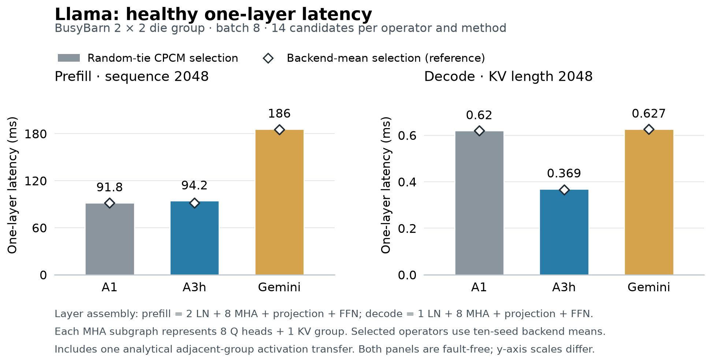

# H 阶段主硬件健康结果

本表采用 W1、Llama 2×2 Die 组、batch=8，prefill 长度与 decode KV 长度均为 2048。
当前主硬件 Llama 已完成 336/336 个候选，24/24 个算子×方法组齐备。每组计划 14 个候选；每个候选完整搜索 1000 步，随后独立评估后端种子 1–10 与十次随机平局 CPCM。

## 八个算子的主质量比较

按同方法十四候选的十种子后端均值选优。方括号为所选候选十次后端评估的最小、最大值，单位毫秒。

| 阶段 | 算子 | A1 | A3h | Gemini | A3h / A1 − 1 | A3h / Gemini − 1 |
|---|---|---|---|---|---|---|
| prefill | ln | 1.2473 [1.2344, 1.2598] | 1.2502 [1.2356, 1.2615] | 1.3225 [1.3059, 1.3408] | +0.24% | -5.46% |
| prefill | mha | 2.7707 [2.5851, 2.9651] | 2.7370 [2.5176, 2.8619] | 5.2193 [5.1609, 5.4396] | -1.21% | -47.56% |
| prefill | proj | 5.5620 [5.5264, 5.5797] | 5.5690 [5.5573, 5.5759] | 17.9782 [17.9262, 18.0096] | +0.13% | -69.02% |
| prefill | ffn | 60.5470 [49.7096, 63.7183] | 60.6925 [49.7096, 65.0369] | 121.9004 [110.2494, 126.1105] | +0.24% | -50.21% |
| decode | ln | 0.0016 [0.0016, 0.0016] | 0.0026 [0.0026, 0.0026] | 0.0031 [0.0031, 0.0031] | +65.05% | -18.00% |
| decode | mha | 0.0205 [0.0205, 0.0205] | 0.0121 [0.0121, 0.0121] | 0.0187 [0.0187, 0.0187] | -40.96% | -35.17% |
| decode | proj | 0.0515 [0.0515, 0.0515] | 0.0271 [0.0271, 0.0272] | 0.0518 [0.0518, 0.0518] | -47.31% | -47.57% |
| decode | ffn | 0.4021 [0.3992, 0.4052] | 0.2387 [0.2259, 0.2463] | 0.4218 [0.4122, 0.4284] | -40.65% | -43.42% |

### 本批结果

A3h 的健康收益主要集中在 decode 的 MHA、projection 和 FFN。单层 decode 按后端选优较 A1 变化 -40.98%，按随机平局 CPCM 选择变化 -40.42%。decode LN 较 A1 增加约 65%，对应绝对增加 1.009 微秒，已计入单层合计。
Prefill 与 A1 接近：后端选优的单层变化为 -0.12%，随机平局 CPCM 选出的单层变化为 +2.65%。本批支持 decode 改善；prefill 的收益没有同样延续，选择器也保留了实际损失。
Gemini 的后端选优 prefill 单层时间是 A3h 的 2.02 倍。表内 MHA、projection、FFN 均较高，其中 FFN 的绝对时间最大；本轮尚未分解 DDR 等待与路由争用，不作这两者的物理归因。

## 三种选优及统一 CPCM 对照

自身估值沿用历史代价定义：A1 按其归一化加权聚合能量；A3h 先按搜索所用完整广播 CPCM 时间 T_sel，再以自身能量打破平局；Gemini 按原生 hops-only 能量。统一确定性 CPCM 另列，便于用同一预测器比较。所有选择最后再列出所选状态的后端均值。
候选之间完全同值时按预定 candidate_order 选取。后端选优是质量参考，另两种选择及统一 CPCM 对照不读取后端结果。

| 方法 | 选择规则 | 八算子选优损失中位数 | 最大值 | 与后端赢家相同 |
|---|---|---|---|---|
| A1 | 自身确定性估值选优 | +18.91% | +142.86% | 1/8 |
| A1 | 随机平局 CPCM 选优 | +0.00% | +0.00% | 8/8 |
| A1 | 统一确定性 CPCM 选优 | +0.00% | +3.17% | 6/8 |
| A3h | 自身确定性估值选优 | +0.31% | +3.49% | 1/8 |
| A3h | 随机平局 CPCM 选优 | +0.21% | +3.49% | 4/8 |
| A3h | 统一确定性 CPCM 选优 | +1.12% | +6.44% | 2/8 |
| Gemini | 自身确定性估值选优 | +14.55% | +69.96% | 0/8 |
| Gemini | 随机平局 CPCM 选优 | +0.00% | +1.31% | 6/8 |
| Gemini | 统一确定性 CPCM 选优 | +0.00% | +0.55% | 6/8 |

十四候选后端均值的中位数、范围、每种选择的具体候选与十种子标准差全部保存在 `hi/tables/next_operators.csv`，逐样本在 `next_samples.csv`。标准差描述同一候选的后端波动；十四候选是映射选择集合。

## 单层与固定 KV 请求估算

Prefill = 2×RMSNorm + 8×代表 MHA + projection + FFN + handoff；decode = RMSNorm + 8×代表 MHA + projection + FFN + handoff。decode FFN 已含一次 RMSNorm，未再重复添加。
handoff 单列为相邻组之间一条有向 D2D 链路传送连续 bf16 激活的解析项：batch×tokens×8192×2 字节，256 字节/ns、固定 20 ns，prefill 1,048,596 ns，decode 532 ns。算子均值之和与 handoff 分列保存在 CSV，便于采用实际层布局时替换。
下面是单层算子结果的串行组装；没有模拟跨算子重叠、所有层同时驻留或层间共享链路竞争。请求 N 表示首个 token 产生后再执行 N 次 decode；使用 P+N×D，decode 每一步保持 KV=2048。

| 选择规则 | 方法 | 单层 TTFT ms | 单层 TPOT ms | 请求 N=128 s | N=512 s | N=2048 s |
|---|---|---|---|---|---|---|
| 后端均值选优 | A1 | 91.8175 | 0.6198 | 0.17115 | 0.40915 | 1.36115 |
| 后端均值选优 | A3h | 91.7068 | 0.3658 | 0.13853 | 0.27898 | 0.84081 |
| 后端均值选优 | Gemini | 185.3269 | 0.6267 | 0.26554 | 0.50618 | 1.46874 |
| 自身确定性估值选优 | A1 | 119.3831 | 0.7099 | 0.21024 | 0.48283 | 1.57317 |
| 自身确定性估值选优 | A3h | 93.9062 | 0.3701 | 0.14128 | 0.28339 | 0.85186 |
| 自身确定性估值选优 | Gemini | 221.3990 | 0.7423 | 0.31642 | 0.60148 | 1.74172 |
| 随机平局 CPCM 选优 | A1 | 91.8175 | 0.6198 | 0.17115 | 0.40915 | 1.36115 |
| 随机平局 CPCM 选优 | A3h | 94.2482 | 0.3693 | 0.14152 | 0.28333 | 0.85056 |
| 随机平局 CPCM 选优 | Gemini | 185.8867 | 0.6267 | 0.26610 | 0.50674 | 1.46930 |
| 统一确定性 CPCM 选优 | A1 | 91.9170 | 0.6198 | 0.17125 | 0.40925 | 1.36125 |
| 统一确定性 CPCM 选优 | A3h | 95.3080 | 0.3701 | 0.14268 | 0.28480 | 0.85326 |
| 统一确定性 CPCM 选优 | Gemini | 185.4940 | 0.6267 | 0.26571 | 0.50635 | 1.46891 |

主柱使用随机平局 CPCM 选择的状态，白色菱形为后端选优；数值均为所选状态的实际后端均值加解析 handoff。可编辑矢量图见 `hi/figures/next_health.svg`。

CSV 中各算子样本最小值之和、最大值之和仅是组成项的范围，既不是全层联合仿真范围，也不是置信区间。

## 80 层成本参考

以 artifact 的 Llama 80 层为参考，令 B 为实际层布局中的跨组连接数。P_op、D_op 是上表单层中不含 handoff 的算子和，则：

- T80_P = 80×P_op + B×1,048,596 ns。
- T80_D = 80×D_op + B×532 ns。
- 首个 token 后追加 N 次 decode 的请求为 T80_P + N×T80_D，KV 固定为 2048。

下表列随机平局 CPCM 选择的 80 层算子和。每增加一条跨组连接，prefill 增加 1.048596 ms、decode 一步增加 0.532 µs；N=2048 的请求增加 2.138132 ms。布局确定后直接代入 B。

| 方法 | 80 层 prefill 算子和 s | 80 层 decode 算子和 ms | N=2048 请求算子和 s |
|---|---|---|---|
| A1 | 7.261513 | 49.540720 | 108.720907 |
| A3h | 7.455965 | 29.500824 | 67.873653 |
| Gemini | 14.787052 | 50.090824 | 117.373059 |

四种选择共 12 行的常数项及每条连接增量见 `hi/tables/next_fullmodel_reference.csv`。这一参考重复使用同一层实测算子成本，B 保留为参数；未指定 80 层分组形状、模拟全模型同时驻留或检查容量，组间共享链路竞争与流水重叠也未加入。

## WATOS 与 Qwen 试点

WATOS 的 Llama 四项、Qwen 两种硬件共八项都只是预定 A3h g0/s123 完整试点。它们计入后续正式候选，尚未覆盖各算子十四候选和完整 LN/projection 链。跨硬件比较采用相同 g0/s123 候选；这里仅报告实际测到的 MHA/FFN，不据此生成完整层 TTFT/TPOT。

| 模型 | 硬件 | 阶段 | 算子 | 后端均值 [最小, 最大] ms | 搜索+评估秒 | 峰值 RSS GiB |
|---|---|---|---|---|---|---|
| llama | watos | decode | mha | 0.0105 [0.0105, 0.0105] | 54.57 | 0.531 |
| llama | watos | decode | ffn | 0.2328 [0.2130, 0.2428] | 148.76 | 0.563 |
| llama | watos | prefill | mha | 1.9635 [1.8800, 2.0693] | 551.16 | 0.627 |
| llama | watos | prefill | ffn | 14.9922 [13.8968, 15.8081] | 165.03 | 0.572 |
| qwen3moe | busybarn | decode | mha | 0.0077 [0.0076, 0.0079] | 170.15 | 0.578 |
| qwen3moe | busybarn | decode | ffn | 0.2952 [0.2945, 0.2971] | 1225.97 | 0.771 |
| qwen3moe | busybarn | prefill | mha | 3.8398 [3.5939, 4.1411] | 177.56 | 0.576 |
| qwen3moe | busybarn | prefill | ffn | 39.5564 [37.2215, 42.7874] | 4480.50 | 1.024 |
| qwen3moe | watos | decode | mha | 0.0074 [0.0071, 0.0077] | 180.27 | 0.575 |
| qwen3moe | watos | decode | ffn | 0.3133 [0.3085, 0.3187] | 1261.56 | 0.769 |
| qwen3moe | watos | prefill | mha | 2.7642 [2.6956, 2.9277] | 178.76 | 0.572 |
| qwen3moe | watos | prefill | ffn | 23.1861 [22.7314, 23.6440] | 5941.24 | 1.041 |

独立汇总检查从 336 份原始 run 与结果重算：24 个候选组、96 个选中状态、12 行单层结果及请求计算均一致，记录见 `hi/evidence/next_h_health_review.json`。这一记录核对的是 Llama 主硬件健康结果，整批 H/I 完成情况另见 `hi/evidence/next_completion_audit.json`。
