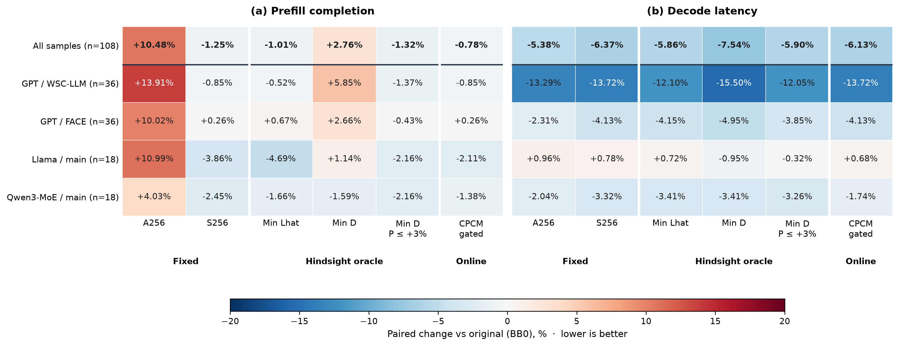
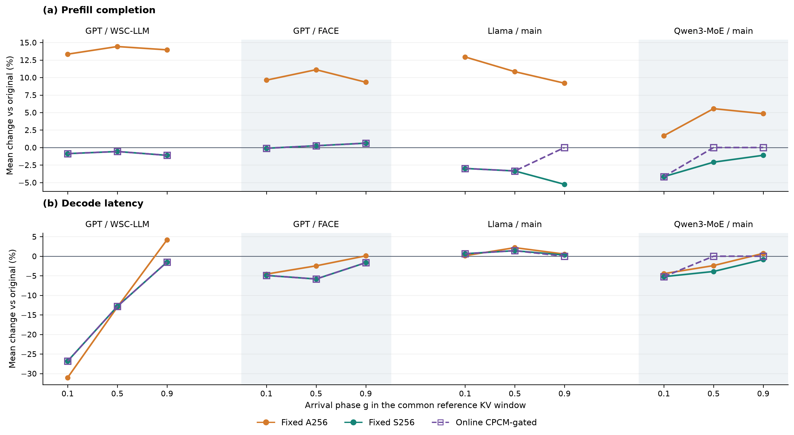
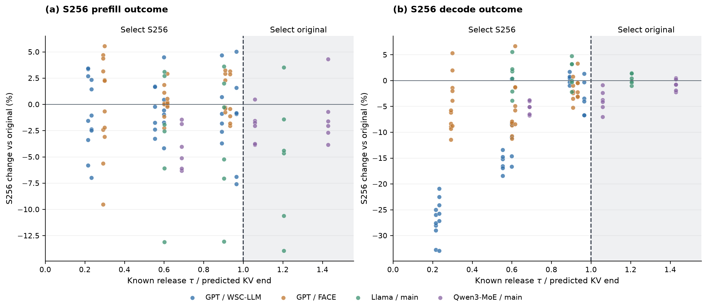

# DSTU 最终图表说明

三张图均使用本轮完整的 108 个配对组：GPT/WSC-LLM 36、GPT/FACE 36、Llama 主硬件 18、Qwen3-MoE 主硬件 18。每个样本先除以相同输入的 original（BB0），再等权平均；历史 36 组独立保留在既有报告。

## 图 1：完整集合与各模型、硬件的策略选择

左图是 P 完成时间、右图是 D 延迟相对 original 的变化，负值表示改善。第一行等权平均全部 108 个样本，下面四行分别使用各组全部样本，因样本数不同，第一行不等于四个组均值的简单平均。六列分为固定策略、事后选择、前验在线选择。Min Lhat 最小化最大归一化迟约，Min D 最小化 D 延迟，Min D P≤+3% 在 P 不超过同输入 original 的 103% 时选 D 最快策略。每个事后选择使用完整执行策略的一行成绩，在线列使用评估前冻结的 CPCM 决定。图中直接标注均值，没有将场景差异画成置信区间。

数据：tables/figure_overall_points.csv；来源：s256_strategy_choices.csv，已与 s256_strategy_summary.csv 逐项核对。

## 图 2：相位与模型、硬件条件

每个模型、硬件组内保留三相位，实心圆分别表示固定 A256 与 S256，空心方形表示 Online-CPCM-Gated。每个点平均该组在该相位的全部映射、修复状态与后端种子：两种 GPT 硬件各 12 个样本，Llama/Qwen 各 6 个。不同模型组之间不连线；original 为零线。这里 g 按共同 A1 健康参考窗口定义，不代表各映射相同的真实重叠。

数据：tables/figure_phase_points.csv。

## 图 3：前验窗口判断与已有后端现象

每点是一条后端种子结果，共 108 点；横轴为已知 D 释放时刻除以 CPCM 在未切块 P 图上的 KV 结束预测。所有本轮状态都有共享有向链路，因此横轴小于 1 的冻结动作是 S256，大于等于 1 的冻结动作是 original。纵轴分别展示固定 S256 相对同输入 original 的 P/D 实际变化，作用是解释该前验判断对应的执行结果；这些实际结果没有参与动作选择。三个种子共享同一前验横坐标，竖向分布是保存样本本身。图中没有按 g=0.9 强制旁路，也没有依据收益重新调整阈值。

数据：tables/figure_gate_points.csv；预测与实际窗口源数据分别保留 source_gate 和 S256_job。

## 复算

`e2e/post_fg/dist/venv/Scripts/python.exe -B e2e/dstu_supplement_plot.py`

输出 PNG 和可编辑文字的 SVG。输入、图和绘图数据 SHA-256 在 evidence/figure_audit.json。
