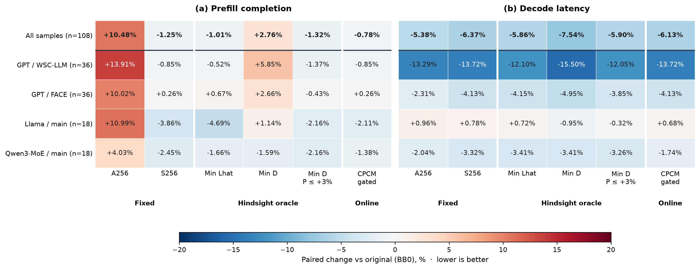

# S256 补充与最终实验收尾

2026-11-18。本轮已完成，详细交付与归档见 [DELIVERY.md](DELIVERY.md)。主传输配置采用 S256，A256 和 original 的全部对照保留。

## 主要结果

12个固定状态、三相位、三个后端种子，共108个三策略比较组。GPT/WSC与GPT/FACE各36组，Llama/Qwen主硬件各18组。先在相同输入下求相对变化，再对108组等权平均；P是Prefill完成时间，D是Decode完成减释放。

| 选择方式 | P 相对 original | D 相对 original |
|---|---:|---:|
| 固定 A256 | +10.480% | −5.380% |
| 固定 S256 | −1.249% | −6.374% |
| 事后最小 Lhat_max | −1.009% | −5.863% |
| 事后最小 D，无 P 约束 | +2.763% | −7.542% |
| 事后最小 D，P≤original×1.03 | −1.317% | −5.898% |
| Online-CPCM-Gated | −0.780% | −6.127% |

事后选择和在线选择都取同一条实际策略的完整P/D。在线规则先用未切P图的CPCM预测KV结束时间，有共享有向资源且tau早于预测结束时选S256，否则original；36个决定在新评估前全部冻结，三个种子共用。实际选择90次S256、18次original。本组数据中在线规则没有超过固定S256，也未减少原有9次D超期。

S256相对A256的P均值降低10.465%、D均值降低0.717%；P为108/108改善，D为66改善、42回退。相对original，GPT与Qwen的D均值分别降低8.926%、3.324%，Llama的D均值增加0.783%，其P均值降低3.864%。完整分组与不利样本均保留。

## 读取顺序

| 文件 | 内容 |
|---|---|
| [S_AND_HI_S256_REPORT.md](S_AND_HI_S256_REPORT.md) | 完整均值、分模型/硬件/状态、三类选择、Pareto、系统消融与成本 |
| [DSTU_APPLICABILITY_ANALYSIS.md](DSTU_APPLICABILITY_ANALYSIS.md) | 共享、实际重叠、三相位及单跑/跨流干扰解释 |
| [ONLINE_GATE_DIAGNOSIS.md](ONLINE_GATE_DIAGNOSIS.md) | 已有108组的门控诊断：Qwen中相位预测误关、六个旁路场景、实际窗口替换分析与单跑变化 |
| [FIGURE_GUIDE.md](FIGURE_GUIDE.md) | 三张论文图、中文图注和可复算数据 |
| [FINAL_PAPER_TABLES.md](FINAL_PAPER_TABLES.md) | 所有表格及绘图输入目录 |
| [ONLINE_RECOVERY.md](ONLINE_RECOVERY.md) | 九条单轨迹停档、24点选择、固定服务时间下恢复回本 |
| [WATOS_DIAGNOSIS.md](WATOS_DIAGNOSIS.md) | Qwen prefill FFN/PF4的跨Die绕行集中与剩余开销 |
| [PAPER_EVIDENCE_INDEX.md](PAPER_EVIDENCE_INDEX.md) | A–J及本轮主张、范围、代码与原始证据 |
| [AUDIT_SUMMARY.md](AUDIT_SUMMARY.md) | 完成数、真实调用、复用链、输入顺序与修正记录 |

## 实际运行与保存位置

主队列564项：12项输入/排名准备、12项在线窗口预测、540项评估记录。评估含324联合及216逻辑单跑；实际新后端258次，历史复用270条、本批复用12条。另2次H/I历史A256回放，共260次真实新后端；新增SA为0。

主队列北京时间15:14:25完成，从首次启动含准备、补传及重启共15分16秒，最高92活跃，最低可用193.925GiB；4次缺输入退出已同ID恢复，OOM为0。12项独立图身份核对15:23:03完成，不调用CPCM或后端。540条评估的真实输入均通过核对。

运行结果、快照、逐跳记录、日志和失败尝试在 `out/`；图、CSV和证据在 `figures/`、`tables/`、`evidence/`；完整COS下载包与实际运行源码在 `dist/`。完整运行包2600文件、独立核对包42文件均已下载并逐文件校验。后续分析可在本机完成，服务器实验已结束。

原始计划第二版见 [APPROVED_PLAN_20261118.md](APPROVED_PLAN_20261118.md)，用户后续加入三类选择及前验门控的执行说明见 [PLAN.md](PLAN.md)。前期A256和H5/I5原始实验未覆盖。v1准备脚本的重复原地切块产生了无效摘要，该字段已排除；v2逐次加载原始图，实际后端数据无需重跑，详见审计。

复算入口均从仓库根目录执行，使用 `e2e/post_fg/dist/venv/Scripts/python.exe -B` 加以下脚本：

- `e2e/dstu_supplement_report.py report`：统计与三类选择。
- `e2e/dstu_supplement_plot.py`：三张图及SVG。
- `e2e/dstu_supplement_recovery.py`：停档、选择与解析回本。
- `e2e/dstu_supplement_diagnose.py render` / `index`：保存态诊断报告与证据索引。
- `e2e/dstu_supplement_audit.py`：完整只读核对。
