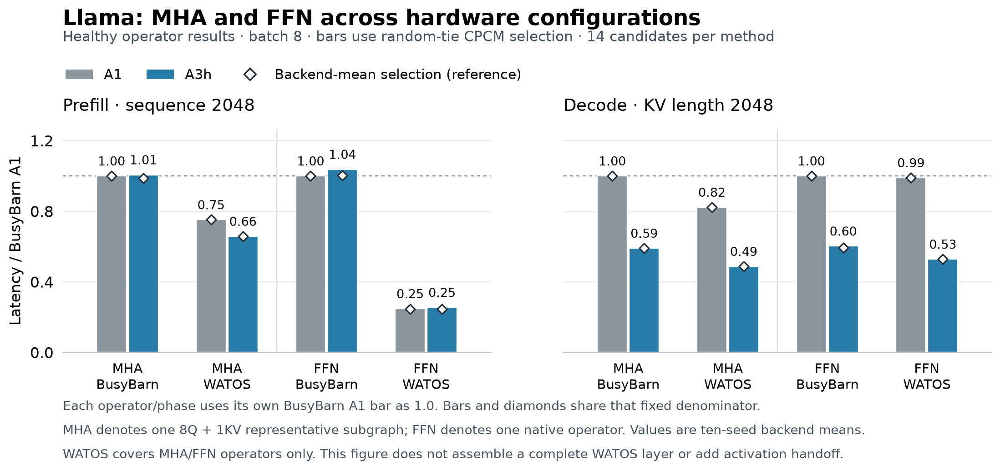

# H3 / I2 / I3 健康实验

H3/I2 已完成 440/440 个新候选，随后授权的 I3 已完成 108/108，复用前两批 348 个，共 896/896 个；Llama 448/448，Qwen 448/448。H3=108、I2D=166、I2P=166 保留原批次；I3 独立运行、独立记时。
旧候选保持原样；新旧候选均核对模型合同、完整 1000 步、后端十种子、十次随机平局 CPCM、receipt 身份和文件摘要。

H3/I2 这 440 项从 2026-11-14T08:38:33.593442+00:00 到 2026-11-14T10:19:29.347176+00:00，墙钟 100.929 分钟。
峰值合计 128 并行，最低可用内存 176.928 GiB；归档失败尝试 0 次。

## 预计用时与实际进展

这轮预估使用已测 Qwen FFN 的完整作业成本，包含十种子后端；未测 A1/Gemini 暂估搜索比例，LN/projection 使用已有图规模。24 个未测类的首候选优先开始，空闲槽位继续运行其余候选；首候选结束后更新该类完整耗时和 RSS。初始范围为排程值至其两倍，不是置信区间；包含搜索、校准、评估、导出/重载，不含后续故障、联合、J、下载与汇总。

| 批次 | 完成/计划 | 原进程小时 | 实际进程小时 | 原墙钟范围 min | 共享队列收齐 min |
|---|---|---|---|---|---|
| H3 | 108/108 | 6.574 | 8.263 | 9.21–18.42 | 28.727 |
| I2D | 166/166 | 16.274 | 20.101 | 25.10–50.20 | 33.134 |
| I2P | 166/166 | 64.663 | 65.447 | 117.31–234.62 | 100.896 |
| all440 | 440/440 | 87.511 | 93.811 | 117.31–234.62 | 100.929 |

三批共享 128 个槽位；各批原墙钟是独立排程预测，不能相加。实际收齐从本轮最初启动时刻统一起算，整轮以 controller_finish 为准。逐作业估计差值及监督器历次剩余时间预测另存 `h3_i2_candidate_estimate_comparison.csv`、`h3_i2_eta_history.csv`。
初始计划范围采用排程值的 1–2 倍；运行中显示沿用已有监督器，仍有未测类别时显示 1–3 倍，全部剩余类别已测时显示 1–1.5 倍。因此首条约 116–349 分钟来自旧的显示系数，尚无新的变慢测量。在线 ETA 按预计时长排序，而实际队列还采用首候选和 Qwen prefill FFN 优先级；完整记录保留这一区别。作业超过现有估计时，监督器展示阶段/步数并暂不提供总剩余时间。

## 分项用时

进程小时为作业用时之和；各批实际收齐时间按日志启动时间 + receipt 用时取最大值，含约 2 秒轮询误差。

| 批次 | 完成/计划 | 搜索 PH | 后端 PH | 随机 CPCM PH | 其余 PH | 完整 PH | 最长任务 min | 从启动到收齐 min |
|---|---|---|---|---|---|---|---|---|
| H3 | 108/108 | 5.951 | 0.780 | 0.019 | 1.514 | 8.263 | 16.73 | 28.727 |
| I2D | 166/166 | 10.586 | 6.980 | 0.088 | 2.447 | 20.101 | 32.80 | 33.134 |
| I2P | 166/166 | 24.686 | 36.562 | 0.326 | 3.874 | 65.447 | 100.62 | 100.896 |
| all440 | 440/440 | 41.222 | 44.321 | 0.432 | 7.835 | 93.811 | 100.62 | 100.896 |

完整分项保留模板、校准、搜索、状态恢复、后端、随机 CPCM、评估准备、导出和重载；Gemini 的 seed123 最好/终态两次评估分别记账。并行用时含资源争用，正式串行计时另属 J 阶段。

## H3：Llama WATOS 算子

主硬件与 WATOS 均在相同方法的十四候选中选取，以下为后端均值选优。两种硬件的候选数相等。

| 阶段 | 算子 | 方法 | BusyBarn ms | WATOS ms | WATOS / BusyBarn − 1 |
|---|---|---|---|---|---|
| prefill | mha | A1 | 2.7707 | 2.0827 | -24.83% |
| prefill | mha | A3h | 2.7370 | 1.8230 | -33.39% |
| prefill | ffn | A1 | 60.5470 | 14.9101 | -75.37% |
| prefill | ffn | A3h | 60.6925 | 14.8905 | -75.47% |
| decode | mha | A1 | 0.0205 | 0.0169 | -17.74% |
| decode | mha | A3h | 0.0121 | 0.0100 | -17.43% |
| decode | ffn | A1 | 0.4021 | 0.3979 | -1.03% |
| decode | ffn | A3h | 0.2387 | 0.2124 | -11.02% |

### 相同 WATOS 硬件上的 A1 与 A3h

| 阶段 | 算子 | 后端选优 A3h/A1−1 | 随机 CPCM 选优 A3h/A1−1 |
|---|---|---|---|
| prefill | mha | -12.47% | -12.47% |
| prefill | ffn | -0.13% | +3.05% |
| decode | mha | -40.74% | -40.74% |
| decode | ffn | -46.63% | -46.63% |

在 WATOS 上，A3h 的 decode MHA/FFN 分别较 A1 变化 -40.74%/-46.63%；prefill MHA 变化 -12.47%。Prefill FFN 的后端选优差异仅 -0.13%，随机 CPCM 选择后为 +3.05%，因此该点没有同样的改善。
跨硬件变化主要体现在 prefill FFN：两种方法在 WATOS 上的时间均下降约 75%；decode FFN 的硬件变化较小。以上比较采用各硬件自己的十四候选，不把单个预定试点与十四候选赢家相比。

| WATOS 方法 | 随机 CPCM 选优损失中位数 | 最大值 | 与后端选优同一状态 |
|---|---|---|---|
| A1 | +0.00% | +0.47% | 3/4 |
| A3h | +0.00% | +3.67% | 3/4 |

H3 的 108 项新增候选累计 8.263 进程小时，最长单任务 16.73 分钟；在共享队列中于 2026-11-14T17:07:17.201243+08:00 收齐，距整轮启动 28.727 分钟。最后完成的 `H_llama_watos_decode_mha_A1_g1_l3` 在启动后 27.850 分钟进入运行，说明该批收齐时间包含与 Qwen 长任务共享槽位的等待。

图中每个算子以对应 BusyBarn A1 的随机 CPCM 选择结果为固定分母；柱为随机 CPCM 选择，白色菱形为后端选优，全部来自同样十四候选的实际后端均值。

当前 Llama WATOS 已完成 112/112 个候选、8/8 个完整算子×方法组，覆盖 P/D 的 MHA/FFN。LN/projection 不在当前 WATOS 计划内，因此不据此组装完整层。全部三种选择及统一 CPCM 对照在 `tables/h3_i2_operators.csv` 与 `h3_i2_hardware_comparison.csv`。

## I2：Qwen 主硬件

Qwen 主硬件目前 24/24 个完整算子×方法组。逐算子结果及齐备后生成的完整单层、48 层参数化参考见 `../I_HEALTH_SUMMARY.md`。头组乘数为 4，decode FFN 已包含一次 RMSNorm；组装使用同一模型合同。

## 新旧样本计数

H3/I2 的 440 项计划包含 4400 个主后端样本 + 8 个新 Qwen Gemini 终态×10=4480 个后端，随机 CPCM 4400 次。I3 另有 1080 个后端和 1080 个随机 CPCM，无 Gemini。结合旧 348 候选与旧 8 个终态，健康全量为 8960 个主后端 +160 个终态后端=9120 个，随机 CPCM 8960 次。终态对照复用同一搜索，不计新候选。

## I3 独立运行与用时

I3 新增 108/108 项，目录 `out/i3_108`。原 I1 四个 WATOS A3h 试点计入 112 个正式候选，未重跑。首四个 A1 类代表优先开始，其余 prefill FFN 优先；全部候选直接释放。
新池先为原 440 项中尚未成功的任务保留名额，两池合计上限 128，系统预留 3 GiB。后续其他已批准批次另记；同机资源是共享的，I3 的墙钟不会与 H3/I2 墙钟相加。

| 完成/计划 | 原进程小时 | 实际进程小时 | 初始墙钟范围 min | I3 启动到完成 min |
|---|---|---|---|---|
| 108/108 | 50.969 | 50.646 | 99.03–198.06 | 109.786 |

I3 从 2026-11-14T09:46:12.585018+00:00 到 2026-11-14T11:35:59.734036+00:00，共 109.786 分钟。

| 搜索 PH | 后端 PH | 随机 CPCM PH | 其余 PH | 完整 PH | 最长任务 min | 峰值单作业 RSS GiB |
|---|---|---|---|---|---|---|
| 20.836 | 26.466 | 0.212 | 3.132 | 50.646 | 109.67 | 1.050 |

I3 初始使用 84 个可用槽、200 GiB 作业预算估计，实际槽位随旧任务完成而增加。初始 99–198 分钟包含完整搜索、十后端、十随机 CPCM 与导出；数据下载与汇总另计。逐作业实测/原估计、I3 自身完成时间及在线预测存于 `tables/i3_candidate_estimate_comparison.csv`、`i3_job_completion_times.csv`、`i3_eta_history.csv`。
