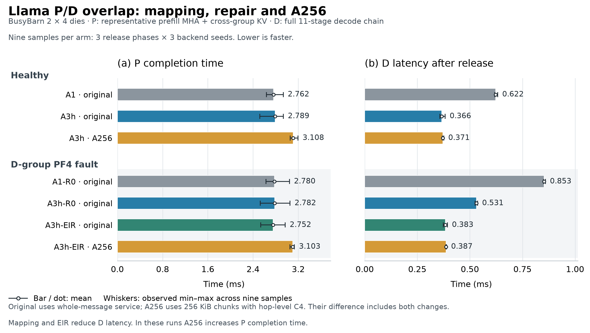

# H5：Llama P/D 联合结果

正式作业已完成 110/110，其中联合 63/63、配对单跑 39/39。本批已全部结束。

主硬件 2×4 晶圆包含两个不相交 2×2 组。P 是 8 个 Q 头、1 组 K/V 的 prefill MHA 代表子图，带真实跨组 KV 写回；D 是一个外置 LN、8 个 MHA 头组、projection、含另一个 RMSNorm 的 FFN，共 11 段。P/D 是独立请求，只共享资源。这里没有模拟完整 prefill FFN 或 80 层同时执行。

图中柱与圆点为每臂9样本均值，横线为实测最小至最大值；健康和D故障分别分组，两个面板使用各自横轴。可编辑矢量图：[SVG](figures/h5_joint.svg)。绘图输入与63个源样本在 `figures/h5_joint_plot_inputs.json`。

## 输入与运行方式

P 侧均从正式 14 候选按后端均值选优：A1 `H_llama_busybarn_prefill_mha_A1_g0_l4`；A3h `H_llama_busybarn_prefill_mha_A3h_g0_s123`。D 直接使用 H4 的健康、R0 或 stop300 最终代表导出，保留既定停止规则及代表修复种子。未重新搜索。
D 故障为右侧组 `(die2,core11) ↔ (die3,core8)` 双向连接失效。健康三臂、D 故障四臂，各 3 个相位 × 3 个后端种子。42 个逻辑配对单跑合为 39 次实际单跑：只复用故障平台上 A3h-R0 与 A3h-EIR 相同 P 流的三个 original 单跑。每个联合结果的配对流核对平台、全事件字段及实际遍历顺序。

无 DSTU 使用 original 整包后端；A256 使用全链路 256 KiB + C4 按跳后端。两者差值反映这套执行方式的整体变化，不能单独归因为优先级排序。相同后端内的 A1/A3h、R0/EIR 比较另列。

## 公共参考与逐次结果

统一参考来自健康 A1/original 的三个 P 单跑、三个 D 单跑：T_P、T_D 为均值，KV 起止时刻也取均值；释放时刻 τ=round(KV_start+g×(KV_end−KV_start))。所有实验臂使用相同参考。评价期限为 P 的 1.5T_P 和 D 的 τ+1.5T_D。C4 的内部排序仍按当前图自身 CPCM 估值生成期限，已在逐次表单独记录，没有替换成公共评价期限。

参考 T_P=2,701,620.667 ns，T_D=617,289.667 ns；KV 窗口 [657,507.333, 1,599,695.333] ns。

P 完成时间 C_P；D 延迟 C_D−τ；配对 ΔP=C_P−P_solo；自身放大率分别除以同种子、同后端配对单跑。L̂_P=(C_P−1.5T_P)/T_P，L̂_D=(C_D−τ−1.5T_D)/T_D，L̂_max 取两者最大值，≤0 表示两条期限均满足。

| 条件 | 实验臂 | 已完成/9 | P 完成时间均值（ms） | D 延迟均值（ms） | 配对 ΔP 均值（ms） | L̂_max 中位数 [最小,最大] | 两条期限均满足 |
|---|---|---:|---:|---:|---:|---:|---:|
| healthy | A1_no_DSTU | 9/9 | 2.762272 | 0.622405 | 0.060651 | -0.47579 [-0.49883, -0.41395] | 9/9 |
| healthy | A3h_no_DSTU | 9/9 | 2.789399 | 0.366444 | 0.033925 | -0.44447 [-0.56719, -0.41327] | 9/9 |
| healthy | A3h_A256 | 9/9 | 3.108142 | 0.371287 | -0.003423 | -0.35221 [-0.36889, -0.31694] | 9/9 |
| D | A1_R0_no_DSTU | 9/9 | 2.780032 | 0.852896 | 0.086135 | -0.11860 [-0.12466, -0.10859] | 9/9 |
| D | A3h_R0_no_DSTU | 9/9 | 2.782068 | 0.531210 | 0.068839 | -0.45272 [-0.56504, -0.36933] | 9/9 |
| D | A3h_EIR_no_DSTU | 9/9 | 2.752388 | 0.382889 | 0.039159 | -0.47464 [-0.56123, -0.40112] | 9/9 |
| D | A3h_EIR_A256 | 9/9 | 3.102735 | 0.386741 | -0.006654 | -0.35305 [-0.36942, -0.34076] | 9/9 |

相位与种子逐项值在 `tables/h5_joints.csv`；三种子分相位汇总在 `h5_by_arm_phase.csv`；单跑全部样本在 `h5_solos.csv`。各臂行的均值取当前完成样本，只有 n=9 才覆盖整套相位与种子。

## 同相位、同种子的比较

| 条件 | 比较（前者/后者） | 已配对/9 | P 变化中位数 [最小,最大] | D 变化中位数 [最小,最大] | L̂_max 差中位数 [最小,最大] | L̂_max 改善/相同/恶化 |
|---|---|---:|---:|---:|---:|---:|
| healthy | A3h_no_DSTU / A1_no_DSTU | 9/9 | +1.275% [-6.332%, +5.781%] | -41.289% [-42.484%, -39.241%] | +0.013 [-0.091, +0.054] | 4/0/5 |
| healthy | A3h_A256 / A3h_no_DSTU | 9/9 | +10.505% [+4.096%, +22.231%] | +1.234% [-2.808%, +3.854%] | +0.111 [+0.045, +0.207] | 0/0/9 |
| D | A3h_R0_no_DSTU / A1_R0_no_DSTU | 9/9 | +2.423% [-6.584%, +7.606%] | -37.810% [-38.357%, -36.803%] | -0.332 [-0.456, -0.251] | 9/0/0 |
| D | A3h_EIR_no_DSTU / A3h_R0_no_DSTU | 9/9 | -0.159% [-5.638%, +3.166%] | -28.062% [-29.817%, -25.101%] | -0.001 [-0.064, +0.030] | 5/0/4 |
| D | A3h_EIR_A256 / A3h_EIR_no_DSTU | 9/9 | +11.612% [+4.375%, +23.486%] | +1.038% [-1.027%, +3.505%] | +0.119 [+0.048, +0.220] | 0/0/9 |
| D | A3h_EIR_A256 / A1_R0_no_DSTU | 9/9 | +11.323% [+2.605%, +18.000%] | -54.729% [-54.940%, -54.164%] | -0.231 [-0.261, -0.216] | 9/0/0 |

变化比例按每对样本分别计算后取中位数与范围；没有用两组中位数相除。配对 ΔP 的差、每对样本及源 ID 另见 `h5_paired_differences.csv`。负值表示减少，回退值全部保留。

## 三个释放相位与结果解释

| 条件 | 实验臂 | g=0.1 的 D / ΔP（μs） | g=0.5 的 D / ΔP（μs） | g=0.9 的 D / ΔP（μs） |
|---|---|---:|---:|---:|
| healthy | A1_no_DSTU | 627.532 / +120.446 (3/3) | 619.597 / +28.864 (3/3) | 620.085 / +32.644 (3/3) |
| healthy | A3h_no_DSTU | 368.467 / +11.585 (3/3) | 363.185 / +73.113 (3/3) | 367.679 / +17.075 (3/3) |
| healthy | A3h_A256 | 372.761 / -18.036 (3/3) | 369.400 / +25.260 (3/3) | 371.699 / -17.493 (3/3) |
| D | A1_R0_no_DSTU | 852.328 / +200.550 (3/3) | 854.480 / +45.997 (3/3) | 851.880 / +11.858 (3/3) |
| D | A3h_R0_no_DSTU | 533.662 / +98.950 (3/3) | 532.913 / +90.069 (3/3) | 527.054 / +17.498 (3/3) |
| D | A3h_EIR_no_DSTU | 385.186 / +73.158 (3/3) | 380.100 / +36.785 (3/3) | 383.381 / +7.535 (3/3) |
| D | A3h_EIR_A256 | 387.045 / -3.417 (3/3) | 385.938 / -14.537 (3/3) | 387.241 / -2.009 (3/3) |

主要收益来自映射与故障修复：健康 A3h/original 相对 A1/original 的 D 延迟配对中位变化为 -41.29%；故障后 EIR/original 相对 A3h-R0/original 为 -28.06%。完整 A3h+EIR+A256 相对 A1-R0 的 D 变化为 -54.73%，这是整个系统的比较。
本批 A256 没有形成额外的延迟改善。相对同一映射的 original 后端，健康/修复后 P 变化中位数分别为 +10.50%/+11.61%，D 分别为 +1.23%/+1.04%；18 对样本的 L̂_max 全部增大。其配对 ΔP 接近零或为负，但 A256 自身 P 单跑就较慢，因此不能把较小的 ΔP 等同于更短的 P 完成时间。
三个相位下 D 的均值差异较小，P 的重叠影响更依赖释放位置：故障 original 的配对 ΔP 从 g=0.1 到 g=0.9 均下降，A1-R0 为 +200.550→+11.858 μs，A3h-R0 为 +98.950→+17.498 μs，EIR 为 +73.158→+7.535 μs。健康 A3h 的 ΔP 在 g=0.5 反而较高，因此没有统一的单调相位规律。每个相位仅三种子，全部样本保留供后续联合分析。
63 个联合样本的 L̂_max 全部小于零，当前 1.5 倍健康 A1 期限未造成超期；本批能够比较延迟与重叠代价，不能据此声称 A256 在这些点上消除了期限违约。负的 ΔP 表示该次联合运行比配对单跑更早完成，按原后端样本保留，没有截断为零。

## 图规模与计算开销

| 组合图 | P 原事件数 | D 原事件数 | KV 逻辑载荷（MiB） | KV/D 共享链路 | P/D 共享计算设备 | 构图秒 | 峰值 RSS（GiB） |
|---|---:|---:|---:|---:|---:|---:|---:|
| healthy_A1 | 2519 | 2959 | 8.0 | 119 | 0 | 5.245 | 0.476 |
| healthy_A3h | 2501 | 2957 | 8.0 | 119 | 0 | 16.831 | 0.582 |
| D_A1 | 2519 | 2959 | 8.0 | 115 | 0 | 5.512 | 0.486 |
| D_A3hR0 | 2501 | 2957 | 8.0 | 115 | 0 | 6.151 | 0.486 |
| D_A3hEIR | 2501 | 2960 | 8.0 | 115 | 0 | 17.094 | 0.586 |

切块后事件数、跳活动数、KV multicast 链路字节、11 段连接数与实际图文件指纹均在 `h5_graphs.csv`。

| 作业类别 | 已完成/计划 | 作业耗时之和（秒） | 其中后端执行（秒） | 其余准备与收尾（秒） | 最长作业（秒） | 峰值 RSS（GiB） |
|---|---:|---:|---:|---:|---:|---:|
| hi_joint_export | 2/2 | 4.144 | 0.000 | 4.144 | 2.174 | 0.222 |
| joint_graph | 5/5 | 50.833 | 0.000 | 50.833 | 17.094 | 0.586 |
| joint_solo | 39/39 | 500.951 | 144.661 | 356.290 | 28.315 | 1.001 |
| joint_reference | 1/1 | 0.001 | 0.000 | 0.001 | 0.001 | 0.028 |
| joint | 63/63 | 1159.538 | 537.695 | 621.843 | 32.996 | 1.063 |

已完成作业累计 0.476519 进程小时，其中后端执行 0.189543 进程小时。进程小时是各进程耗时相加，不等于并行批次的经过时间。
从首次试点启动 2026-11-14T10:33:42.606503+00:00 到最近批次记录 2026-11-14T10:39:04.455983+00:00，经过 5.364 分钟，包含试点与全量之间的等待；最近结束标记为 110/110 项。
14项试点调度阶段经过 76.211 秒。
其余96项（复用已完成14项）调度阶段经过 86.418 秒。
H5 本池观测峰值活跃 38；最低可用内存 191.075 GiB。当前保存失败尝试 0 条。本批记录未提供其他并行批次合计的活跃峰值。

作业时间来自该作业结果与 receipt；后端时间使用 simulation.wall，构图、平台准备、拷贝、记录整理等归入剩余时间，不重复相加。最初清单的每类秒数仅为启动占位，不作为论文串行计时。完整批次结果、试点批次记录、资源记录和源文件哈希在 `evidence/h5_completion_audit.json`。
