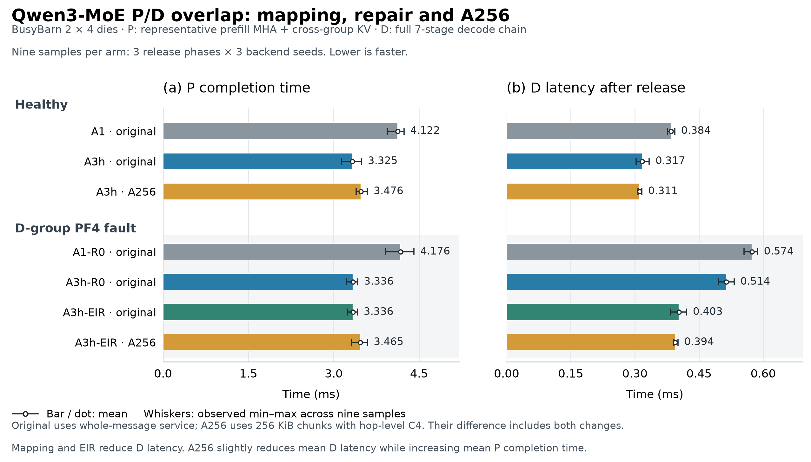

# I5：Qwen P/D 联合结果

正式作业完成 110/110；其中联合 63/63、配对单跑 39/39。本批已全部完成。

主硬件2×4晶圆包含两个2×2组，batch16。P是8个Q头+1组K/V的prefill MHA代表图及真实跨组KV写回，Qwen head_dim=64，逻辑KV为16×2048×64×2×2=8MiB。D是外置LN+4个MHA头组+projection+FFN，共7段；FFN内含另一个RMSNorm。P/D为独立请求，只共享资源。

P从各14候选选取后端均值赢家：A1 `I_qwen3moe_busybarn_prefill_mha_A1_g0_l1`，A3h `I_qwen3moe_busybarn_prefill_mha_A3h_g0_s3`。D使用I4-light健康、R0和stop300最终代表状态。故障为右组 `(die2,core11) ↔ (die3,core8)` 双向连接失效。
健康3臂、D故障4臂，各3相位×3后端种子。42个逻辑单跑合为39次实际单跑，只复用同PF4平台上A3h-R0/EIR完全相同P流的三个original单跑；逐次核对平台、完整有序事件和实际遍历指纹。

## 公共参考与指标

健康A1/original的3个P单跑和3个D单跑给出T_P、T_D及KV窗口均值，所有实验臂共用τ=round(KV_start+g×(KV_end−KV_start))。P评价期限为1.5T_P，D为τ+1.5T_D；C4内部排序期限按各自图的CPCM估值计算，和公共评价期限分别记录。
P完成时间=C_P，D延迟=C_D−τ，配对ΔP=C_P−P_solo；自身放大率除以同种子、同后端单跑。L̂_P=(C_P−1.5T_P)/T_P，L̂_D=(C_D−τ−1.5T_D)/T_D，L̂_max取较大者。
公共参考T_P=4,204,033.667ns，T_D=379,360.667ns；KV窗口[398,203.333, 1,015,495.000]ns。

柱与圆点为每臂9样本均值，横线为实测最小至最大值；健康和D故障分别分组。矢量图：[SVG](figures/i5_joint.svg)；逐样本绘图输入和核对值见 `figures/i5_joint_plot_inputs.json`。

| 条件 | 实验臂 | 样本数 | P均值ms | D均值ms | 配对ΔP均值ms | L̂_max中位数[最小,最大] | 两期限均满足 |
|---|---|---:|---:|---:|---:|---:|---:|
| healthy | A1_no_DSTU | 9/9 | 4.121908 | 0.384385 | -0.082126 | -0.48901 [-0.50793, -0.46380] | 9/9 |
| healthy | A3h_no_DSTU | 9/9 | 3.324519 | 0.317003 | 0.074961 | -0.66218 [-0.70107, -0.62142] | 9/9 |
| healthy | A3h_A256 | 9/9 | 3.476063 | 0.311319 | -0.004727 | -0.67286 [-0.68281, -0.64598] | 9/9 |
| D | A1_R0_no_DSTU | 9/9 | 4.175728 | 0.573993 | -0.058248 | 0.01686 [-0.03607, 0.04710] | 2/9 |
| D | A3h_R0_no_DSTU | 9/9 | 3.335919 | 0.513839 | -0.063793 | -0.13451 [-0.19230, -0.09801] | 9/9 |
| D | A3h_EIR_no_DSTU | 9/9 | 3.335706 | 0.402634 | -0.064005 | -0.43059 [-0.48893, -0.39064] | 9/9 |
| D | A3h_EIR_A256 | 9/9 | 3.464942 | 0.393868 | 0.029201 | -0.46368 [-0.46967, -0.44442] | 9/9 |

## 同相位、同种子配对比较

original使用整包后端，A256使用全链路256KiB+C4按跳后端，两者的变化是完整执行方式的变化。映射和EIR则在相同original后端内比较。每对先计算比例，再对9对取中位数和范围。

| 条件 | 前者/后者 | 配对数 | P变化中位数[范围] | D变化中位数[范围] | L̂_max差中位数[范围] | L̂改善/相同/恶化 |
|---|---|---:|---:|---:|---:|---:|
| healthy | A3h_no_DSTU/A1_no_DSTU | 9/9 | -19.637% [-23.364%, -14.521%] | -18.609% [-20.073%, -14.481%] | -0.180 [-0.206, -0.149] | 9/0/0 |
| healthy | A3h_A256/A3h_no_DSTU | 9/9 | +2.499% [-1.969%, +13.241%] | -2.940% [-5.170%, +2.642%] | -0.018 [-0.045, +0.055] | 6/0/3 |
| D | A3h_R0_no_DSTU/A1_R0_no_DSTU | 9/9 | -19.476% [-25.899%, -14.838%] | -10.443% [-12.875%, -6.921%] | -0.156 [-0.197, -0.104] | 9/0/0 |
| D | A3h_EIR_no_DSTU/A3h_R0_no_DSTU | 9/9 | +0.002% [-2.890%, +3.066%] | -21.683% [-23.573%, -19.674%] | -0.287 [-0.330, -0.269] | 9/0/0 |
| D | A3h_EIR_A256/A3h_EIR_no_DSTU | 9/9 | +2.653% [-0.797%, +10.927%] | -2.740% [-6.616%, +2.599%] | -0.029 [-0.073, +0.026] | 6/0/3 |
| D | A3h_EIR_A256/A1_R0_no_DSTU | 9/9 | -15.641% [-23.924%, -12.745%] | -31.431% [-33.117%, -29.619%] | -0.477 [-0.512, -0.434] | 9/0/0 |

## 释放相位

| 条件 | 实验臂 | g=0.1 D/ΔP μs | g=0.5 D/ΔP μs | g=0.9 D/ΔP μs |
|---|---|---:|---:|---:|
| healthy | A1_no_DSTU | 383.526/-122.481 (3/3) | 390.683/-80.888 (3/3) | 378.945/-43.009 (3/3) |
| healthy | A3h_no_DSTU | 323.356/+43.665 (3/3) | 320.742/+63.175 (3/3) | 306.911/+118.044 (3/3) |
| healthy | A3h_A256 | 310.082/-30.439 (3/3) | 311.662/+6.155 (3/3) | 312.212/+10.104 (3/3) |
| D | A1_R0_no_DSTU | 581.277/-8.119 (3/3) | 577.750/-61.809 (3/3) | 562.951/-104.816 (3/3) |
| D | A3h_R0_no_DSTU | 528.251/-43.166 (3/3) | 514.060/-42.542 (3/3) | 499.207/-105.671 (3/3) |
| D | A3h_EIR_no_DSTU | 415.895/-34.402 (3/3) | 406.965/-63.509 (3/3) | 385.042/-94.104 (3/3) |
| D | A3h_EIR_A256 | 393.406/+52.077 (3/3) | 396.052/+39.711 (3/3) | 392.144/-4.186 (3/3) |

## 结果解释

健康映射从A1改为A3h后，P与D配对变化中位数分别为-19.64%、-18.61%。同一original后端内，故障EIR相对A3h-R0的D变化为-21.68%，P变化为+0.002%。
A256呈现P/D之间的取舍：健康/修复后P中位变化为+2.50%/+2.65%，D为-2.94%/-2.74%。两个条件分别有6和6对L̂_max改善，均有3对增大。
healthy条件中，A256在g=0.1/0.5/0.9的D配对中位变化依次为-4.15%/-2.94%/+2.54%。较晚释放时original本身的D延迟已降低，A256不再更快；g=0.9的三个种子均出现这一回退。
D条件中，A256在g=0.1/0.5/0.9的D配对中位变化依次为-6.17%/-2.74%/+1.97%。较晚释放时original本身的D延迟已降低，A256不再更快；g=0.9的三个种子均出现这一回退。
完整A3h+EIR+A256相对A1-R0，P变化中位数-15.64%，D为-31.43%。这包含映射、修复和服务方式三部分。
63个联合样本中，56个满足共同的两条期限。7个超期样本全部来自A1-R0的D，A3h-R0已在9个样本中全部满足期限；不能把这7个样本的恢复单独归为EIR或A256。ΔP是与配对单跑的时间差，自身放大率以配对单跑为分母，两者与公共期限指标分列。

## 图规模和分项时间

| 组合图 | P事件 | D事件 | 逻辑KV MiB | KV/D共享链路 | 构图秒 | RSS GiB |
|---|---:|---:|---:|---:|---:|---:|
| healthy_A1 | 1204 | 10109 | 8.0 | 155 | 6.806 | 0.526 |
| healthy_A3h | 1194 | 10113 | 8.0 | 163 | 20.610 | 0.636 |
| D_A1 | 1204 | 10109 | 8.0 | 155 | 7.652 | 0.534 |
| D_A3hR0 | 1194 | 10113 | 8.0 | 158 | 7.470 | 0.526 |
| D_A3hEIR | 1194 | 10096 | 8.0 | 158 | 21.124 | 0.640 |

| 类别 | 完成/计划 | 作业秒之和 | 后端执行秒 | 其余准备与收尾秒 | 最长作业秒 | 峰值RSS GiB |
|---|---:|---:|---:|---:|---:|---:|
| hi_joint_export | 2/2 | 3.609 | 0.000 | 3.609 | 1.908 | 0.218 |
| joint_graph | 5/5 | 63.662 | 0.000 | 63.662 | 21.124 | 0.640 |
| joint_solo | 39/39 | 1055.320 | 692.013 | 363.307 | 59.914 | 1.017 |
| joint_reference | 1/1 | 0.002 | 0.000 | 0.002 | 0.002 | 0.029 |
| joint | 63/63 | 2985.126 | 2355.439 | 629.687 | 72.106 | 1.122 |

已完成作业累计1.141033进程小时，后端纯执行0.846514进程小时。二者为包含关系，不相加。进程小时也不等于并行经过时间。
pilot阶段从2026-11-14T10:58:03.756724+00:00到2026-11-14T10:59:45.979220+00:00，经过102.222秒，结束记录完成数含先前复用为14。
remaining阶段从2026-11-14T11:01:21.682219+00:00到2026-11-14T11:03:52.132901+00:00，经过150.451秒，结束记录完成数含先前复用为110。
首次试点到最近批次结束共5.806分钟，包含两批之间的等待。
I5本池峰值活跃44，最低可用内存198.369GiB，保存失败尝试0条。

试点后更新的剩余96项估计如下，等待其他批次释放槽位的时间另计：

| 可用并行槽 | 预测经过时间（分钟） |
|---:|---:|
| 8 | 9.673 |
| 16 | 5.003 |
| 32 | 3.135 |
| 64 | 2.402 |

预测剩余作业累计73.082进程分钟；实际完成96项，作业时间合计63.842进程分钟，含启动与轮询的receipt合计67.239进程分钟。
实际剩余批次经过2.508分钟，本池峰值44；对应试点模型32–64槽约2.40–3.14分钟的预测范围。此前安排约3–6分钟，实际略早完成。估时文件原样保存在`evidence/i5_pilot_estimate.json`。

逐次样本、三种子分相位、配对差值、图文件指纹和分项耗时见`tables/i5_*.csv`；原始结果复算记录为`evidence/i5_completion_audit.json`。本批是代表prefill MHA与完整decode算子链的联合仿真，不含完整prefill FFN、48层同时执行或MF6/Split。
