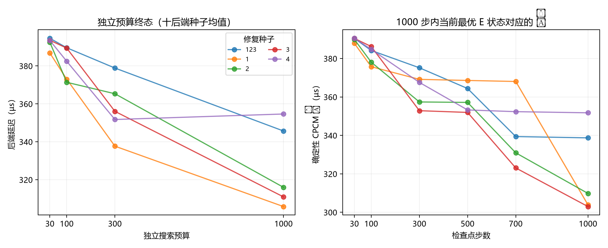

# A：Qwen decode FFN / PF4 的独立预算诊断

五条完整 1000 步轨迹和 50 次最终后端已齐。

主硬件 BusyBarn 2×2，健康起点为既有 A3h 赢家 I_qwen3moe_busybarn_decode_ffn_A3h_g0_s6，故障为原 PF4。1000 步从同一 L1 快照独立开始，没有继承 stop300；动作、校准、L2G+sync、精确回滚和十后端种子沿用原规则。搜索使用已验证确定性 bb 加速，关闭额外 checks。

## 独立预算终态

下表以各修复状态的十种子后端均值为单位，再在五个修复种子间取中位数与范围。30/100/300 为已完成主协议，1000 为单列预算诊断。

| 独立预算 | 修复种子数 | 后端均值的中位数 [最小,最大] µs | CPCM 中位 µs | 单轨迹决策中位 s | 本档全部候选决策 s | 本档后端验证 s |
|---|---:|---:|---:|---:|---:|---:|
| 30 | 5 | 393.430 [386.809, 394.599] | 390.487 | 63.866 | 328.126 | 1741.928 |
| 100 | 5 | 382.461 [371.382, 389.589] | 377.778 | 156.105 | 799.896 | 1730.283 |
| 300 | 5 | 356.069 [337.704, 378.895] | 352.875 | 435.521 | 2183.176 | 1655.094 |
| 1000 | 5 | 315.988 [305.845, 354.664] | 309.818 | 1450.653 | 7260.699 | 1522.716 |

1000 步相对独立 300 步的后端中位变化为 -11.257%；五候选新增决策成本 7260.7 秒，后端验证 1522.7 秒。

这项对比检验增加预算的作用；无论有无残差，都不据此自动追加搜索预算。仅凭曲线变平也不能证明达到拓扑容量下界。

每条轨迹的新增决策成本为校准、搜索、最佳状态恢复及终态 CPCM；继承的 R0/L1 时间单独保存，未再次计入新执行。五候选研究汇总成本与单轨迹成本分列。升级到原 300 步的流程累计包括原 30、100、300 三档；1000 步诊断本身不是这个在线升级规则的新增正式档位。

[独立预算逐状态表](tables/a_independent_budgets.csv)；[全部后端样本](tables/a_backend_samples.csv)。

## 1000 步日程内检查点

已保存 30 个检查点。每条完整轨迹记录 30/100/300/500/700/1000 步的当前最小 E 状态及对应 T̂、best_step、接受数、校准和累计搜索时间、快照路径。ck_backend=False，没有中途后端评估。

1000 步日程的温度随总预算定义，第 300 步检查点不替代原 300 步独立实验。最佳状态由既定 E（含微小距离项）选出，没有从拒绝提议的 T_new 中另取最小值。

[检查点逐行数据](tables/a_checkpoints.csv)。本机检查点开关验证使用同 L1 两条 8 步轨迹与各 3 次校准，逐提议、最终状态和 Python/NumPy 随机状态一致，零后端；它只验证记录行为，不计入正式质量样本。

## CPCM 时序解释

已对 13 个保存状态做固定确定性 CPCM 推演，后端新增 0；诊断总耗时 10.041 秒。每次平台身份与保存值匹配，重放 T̂ 与原值完全相等。

关键链构成按前驱活动开始到后继开始的 lag 分段，最后计至 T̂；hop 同时发放的零 lag 不重复计时。每段不重叠，总和严格等于该次 T̂。类别按实际资源划分 TensorCore、Vector、D2D、片内 NoC、DDR 接口和 release/gap/other；DDR 发出消息在 NoC/D2D 上的服务归入实际链路。

排他等待使用原 Analysis.blocking() 默认 cb_excl，另列主要资源绝对等待量。关键链构成和等待归因是两种解释，不相加。它们来自 CPCM 保存状态，不是逐事件后端实测；后端总延迟在每行旁列。

[关键链构成](tables/a_chain_composition.csv)、[连续时间分段](tables/a_chain_segments.csv)、[排他等待](tables/a_exclusive_wait.csv)、[资源负载](tables/a_resource_load.csv)、[诊断耗时](tables/a_diagnostic_timing.csv)。
