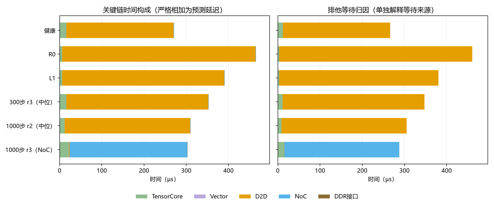

# A：Qwen decode FFN / PF4 的独立预算诊断

五条完整 1000 步轨迹和 50 次最终后端已齐。

主硬件 BusyBarn 2×2，健康起点为既有 A3h 赢家 I_qwen3moe_busybarn_decode_ffn_A3h_g0_s6，故障为原 PF4。1000 步从同一 L1 快照独立开始，没有继承 stop300；动作、校准、L2G+sync、精确回滚和十后端种子沿用原规则。搜索使用已验证确定性 bb 加速，关闭额外 checks。

## 独立预算终态

下表以各修复状态的十种子后端均值为单位，再在五个修复种子间取中位数与范围。30/100/300 为已完成主协议，1000 为单列预算诊断。

| 独立预算 | 修复种子数 | 后端均值的中位数 [最小,最大] µs | CPCM 中位 µs | 单轨迹决策中位 s | 本档全部候选决策 s | 本档后端验证 s |
|---|---:|---:|---:|---:|---:|---:|
| 30 | 5 | 393.430 [386.809, 394.599] | 390.487 | 63.866 | 328.126 | 1741.928 |
| 100 | 5 | 382.461 [371.382, 389.589] | 377.778 | 156.105 | 799.896 | 1730.283 |
| 300 | 5 | 356.069 [337.704, 378.895] | 352.875 | 435.521 | 2183.176 | 1655.094 |
| 1000 | 5 | 315.988 [305.845, 354.664] | 309.818 | 1450.653 | 7260.699 | 1522.716 |

1000 步相对独立 300 步的后端中位变化为 -11.257%；五候选新增决策成本 7260.7 秒，后端验证 1522.7 秒。

这项对比检验增加预算的作用；无论有无残差，都不据此自动追加搜索预算。仅凭曲线变平也不能证明达到拓扑容量下界。

健康、R0、L1 的十次后端均值分别为 276.994、464.035、391.750 µs。五个修复种子中 4/5 在独立 1000 步下改善；后端中位健康残差由 +28.55% 降到 +14.08%。新增预算有实际收益，且尚未回到健康参考附近。原 300 步仍是正式停止规则得到的主结果。
五个1000步终态的确定性 T̂ 仍高于健康 T̂ 的1.02倍；其最小残差为 +11.68%，因此都未进入既定2%恢复范围。

每条轨迹的新增决策成本为校准、搜索、最佳状态恢复及终态 CPCM；继承的 R0/L1 时间单独保存，未再次计入新执行。五候选研究汇总成本与单轨迹成本分列。升级到原 300 步的流程累计包括原 30、100、300 三档；1000 步诊断本身不是这个在线升级规则的新增正式档位。

[独立预算逐状态表](tables/a_independent_budgets.csv)；[全部后端样本](tables/a_backend_samples.csv)。

## 1000 步日程内检查点

已保存 30 个检查点。每条完整轨迹记录 30/100/300/500/700/1000 步的当前最小 E 状态及对应 T̂、best_step、接受数、校准和累计搜索时间、快照路径。ck_backend=False，没有中途后端评估。

1000 步日程的温度随总预算定义，第 300 步检查点不替代原 300 步独立实验。最佳状态由既定 E（含微小距离项）选出，没有从拒绝提议的 T_new 中另取最小值。

[检查点逐行数据](tables/a_checkpoints.csv)。本机检查点开关验证使用同 L1 两条 8 步轨迹与各 3 次校准，逐提议、最终状态和 Python/NumPy 随机状态一致，零后端；它只验证记录行为，不计入正式质量样本。

## CPCM 时序解释

已对 13 个保存状态做固定确定性 CPCM 推演，后端新增 0；诊断总耗时 11.105 秒。每次平台身份与保存值匹配，重放 T̂ 与原值完全相等。

关键链构成按前驱活动开始到后继开始的 lag 分段，最后计至 T̂；hop 同时发放的零 lag 不重复计时。每段不重叠，总和严格等于该次 T̂。类别按实际资源划分 TensorCore、Vector、D2D、片内 NoC、DDR 接口和 release/gap/other；DDR 发出消息在 NoC/D2D 上的服务归入实际链路。

排他等待使用原 Analysis.blocking() 默认 cb_excl，另列主要资源绝对等待量。关键链构成和等待归因是两种解释，不相加。它们来自 CPCM 保存状态，不是逐事件后端实测；后端总延迟在每行旁列。

[关键链构成](tables/a_chain_composition.csv)、[连续时间分段](tables/a_chain_segments.csv)、[排他等待](tables/a_exclusive_wait.csv)、[资源负载](tables/a_resource_load.csv)、[诊断耗时](tables/a_diagnostic_timing.csv)。

## 各种子的变化与迁移

同一个修复种子在两个独立预算下分别运行，温度日程也随预算变化。下表是种子标签对应的终态比较。

| 修复种子 | 300→1000 后端 µs | 后端变化 | 1000 步健康残差 | 唯一迁移块 MiB，300→1000 | 1000 最佳步 / 接受数 |
|---|---:|---:|---:|---:|---:|
| 123 | 378.895 → 345.692 | -8.763% | +24.801% | 22.525 → 60.087 | 997 / 306 |
| 1 | 337.704 → 305.845 | -9.434% | +10.416% | 60.056 → 127.633 | 999 / 586 |
| 2 | 365.348 → 315.988 | -13.510% | +14.077% | 43.565 → 102.116 | 976 / 487 |
| 3 | 356.069 → 310.945 | -12.673% | +12.257% | 36.039 → 102.107 | 996 / 333 |
| 4 | 351.761 → 354.664 | +0.825% | +28.040% | 43.547 → 69.105 | 974 / 572 |

seed 2、3 的后端分别改善 -13.51%、-12.67%。seed 4 的独立 1000 步后端为 +0.825%，确定性 CPCM 也为 +0.112%；因此增加预算的收益取决于轨迹，不能由步数直接保证。
五状态唯一迁移块中位数由 43.547 MiB 增到 102.107 MiB。这里统计去重后的实际迁移块字节；移动的行为数与DDR读取来源变化另保留在原 migration 字段中。

## 同一条 1000 步轨迹后半段还有多少变化

| 修复种子 | 第300步 T̂ µs | 第700步 T̂ µs | 第1000步 T̂ µs | 300→1000变化 | 700→1000变化 | 原独立300与本轨迹第300步相同 |
|---|---:|---:|---:|---:|---:|---|
| 123 | 375.200 | 339.422 | 338.740 | -9.717% | -0.201% | 是 |
| 1 | 369.177 | 368.073 | 303.870 | -17.690% | -17.443% | 否 |
| 2 | 357.420 | 330.961 | 309.818 | -13.318% | -6.388% | 否 |
| 3 | 352.875 | 323.097 | 302.986 | -14.138% | -6.224% | 是 |
| 4 | 367.591 | 352.372 | 351.776 | -4.302% | -0.169% | 否 |

五条轨迹在第 300 步以后都找到更小 E 的状态。seed 1 的主要下降发生在 700→1000 步，T̂ 再降 -17.443%；seed 2、3 后段也继续改善。seed 123、4 在 700 步后只小幅变化。最终 best_step 为 974–999，这些记录说明部分轨迹仍在较晚阶段找到更好的映射。五条轨迹中的三条在第300步已不同于原独立300步终态，正好体现两种日程不能互相替代。

## 等待为何降低，以及剩余等待在哪里

下表每行是一个实际保存状态。关键链时间列互斥相加得到 T̂；最大排他等待仅是等待归因中的首项，另表保留其余资源。

| 状态 | 后端 / T̂ µs | Tensor µs | D2D µs | NoC µs | Vector+DDR+gap µs | 最大排他等待类别 / µs | 最忙资源服务 / T̂ |
|---|---:|---:|---:|---:|---:|---:|---:|
| healthy | 276.994 / 271.303 | 15.744 | 254.365 | 0.820 | 0.374 | D2D / 254.007 | 97.11% |
| R0 | 464.035 / 464.860 | 6.336 | 457.602 | 0.548 | 0.374 | D2D / 457.579 | 98.59% |
| L1 | 391.750 / 390.555 | 6.336 | 383.231 | 0.548 | 0.440 | D2D / 377.080 | 98.55% |
| s300 r123 | 378.895 / 375.200 | 9.600 | 364.695 | 0.531 | 0.374 | D2D / 358.491 | 97.58% |
| s300 r1 | 337.704 / 333.463 | 15.744 | 316.765 | 0.580 | 0.374 | D2D / 310.584 | 98.41% |
| s300 r2 | 365.348 / 360.977 | 12.480 | 347.526 | 0.597 | 0.374 | D2D / 340.453 | 97.95% |
| s300 r3 | 356.069 / 352.875 | 15.744 | 336.177 | 0.580 | 0.374 | D2D / 336.141 | 98.28% |
| s300 r4 | 351.761 / 351.381 | 12.672 | 337.463 | 0.776 | 0.470 | D2D / 336.314 | 97.24% |
| s1000 r123 | 345.692 / 338.740 | 21.120 | 316.438 | 0.712 | 0.470 | D2D / 193.353 | 98.65% |
| s1000 r1 | 305.845 / 303.870 | 15.744 | 287.204 | 0.548 | 0.374 | D2D / 286.622 | 97.65% |
| s1000 r2 | 315.988 / 309.818 | 12.288 | 296.504 | 0.646 | 0.380 | D2D / 296.032 | 97.65% |
| s1000 r3 | 310.945 / 302.986 | 21.504 | 1.724 | 279.122 | 0.636 | NoC / 178.651 | 98.46% |
| s1000 r4 | 354.664 / 351.776 | 6.144 | 344.606 | 0.646 | 0.380 | D2D / 344.262 | 98.49% |

PF4 后的 R0 主要等待集中在剩余 D2D ((0,7),(1,4))：排他等待 457.579 µs。L1 把它降到 377.080 µs；原五条 300 步终态仍以 D2D 为最大等待来源，首项为 310.584–358.491 µs。
1000 步的 seed 1、2 将主 D2D 等待进一步降至 286.622 和 296.032 µs，同时最忙资源总服务也下降。seed 123 的 D2D 等待分散到两个方向，首项下降后仍须看两项合计，不能只按首项大小推断总收益。
seed 3 出现不同的限制因素：其关键链 NoC 占 92.12%，排他等待主要来自 Die 2 内部 ((2,7),(2,6)) 的 178.651 µs 与 ((2,3),(2,7)) 的 92.212 µs，D2D 排他等待仅 0.495 µs。此时 D2D 仍有接近 T̂ 的资源服务负载，但完成时刻的关键阻塞已转移到片内链路。seed 4 则仍由 ((1,4),(0,7)) 的 344.262 µs D2D 等待主导，对应它的预算扩大未改善终态。
这些现象支持‘更多重映射预算减轻了部分链路排队，但轨迹间仍有不同的热点’。当前诊断解释的是已找到映射的时间线，没有建立对所有可行映射都成立的容量下界。

图中300步r3与1000步r2分别是各预算的后端中位状态；另列1000步r3，展示关键等待转向NoC的实例。两张子图分别展示时间构成与等待归因，不互相相加。

## 本次实际耗时与资源

以下是质量实验期间的实测进程时间，同机存在其他质量任务；正式空闲单进程计时由 J 单列。校准、搜索、恢复、最终 CPCM 与十次后端验证分别记账，未重新收取已有 R0/L1。

| 种子 | 校准 s | 搜索 s | 恢复+最终CPCM s | 十次后端含准备 s | 其他初始化/导出/检查点 s | 完整进程 min | 峰值 GiB |
|---|---:|---:|---:|---:|---:|---:|---:|
| 123 | 26.011 | 1529.879 | 1.286 | 311.697 | 12.615 | 31.358 | 0.814 |
| 1 | 25.235 | 1387.774 | 1.099 | 324.237 | 12.833 | 29.186 | 0.809 |
| 2 | 24.125 | 1425.454 | 1.074 | 288.016 | 12.634 | 29.188 | 0.806 |
| 3 | 25.306 | 1484.125 | 1.218 | 299.925 | 13.812 | 30.406 | 0.812 |
| 4 | 26.453 | 1300.480 | 1.182 | 298.841 | 12.825 | 27.330 | 0.808 |

本次 5000 个正式提议加 75 个校准提议；五条新轨迹决策累计 7260.699 s，十种子后端验证累计 1522.716 s，其中真实后端函数 1403.374 s，其余为复制与种子准备。完整进程累计 2.458 进程小时，最长单进程 31.358 min。
相对于原五条独立 300 步，新五条 1000 步决策总成本为 3.326 倍；后端中位改善 11.257%，中位迁移字节增加。这个成本—恢复幅度的取舍作为 A 的预算诊断单列，正式停止规则与原 300 步结果保持原样。

可复算入口：`python -B e2e/hi_closeout_a_report.py`。全部20个独立预算终态、200个后端样本、30个检查点、13状态诊断和5个成功回执均在CSV/审计记录中；其中新增只占5条1000步轨迹和50个最终后端样本。本次报告新增13次确定性CPCM解释，后端与搜索新增0。
