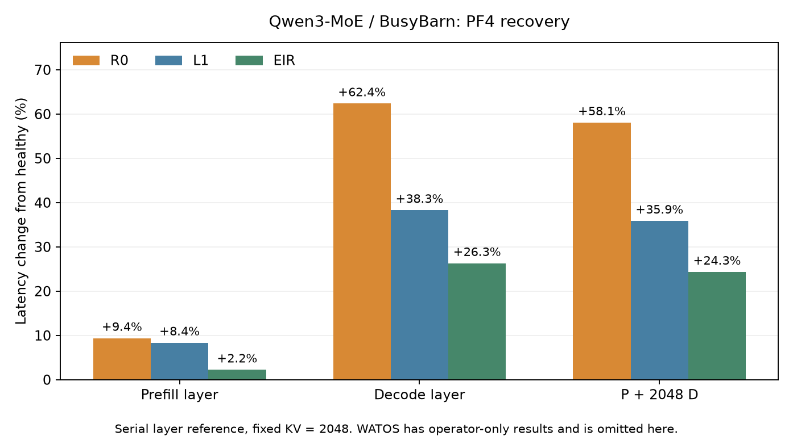

# Qwen 两个 prefill FFN / PF4 点及完整层参考

本批已完成 46/46 作业，真实 L2 25 条，停档复用 5 条，新增后端 310 次。与旧十个 PF4 点合并，当前已核对 12/12 点。

两种硬件各复用已有十四候选中的正式 A3h 赢家；固定故障仍为 `(die0,core11) ↔ (die1,core8)` 双向连接失效。健康重放、R0、L1 和每条实际 L2 的后端种子均为1–10。旧896健康候选和此前完成的故障记录保持不变。

| 硬件 | 健康ms | R0 ms | L1 ms | EIR ms | EIR/健康−1 | EIR/R0−1 | 停止档/原因 |
|---|---:|---:|---:|---:|---:|---:|---|
| busybarn | 39.467626 | 43.458909 | 43.080058 | 40.131531 | +1.68% | -7.66% | s300/tier_gain |
| watos | 21.803526 | 31.650799 | 30.056106 | 29.445254 | +35.05% | -6.97% | s100/tier_gain |

各档都是从同一 L1 状态开始的独立30/100/300步搜索，修复种子为123、1、2、3、4。跨级回到健康估值2%以内停止；100/300档还按相邻两档平均CPCM改善不足2%停止，300档为预算终点。停止使用五轨迹平均估值，最终导出使用该档五个后端均值的中位代表。另行开展的1000步诊断不会替换这里的原300步结果。

| 硬件 | 独立步数 | 实际轨迹 | 停档复用 | 待处理 | 五轨迹平均CPCM ns | 五个后端均值中位数ns | 五个后端均值范围ns |
|---|---:|---:|---:|---:|---:|---:|---|
| busybarn | 30 | 5 | 0 | 0 | 37888853.2 | 41222761.6 | [40112542.7, 43591692.1] |
| busybarn | 100 | 5 | 0 | 0 | 37038428.8 | 41327467.8 | [40028031.9, 44554640.7] |
| busybarn | 300 | 5 | 0 | 0 | 36827507.2 | 40131531.2 | [39684350.2, 43376397.4] |
| watos | 30 | 5 | 0 | 0 | 28538265 | 29774088.4 | [29592299.7, 30437616.5] |
| watos | 100 | 5 | 0 | 0 | 28441858.8 | 29445253.8 | [29268554.6, 29768620.8] |
| watos | 300 | 0 | 5 | 0 | — | — | — |

busybarn 的最终档平均 CPCM 仍比健康高 +5.16%；停止原因按上述五轨迹均值计算。最终后端中位代表为修复 seed4，十种子范围 38.048–41.792 ms。后端恢复程度与 CPCM 的停止条件分别报告。

watos 的最终档平均 CPCM 仍比健康高 +35.44%；停止原因按上述五轨迹均值计算。最终后端中位代表为修复 seed123，十种子范围 28.471–30.436 ms。后端恢复程度与 CPCM 的停止条件分别报告。

主硬件层参考

Prefill = 2×RMSNorm + 4×代表MHA + projection + FFN + 524308ns handoff。Decode = RMSNorm + 4×代表MHA + projection + FFN + 276ns handoff；decode FFN已经包含第二次RMSNorm。每个MHA代表图含8个Q头和一组K/V，Qwen层乘4。

| 阶段 | 状态 | 算子和ms | handoff ns | 层参考ms | 相对健康 | 相对R0 |
|---|---|---:|---:|---:|---:|---:|
| prefill | healthy | 55.141980 | 524308 | 55.666288 | +0.00% | -8.57% |
| prefill | R0 | 60.357012 | 524308 | 60.881320 | +9.37% | +0.00% |
| prefill | L1 | 59.794235 | 524308 | 60.318543 | +8.36% | -0.92% |
| prefill | EIR | 56.382712 | 524308 | 56.907020 | +2.23% | -6.53% |
| decode | healthy | 0.307114 | 276 | 0.307390 | +0.00% | -38.41% |
| decode | R0 | 0.498851 | 276 | 0.499127 | +62.38% | +0.00% |
| decode | L1 | 0.424821 | 276 | 0.425097 | +38.29% | -14.83% |
| decode | EIR | 0.387907 | 276 | 0.388183 | +26.28% | -22.23% |

| 状态 | P ms | D ms | P+2048D 秒 | 相对健康 | 相对R0 |
|---|---:|---:|---:|---:|---:|
| healthy | 55.666288 | 0.307390 | 0.685201 | +0.00% | -36.74% |
| R0 | 60.881320 | 0.499127 | 1.083093 | +58.07% | +0.00% |
| L1 | 60.318543 | 0.425097 | 0.930918 | +35.86% | -14.05% |
| EIR | 56.907020 | 0.388183 | 0.851906 | +24.33% | -21.35% |

这是同一模型、同一PF4下算子均值的串行组装。KV固定2048；没有逐token增长，也不是48层或流水线联合仿真。组内故障不改变解析handoff项。WATOS只保留prefill/decode MHA与FFN四类独立算子，不补造缺失的LN/projection或整层指标。

图中三个指标各自以健康状态为基准，均由上表的算子均值与固定handoff组装。WATOS没有完整层结果，因此不放入此图。

WATOS四类独立算子

| 算子 | 健康ms | R0 ms | 最终EIR ms | EIR/健康−1 | EIR/R0−1 |
|---|---:|---:|---:|---:|---:|
| pf_mha | 2.321891 | 2.765845 | 2.467088 | +6.25% | -10.80% |
| dc_mha | 0.005910 | 0.008161 | 0.006785 | +14.81% | -16.86% |
| dc_ffn | 0.281480 | 0.398450 | 0.327869 | +16.48% | -17.71% |
| pf_ffn | 21.803526 | 31.650799 | 29.445254 | +35.05% | -6.97% |

迁移与成本

每状态的行为搬迁、DDR读取源变化、唯一迁移块字节与块数保存在逐状态表；最终代表和全部修复种子都保留，后端范围不省略。

| 类型 | 作业数 | 后端调用秒 | 后端复制/准备秒 | 校准秒 | 搜索秒 | 恢复与最终CPCM秒 | 其他秒 |
|---|---:|---:|---:|---:|---:|---:|---:|
| fault_pre | 2 | 4810.243 | 68.612 | 0.000 | 0.000 | 2.609 | 54.243 |
| fault_l1 | 2 | 10872.762 | 137.527 | 0.000 | 103.369 | 4.670 | 82.042 |
| fault_rep | 25 | 76741.930 | 871.370 | 1604.239 | 10156.902 | 69.809 | 908.060 |

已完成作业累计 29.60776 进程小时（含子进程启动）；任务体 29.58085 进程小时。L2记录中继承的R0/L1耗时单列，不再计入新的修复决策。实际发生的各档校准、搜索、导出与后端都计入。并行进程小时不作为墙钟或论文单进程计时。

复算：`python e2e/hi_closeout_b_report.py`；运行中加 `--progress`。本批逐作业、逐状态、逐后端种子、独立预算、停止原因与迁移明细位于 `tables/b_*.csv`，12点合并表与主硬件层/请求表也保留原来源作业。
