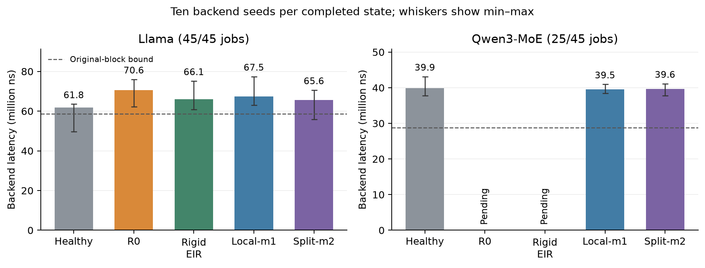
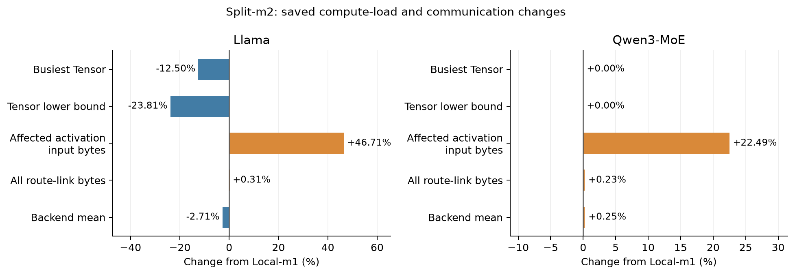

# 两个新模型的 MF6 与局部切分

本报告只读取保存结果；不调用后端或搜索。

已完成 70/90 个作业；实际新增后端 172 次、L2 搜索 10 条。停档复用 5 项、健康状态复用 1 项。

故障由健康 A3h decode MHA 的一次 seed1 后端选定：非角落 PE 的 Tensor/Vector 忙碌时间最大者，平局按坐标。PE 的计算单元失效，路由器与链路保留。随后按预先固定的 FFN、projection 顺序选择有孤儿 Tensor 且可合法二分的算子，没有用修复结果筛选位置或算子。

- llama：pf_ffn，已完成 45/45 项。
- qwen3moe：pf_ffn，已完成 25/45 项。

待完成状态：qwen3moe R0、qwen3moe rigid EIR。下表仅纳入已有十个后端种子的状态；未完成 EIR 不提前选取修复结果。

| 模型/算子 | 状态 | 后端均值ns [最小,最大] | 相对健康 | 相对R0 | 低于故障后原固定块下界的样本 |
|---|---|---:|---:|---:|---|
| llama/pf_ffn | healthy | 61,847,098.3 [49,709,641, 63,521,445] | +0.00% | -12.37% | —（健康平台） |
| llama/pf_ffn | R0 | 70,580,074.9 [62,127,808, 75,974,266] | +14.12% | +0.00% | 0/10 |
| llama/pf_ffn | rigid EIR | 66,090,560.1 [60,916,074, 75,138,269] | +6.86% | -6.36% | 0/10 |
| llama/pf_ffn | Local-m1 | 67,451,806.0 [63,012,351, 77,415,284] | +9.06% | -4.43% | 0/10 |
| llama/pf_ffn | Split-m2 | 65,620,952.7 [55,789,449, 70,565,830] | +6.10% | -7.03% | 1/10 |
| qwen3moe/pf_ffn | healthy | 39,880,336.8 [37,816,669, 43,131,461] | +0.00% | — | —（健康平台） |
| qwen3moe/pf_ffn | Local-m1 | 39,517,838.8 [38,392,242, 40,952,672] | -0.91% | — | 0/10 |
| qwen3moe/pf_ffn | Split-m2 | 39,615,484.9 [37,745,061, 41,116,417] | -0.66% | — | 0/10 |

rigid EIR 按原 2% 及 30/100/300 独立预算停止，内部五条修复轨迹和每条十次后端全部计入成本；上表取原停止档的后端中位代表，完整五种子结果另表保存。Local-m1 与 Split-m2 从同一健康图的故障孤儿块出发，用同一放置和路径规则，健康核原计算落点不变。

Split 仅比较合法的 N、M 轴，依次最小化实际取整 FLOP 增量、完整图链路字节、固定轴顺序。表中保存所有候选轴、实际输入复制、输出区域覆盖和取整变化；不假设通信按二分比例减少。

固定块下界按真实块时长和故障后可用 Tensor 单元计算：max(max c、sum c/P、ceil(K/P) min c)。同时报告新图下界与最忙核负载。只有后端总延迟实际低于旧块下界，才构成超出旧分块放置可达到范围的证据。

唯一权重迁移字节沿用 EIR 的 DDR 来源新增副本定义；局部切分保留原 DDR 源，额外 PE 输入复制和链路传输另列。健康输入和全体原始候选未修改。

### 实际块大小、下界和计算负载

服务时间由保存图里的真实 Tensor 形状及当前硬件计算。原固定块下界使用故障后 63 个 Tensor 单元；健康行使用 64 个。计数项为 ceil(K/P) × 最短块，基本项包含最长块及总工作量/P，两者取较大值。

| 模型 | 状态 | Tensor块数 | 存活单元 | 块时长最小/最大（Mns） | 基本下界（Mns） | 计数下界（Mns） | 实际分块下界（Mns） | 最忙Tensor负载（Mns） |
|---|---|---:|---:|---:|---:|---:|---:|---:|
| llama | healthy | 192 | 64 | 14.680/14.680 | 44.040 | 44.040 | 44.040 | 44.040 |
| llama | R0 | 192 | 63 | 14.680/14.680 | 44.739 | 58.720 | 58.720 | 58.720 |
| llama | rigid EIR | 192 | 63 | 14.680/14.680 | 44.739 | 58.720 | 58.720 | 58.720 |
| llama | Local-m1 | 192 | 63 | 14.680/14.680 | 44.739 | 58.720 | 58.720 | 58.720 |
| llama | Split-m2 | 195 | 63 | 7.340/14.680 | 44.739 | 29.360 | 44.739 | 51.380 |
| qwen3moe | healthy | 1536 | 64 | 0.197/3.146 | 28.312 | 4.719 | 28.312 | 32.047 |
| qwen3moe | Local-m1 | 1536 | 63 | 0.197/3.146 | 28.761 | 4.915 | 28.761 | 32.047 |
| qwen3moe | Split-m2 | 1560 | 63 | 0.098/3.146 | 28.761 | 2.458 | 28.761 | 32.047 |

### 通信与复制

下表用十进制 MB/GB（1 MB = 10⁶字节，1 GB = 10⁹字节）。route-link 字节对每条实际链路计数；受影响输入字节只统计局部改图部分，不与全图 DDR 读取相加。复制量是实际传输，不表示新增独立权重副本，也不表示峰值 SRAM 占用。

| 模型 | 状态 | 全图逻辑传输（GB） | 全图route-link（GB） | DDR读取（GB） | 受影响权重输入（MB） | 受影响激活输入（MB） |
|---|---|---:|---:|---:|---:|---:|
| llama | healthy | 22.983 | 124.096 | 14.496 | — | — |
| llama | R0 | 22.916 | 124.134 | 14.496 | — | — |
| llama | rigid EIR | 22.931 | 121.580 | 14.496 | — | — |
| llama | Local-m1 | 22.983 | 123.748 | 14.496 | 88.088 | 318.767 |
| llama | Split-m2 | 23.132 | 124.132 | 14.630 | 88.088 | 467.665 |
| qwen3moe | healthy | 69.468 | 389.718 | 4.712 | — | — |
| qwen3moe | Local-m1 | 68.935 | 385.436 | 4.712 | 37.782 | 1417.675 |
| qwen3moe | Split-m2 | 69.254 | 386.340 | 4.712 | 37.782 | 1736.442 |

### 从这两个保存点能看到什么

- llama：m2 相对 m1 的最忙 Tensor 负载变化 -12.50%，实际分块下界变化 -23.81%；受影响激活输入变化 +46.71%，全图 route-link 字节变化 +0.31%。后端均值变化 -2.71%，m1/m2 分别有 0/10、1/10 个样本低于旧分块下界 58.720 Mns。
- qwen3moe：m2 相对 m1 的最忙 Tensor 负载变化 +0.00%，实际分块下界变化 +0.00%；受影响激活输入变化 +22.49%，全图 route-link 字节变化 +0.23%。后端均值变化 +0.25%，m1/m2 分别有 0/10、0/10 个样本低于旧分块下界 28.761 Mns。
llama 的原图有 192 个 Tensor 块，块时长分为 1 档。m1 下界由块数及最短块形成的计数项决定；m2 把块数增加到 195 后，下界由基本项决定，最忙 Tensor 实际负载为 51.380 Mns。计算负载、输入复制和真实后端时间一起说明该点的切分效果。
qwen3moe 的原图有 1536 个 Tensor 块，块时长分为 2 档。m1 下界由总工作量/P与最长块形成的基本项决定；m2 把块数增加到 1560 后，下界由基本项决定，最忙 Tensor 实际负载为 32.047 Mns。计算负载、输入复制和真实后端时间一起说明该点的切分效果。

柱为十种子均值，线段为最小至最大值；Pending 表示该状态尚未收齐。虚线为故障后旧分块下界。

所有变化以同模型 Local-m1 为参照。对应 SVG 与 PNG 一并保存在 figures；绝对值与逐种子样本在表中。

累计作业成本 2.1276 进程小时，最长作业 38.30 分钟，最高 RSS 0.949 GiB。这是并行质量运行成本；正式单进程计时由 J 报告。

复算：`python e2e/hi_closeout_c_report.py --out e2e/hi/out/closeout_20261115`。逐种子样本、全部 EIR 档位、停止决策、通信/下界、轴选择、迁移及逐项成本在 `tables/c_*.csv`；输入/回执/原始状态摘要在 `evidence/c_completion.json`。
