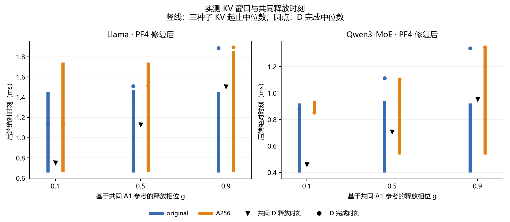

# H/I 收尾 P0：已有结果的四项补充

本报告只读取既有 CSV 和 JSON，新增搜索 0、后端评估 0。候选与故障状态均沿用原结果，H5/I5 的输入和原 300 步主结果不变。

## 完成状态

健康候选 896/896、64 个十四候选组已齐。Llama PF4 12/12，Qwen PF4 在本次后处理基线中为 10/12；剩余两个 prefill FFN 点由 B 包补齐。新模型 MF6/Split、GPT S 八组合及剩余 J 计时按本轮计划执行，状态见收尾总览；旧 J 第一批 45 项保留，H6 后置。

[原批次完整汇总](../HI_FOLLOWUP_SUMMARY.md)；[本轮计划](../../HI_CLOSEOUT_PLAN.md)。H_HEALTH_SUMMARY 的末节已标为历史试点并链接完整结果。

## 64 组候选的选择损失

每组固定模型、硬件、阶段、算子和方法，共 14 个候选。以各候选十种子后端均值计算所选值/组内最低值−1。所有浮点数使用原始精度；P90 使用排序后的线性插值。这是选择损失，不是 CPCM 的延迟估值误差。

自身代价沿用原选择键：A3h 先看保存的搜索确定性估值、再看自身能量；A1/Gemini 看自身能量。统一确定性和随机 CPCM 看相应估值；最后均按原 candidate_order 破同分。

| 选择方式 | 同一赢家 /64 | 零损失 /64 | 中位数 | P90 | 最大 |
|---|---:|---:|---:|---:|---:|
| 自身代价 | 16 | 18 | 2.299% | 32.551% | 142.859% |
| 统一确定性 CPCM | 38 | 38 | 0.000% | 3.617% | 12.524% |
| 十次随机 CPCM 均值 | 53 | 53 | 0.000% | 0.523% | 3.671% |

逐组 192 行见 [selector_regret.csv](tables/selector_regret.csv)，包含所选 ID、后端赢家 ID、两者后端均值与选择键。候选相同和延迟零损失分别计数；两个不同状态的后端均值相同时，后者仍算零损失。

## 同后端单跑干扰与 KV 窗口

共 126 个联合结果（H5/I5 各 63）。D 干扰 = D 联合延迟 / 同种子、同执行方式的 D 单跑延迟−1。配对核对了平台、完整流身份和实际集合遍历身份。负值保留：两次执行的随机仲裁轨迹不同，联合运行也可能略短。

| 模型 | 条件 | 实验臂 | D 干扰中位数 [最小, 最大] | 负值 /9 |
|---|---|---|---:|---:|
| llama | healthy | A1_no_DSTU | +0.620% [+0.120%, +2.414%] | 0 |
| llama | healthy | A3h_no_DSTU | -0.976% [-4.734%, +4.435%] | 5 |
| llama | healthy | A3h_A256 | -0.767% [-1.303%, +0.539%] | 7 |
| llama | D | A1_R0_no_DSTU | +0.526% [-0.461%, +1.411%] | 3 |
| llama | D | A3h_R0_no_DSTU | +0.793% [-0.102%, +2.005%] | 2 |
| llama | D | A3h_EIR_no_DSTU | +0.293% [-1.044%, +4.056%] | 2 |
| llama | D | A3h_EIR_A256 | +0.058% [-0.274%, +0.551%] | 3 |
| qwen3moe | healthy | A1_no_DSTU | +0.897% [-0.845%, +3.567%] | 2 |
| qwen3moe | healthy | A3h_no_DSTU | +4.295% [-0.047%, +10.205%] | 1 |
| qwen3moe | healthy | A3h_A256 | +1.360% [-2.688%, +3.721%] | 3 |
| qwen3moe | D | A1_R0_no_DSTU | +3.486% [-0.690%, +5.584%] | 1 |
| qwen3moe | D | A3h_R0_no_DSTU | +3.654% [-0.733%, +6.361%] | 3 |
| qwen3moe | D | A3h_EIR_no_DSTU | +4.224% [-1.423%, +8.366%] | 3 |
| qwen3moe | D | A3h_EIR_A256 | -0.384% [-0.743%, +1.557%] | 5 |

修复后的 original 中，Llama 的 D 干扰中位数只有 +0.293%，Qwen 为 +4.224%；A256 后分别为 +0.058% 和 −0.384%。这说明两模型留给传输方案消除的干扰量不同，需结合 P 完成时间及执行方式本身的成本一起判断。



图只展示 PF4 修复后 original 与 A256 的三种子中位数，全部七臂、三相位、三种子的原值保存在窗口表。横轴 g 来自共同健康 A1/original 参考，不是各方法自身 KV 已传完的比例。竖线与圆点来自实际后端，不是 CPCM 预测。

窗口相交以 max(0,min(KV_end,D_completion)−max(KV_start,tau_D)) 计算，只表示时间相交，不把它当作排队阻塞量。D 存活窗口从统一释放时刻开始。修复后 g=0.9 时，original 的 KV/D 窗口相交样本为 Llama 1/3、Qwen 0/3；A256 分别为 3/3、2/3。这也说明相同 g 并不对应相同的实际 KV 进度。

逐行原值：[joint_interference.csv](tables/joint_interference.csv)、[kv_overlap_windows.csv](tables/kv_overlap_windows.csv)；按实验臂及相位汇总：[joint_interference_summary.csv](tables/joint_interference_summary.csv)。

## 同一停止档位内的代表状态选择

覆盖已有 22 个 A3h PF4 点，停止档位分布为 `{"R0": 9, "L1": 3, "s300": 4, "s100": 5, "s30": 1}`。每点固定原停止档位，分别选 seed123、最小确定性 CPCM、原报告的五种子后端中位代表；R0/L1 停止点三列使用同一状态。

最小 CPCM 同分时按修复种子顺序 123、1、2、3、4；原后端中位代表沿用既有规则（中位后端值同分时取较小种子）。下表比较相对原主表代表状态的后端变化。

| 选择方式 | 相同状态 /22 | 后端变化中位数 | 最小 | 最大 |
|---|---:|---:|---:|---:|
| fixed_seed123 | 12 | +0.000% | -8.927% | +6.411% |
| minimum_T_hat | 14 | +0.000% | -8.927% | +3.925% |
| backend_median | 22 | +0.000% | +0.000% | +0.000% |

| 模型/硬件/算子 | 停止档位 | seed123 残差 | 最小 CPCM 残差 | 后端中位代表残差 |
|---|---|---:|---:|---:|
| llama/busybarn/pf_ln | R0 | +0.801% | +0.801% | +0.801% |
| llama/busybarn/pf_mha | L1 | +4.360% | +4.360% | +4.360% |
| llama/busybarn/pf_proj | R0 | +0.190% | +0.190% | +0.190% |
| llama/busybarn/pf_ffn | R0 | +1.907% | +1.907% | +1.907% |
| llama/busybarn/dc_ln | R0 | +0.000% | +0.000% | +0.000% |
| llama/busybarn/dc_mha | L1 | +0.741% | +0.741% | +0.741% |
| llama/busybarn/dc_proj | R0 | +1.124% | +1.124% | +1.124% |
| llama/busybarn/dc_ffn | s300 | +3.289% | +2.696% | +4.785% |
| llama/watos/pf_mha | s100 | +6.040% | +5.172% | +5.172% |
| llama/watos/pf_ffn | R0 | +0.815% | +0.815% | +0.815% |
| llama/watos/dc_mha | R0 | +1.286% | +1.286% | +1.286% |
| llama/watos/dc_ffn | s100 | +2.569% | +2.570% | +2.570% |
| qwen3moe/busybarn/pf_ln | L1 | +1.872% | +1.872% | +1.872% |
| qwen3moe/busybarn/pf_mha | s100 | +5.198% | +2.576% | +4.164% |
| qwen3moe/busybarn/pf_proj | R0 | +0.000% | +0.000% | +0.000% |
| qwen3moe/busybarn/dc_ln | R0 | +0.000% | +0.000% | +0.000% |
| qwen3moe/busybarn/dc_mha | s300 | +7.077% | +4.044% | +6.304% |
| qwen3moe/busybarn/dc_proj | s30 | +4.293% | +0.968% | +2.279% |
| qwen3moe/busybarn/dc_ffn | s300 | +36.788% | +21.917% | +28.547% |
| qwen3moe/watos/pf_mha | s100 | +4.340% | +10.424% | +6.253% |
| qwen3moe/watos/dc_mha | s100 | +11.881% | +11.881% | +14.809% |
| qwen3moe/watos/dc_ffn | s300 | +6.083% | +6.083% | +16.480% |

这里评价的是已有候选的不同选择办法。seed123 一列没有重新实现按自身结果停档的在线控制器；最小 CPCM 一列也需要先产生五个候选。不能把其选择质量配上单条轨迹的成本。

[eir_selection_sensitivity.csv](tables/eir_selection_sensitivity.csv) 的 66 行保留每个状态的后端均值、相对健康残差、相对 R0 改善、唯一迁移块字节及行为/DDR 迁移。原主表及 H5/I5 仍使用原后端中位代表。

## 复算与来源

从仓库根目录运行：

```powershell
e2e/post_fg/dist/venv/Scripts/python.exe -B e2e/hi_closeout_p0.py
```

[p0_audit.json](evidence/p0_audit.json) 记录输入文件 SHA-256、原始 JSON 与 CSV 的逐项核对、生成时间和实际耗时。脚本只加载保存数据，不导入仿真/搜索模块。表格可独立复算上述统计。
