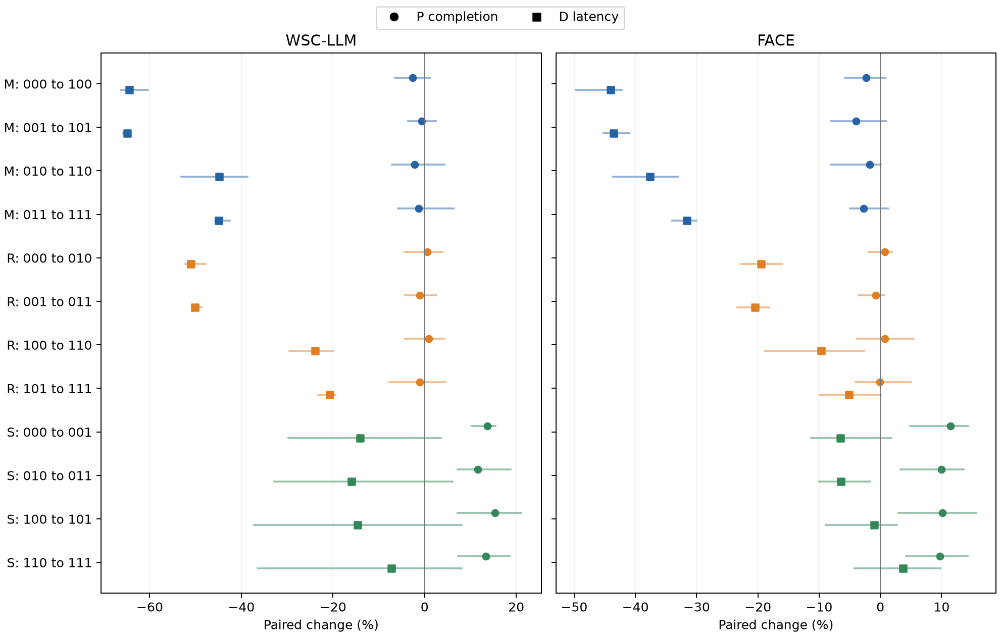

# GPT S 系统八组合

144 项联合已齐：108 项新增、36 项由此前的 fresh_transform_v1 同身份结果复用。共 50 条实际 A1 修复搜索、840 次新增后端；96 项逻辑配对单跑中实际运行 72 次，另24项复用本批已经完成、实际图及执行身份相同的单跑。

三位数字依次表示映射、修复和传输选择。P 是一个 prefill MHA 流，D 是 LN、8个代表MHA、projection与FFN组成的decode链；PF4故障施加于D侧。M切换时P和D映射一起切换；R只修复D侧；S采用All256+C4。

| 组合 | 映射 | 故障后状态 | 传输 |
|---|---|---|---|
| 000 | A1 | R0 | original |
| 001 | A1 | R0 | All256+C4 |
| 010 | A1 | EIR | original |
| 011 | A1 | EIR | All256+C4 |
| 100 | A3h | R0 | original |
| 101 | A3h | R0 | All256+C4 |
| 110 | A3h | EIR | original |
| 111 | A3h | EIR | All256+C4 |

A3h映射和EIR均明显缩短D链；All256+C4的增量取决于硬件和到达相位，并伴随P完成时间增加。FACE上已有A3h+EIR时，110→111的D延迟中位数反而增加3.679%，P增加9.743%；应同时保留110和111的结果。

| 硬件 | 相对000 | P中位变化 [最小,最大] | D中位变化 [最小,最大] | P改善数/9 | D改善数/9 |
|---|---|---:|---:|---:|---:|
| wsc | 110 | -3.095% [-4.857%, +2.061%] | -73.133% [-76.215%, -69.958%] | 8 | 9 |
| wsc | 111 | +11.772% [+5.601%, +16.815%] | -75.851% [-81.158%, -70.676%] | 0 | 9 |
| face | 110 | -1.505% [-7.391%, +1.483%] | -49.457% [-54.589%, -46.498%] | 8 | 9 |
| face | 111 | +6.992% [+3.168%, +10.340%] | -49.620% [-51.985%, -44.954%] | 0 | 9 |

所有八臂使用健康 A1/original 的共同到达时刻与评价参考。A1-EIR的停止条件使用自身健康CPCM，C4内部期限按各自当前All256图计算，即dP=1.5×T̂P、dD=τ+1.5×T̂D。共同参考决定τ与评价分母，当前图决定C4优先级。已逐项核对8个图来源、32个算子状态和240个联合/单跑配置。

| 硬件 | 增加能力 | 对比 | P 完成时间中位变化 | D 延迟中位变化 | D 延迟范围 |
|---|---|---|---:|---:|---:|
| wsc | M | 000→100 | -2.614% | -64.461% | [-66.268%, -60.359%] |
| wsc | M | 001→101 | -0.690% | -64.937% | [-65.840%, -64.563%] |
| wsc | M | 010→110 | -2.156% | -44.799% | [-53.067%, -38.715%] |
| wsc | M | 011→111 | -1.252% | -44.955% | [-45.722%, -42.553%] |
| wsc | R | 000→010 | +0.544% | -50.979% | [-52.218%, -47.851%] |
| wsc | R | 001→011 | -1.115% | -50.163% | [-50.685%, -48.668%] |
| wsc | R | 100→110 | +0.876% | -23.945% | [-29.489%, -20.025%] |
| wsc | R | 101→111 | -1.038% | -20.705% | [-23.358%, -19.518%] |
| wsc | S | 000→001 | +13.692% | -14.095% | [-29.713%, +3.510%] |
| wsc | S | 010→011 | +11.558% | -15.990% | [-32.829%, +6.081%] |
| wsc | S | 100→101 | +15.359% | -14.649% | [-37.195%, +8.030%] |
| wsc | S | 110→111 | +13.368% | -7.224% | [-36.485%, +8.116%] |
| face | M | 000→100 | -2.339% | -44.054% | [-49.733%, -42.244%] |
| face | M | 001→101 | -3.983% | -43.552% | [-45.225%, -41.030%] |
| face | M | 010→110 | -1.756% | -37.654% | [-43.616%, -33.086%] |
| face | M | 011→111 | -2.701% | -31.609% | [-33.994%, -30.007%] |
| face | R | 000→010 | +0.740% | -19.462% | [-22.693%, -15.973%] |
| face | R | 001→011 | -0.755% | -20.446% | [-23.363%, -18.182%] |
| face | R | 100→110 | +0.758% | -9.657% | [-18.868%, -2.676%] |
| face | R | 101→111 | -0.128% | -5.128% | [-9.827%, +0.075%] |
| face | S | 000→001 | +11.460% | -6.563% | [-11.316%, +1.809%] |
| face | S | 010→011 | +9.946% | -6.412% | [-9.979%, -1.641%] |
| face | S | 100→101 | +10.094% | -1.022% | [-8.909%, +2.744%] |
| face | S | 110→111 | +9.743% | +3.679% | [-4.257%, +9.764%] |

每行含相同硬件、三相位、三种子的九个配对。M 是 A1→A3h，R 是 R0→EIR，S 是 original→All256+C4；S 同时改变切块、按跳服务与优先级，表示传输方案整体增量。百分比按每对结果计算后再取中位数，不把各能力的百分比相加。

WSC四种条件下M的D延迟中位变化为−64.937%至−44.799%，R为−50.979%至−20.705%；FACE的M为−44.054%至−31.609%，R为−20.446%至−5.128%。FACE的101→111有一个配对D延迟增加0.075%，其余R配对均改善。P的变化独立列示。

All256+C4在WSC的110→111中位D改善7.224%，但该条件g=0.9的三个种子均回退；FACE同一条件九个配对中八个D回退。下表按到达相位拆开，展示共同参考时间轴上的差异。

| 硬件 | 110→111到达相位g | P中位变化 | D中位变化 [最小,最大] |
|---|---:|---:|---:|
| wsc | 0.1 | +12.081% | -32.504% [-36.485%, -29.549%] |
| wsc | 0.5 | +17.478% | -7.224% [-8.333%, -2.618%] |
| wsc | 0.9 | +12.159% | +6.907% [+2.438%, +8.116%] |
| face | 0.1 | +11.671% | +2.229% [-4.257%, +4.738%] |
| face | 0.5 | +12.724% | +8.277% [+3.679%, +9.764%] |
| face | 0.9 | +9.505% | +3.620% [+2.886%, +6.028%] |

A1的EIR是实际完成的L1与30/100/300步独立修复。WSC的MHA在300步档停止，projection和FFN在100步档停止；FACE三者在30步档停止，两种硬件的LN均保留R0。八个算子最终都按自身健康A1的2%条件停止。停止判断用该档五轨迹平均CPCM，联合图取该档后端中位代表，两项分别保存。

| 硬件 | 算子 | 停止档 | 实际L2数 | 五种子累计决策秒 | 后端验证秒 | 最终新增权重副本MiB | 搬迁行为比例 |
|---|---|---|---:|---:|---:|---:|---:|
| wsc | dc_ln | R0 | 0 | 1.061 | 28.248 | 0.000 | 0.00% |
| wsc | dc_mha | s300 | 15 | 267.385 | 400.603 | 12.806 | 31.94% |
| wsc | dc_proj | s100 | 10 | 24.302 | 186.332 | 30.381 | 36.25% |
| wsc | dc_ffn | s100 | 10 | 58.415 | 216.037 | 135.047 | 11.73% |
| face | dc_ln | R0 | 0 | 1.068 | 28.293 | 0.000 | 0.00% |
| face | dc_mha | s30 | 5 | 32.047 | 155.584 | 3.423 | 7.64% |
| face | dc_proj | s30 | 5 | 8.475 | 105.836 | 15.756 | 8.75% |
| face | dc_ffn | s30 | 5 | 18.210 | 125.177 | 49.523 | 2.79% |

本轮S作业体累计5.93611进程小时、最高RSS 1.006 GiB。840次新增后端 = 8×20次A1 R0/L1 + 50×10次实际L2 + 72次配对单跑 + 108次联合。搜索提议3900次，校准另列于质量总账；36次既有联合结果复用、24次本批单跑结果复用分别记录，均不计新增后端。

迁移按每个算子相对自身健康映射计算，包含行为落点、DDR读取源变化和去重权重副本字节；32个完整状态见[s_mapping_states.csv](tables/s_mapping_states.csv)。它们是模板算子的迁移量，未简单乘8当成整个MHA链的物理权重迁移。三相位、三种子和两种传输共享同一映射状态，不重复计算修复成本。

[s_mapping_costs.csv](tables/s_mapping_costs.csv)同时保存新增A1与历史A3h修复成本，并标明来源。研究五种子累计决策包含R0/L1、各已执行档校准、搜索及t_finalize；t_finalize已包含恢复最佳状态和最终CPCM，两个分项另列展示，累计时只加一次。十种子后端验证另外列示。逐条原始记录核对见[s_finalize_timing_check.json](evidence/s_finalize_timing_check.json)。这些并行时长与J阶段的空闲单进程计时分开。

[s_arm_summary.csv](tables/s_arm_summary.csv)保留每个组合P、D、L̂与干扰的均值、中位数和极值；[s_conditional_pairs.csv](tables/s_conditional_pairs.csv)保留全部216个条件配对；[s_phase_conditionals.csv](tables/s_phase_conditionals.csv)按相位拆分。图中的点是中位数、线段是最小至最大，两个符号分别表示P和D。

所有三相位都依据共同A1参考释放；g=0.9表示参考KV窗口的90%位置。配对单跑只复用完整图、实际遍历顺序、平台、执行方式、rank、释放和种子完全相同的记录。当前结果衡量这两种硬件、PF4、一个P流与一条D链的固定工作负载完成时间和干扰。
