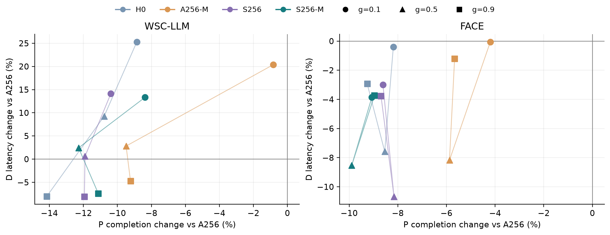
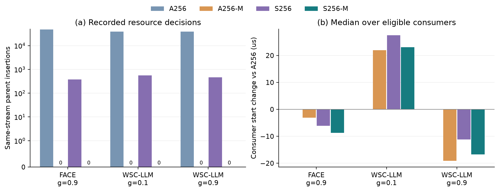

# DSTU 机制与策略试点

使用既有 F/G 的 A3h 映射、路径和硬件；全部新结果独立保存。
C4 排名、公共释放时刻与公共期限取现有 All256/健康 A1 参考。Shared-only 单跑继续使用联合输入的掩码。

BB0：原 BusyBarn 后端、不切块；H0：按跳后端＋C4、不切块；A256：全链路256 KiB切块＋C4；S256：仅切经过高优先流共享有向资源的低优先大消息；后缀 -M 表示同流消息连续优先。
故障条件D表示在右侧decode组注入既定PF4，并使用已有EIR修复状态；左侧prefill组保持健康。没有在本轮重新搜索映射。

| 范围 | 逻辑项 | 历史复用 | 本批等价复用 | 新后端调用 |
|---|---:|---:|---:|---:|
| PF4 | 90 | 0 | 0 | 90 |
| baseline_trace | 6 | 0 | 0 | 6 |
| healthy | 180 | 0 | 6 | 174 |

初批的三个 A256 日志重放与历史结果不等。核对发现事件、边和数据相同，但历史保存再重载与本次构图产生的依赖集合遍历次序不同，进入仲裁队列的顺序随之不同。初批和失败日志完整保存在 `dist/quality_health_20261113_initial.tar.gz` 与 `out/main/attempts/20261113_before_fresh_baselines/`。
健康比较重新测量 BB0/A256 共60项，六个方案均从原始图按本次 fresh transform 流程构造。既有四个新方案和六项等价单跑继续使用原结果；两个硬件的 A256/A256-M、BB0/H0 与 H0-D/S256-D 已逐项核对完整图以及实际集合遍历次序。故障确认的三个方案也采用此流程重新评估。
历史结果差异另列[输入流程比较表](tables/dstu_protocol_comparison.csv)。A256 代表日志严格核对本次同图、同种子的基线；历史差异与策略收益分开记录。

健康比较中，S256 的 D 单跑复用同配置 H0；执行前核对过滤后的完整事件图、平台、C4、释放和种子。S256 的共享掩码与 P 变换摘要单独保存。PF4三方案的90项均实际评估。

## 全部相位与种子的结果

负变化表示低于原 All256+C4。每硬件、条件、方案按三个相位各三个种子统计；故障确认沿用一个统一选定方案。

| 条件 | 硬件 | 方案 | P变化：中位 [范围] | D变化：中位 [范围] | D改善/持平/变差 | 超期数 |
|---|---|---|---|---|---|---:|
| D | FACE | A256 | +0.00% [+0.00%, +0.00%] | +0.00% [+0.00%, +0.00%] | 0/9/0 | 0 |
| D | FACE | BB0 | -8.88% [-12.45%, -3.99%] | -3.55% [-8.90%, +4.45%] | 8/0/1 | 0 |
| D | FACE | S256 | -9.27% [-12.53%, -3.49%] | -5.81% [-10.12%, +0.54%] | 8/0/1 | 0 |
| D | WSC-LLM | A256 | +0.00% [+0.00%, +0.00%] | +0.00% [+0.00%, +0.00%] | 0/9/0 | 0 |
| D | WSC-LLM | BB0 | -11.79% [-15.68%, -6.84%] | +7.79% [-7.51%, +57.44%] | 3/0/6 | 0 |
| D | WSC-LLM | S256 | -16.06% [-18.43%, -7.83%] | +0.17% [-10.72%, +14.81%] | 4/0/5 | 0 |
| healthy | FACE | A256 | +0.00% [+0.00%, +0.00%] | +0.00% [+0.00%, +0.00%] | 0/9/0 | 0 |
| healthy | FACE | A256-M | -5.85% [-8.38%, +1.03%] | -1.49% [-8.92%, +2.41%] | 8/0/1 | 0 |
| healthy | FACE | BB0 | -8.40% [-15.79%, -5.32%] | -2.97% [-10.82%, +1.93%] | 8/0/1 | 0 |
| healthy | FACE | H0 | -8.09% [-12.40%, -6.09%] | -3.96% [-8.86%, +2.35%] | 7/0/2 | 0 |
| healthy | FACE | S256 | -7.59% [-11.75%, -5.33%] | -4.50% [-12.27%, -1.46%] | 9/0/0 | 0 |
| healthy | FACE | S256-M | -8.60% [-15.23%, -6.32%] | -4.41% [-11.90%, -2.35%] | 9/0/0 | 0 |
| healthy | WSC-LLM | A256 | +0.00% [+0.00%, +0.00%] | +0.00% [+0.00%, +0.00%] | 0/9/0 | 0 |
| healthy | WSC-LLM | A256-M | -6.67% [-12.92%, +2.98%] | +5.15% [-6.88%, +25.63%] | 4/0/5 | 0 |
| healthy | WSC-LLM | BB0 | -11.64% [-18.18%, +3.15%] | +7.08% [-9.89%, +47.64%] | 3/0/6 | 0 |
| healthy | WSC-LLM | H0 | -11.13% [-18.89%, -4.08%] | +7.72% [-8.29%, +27.12%] | 3/0/6 | 0 |
| healthy | WSC-LLM | S256 | -12.27% [-13.81%, -5.39%] | -0.19% [-9.70%, +17.95%] | 5/0/4 | 0 |
| healthy | WSC-LLM | S256-M | -11.79% [-14.80%, -3.96%] | +2.84% [-8.31%, +14.54%] | 3/0/6 | 0 |

每点平均同相位的三个后端种子，误差范围和逐种子值保存在完整表。图中零点为当前 A256；同时保留 H0、A256-M、S256、S256-M，拆开切块范围与消息服务顺序。

## 单跑自身变化与联合额外变化

`O_X = 新方案单跑 − BB0单跑`；`J_X = 同方案联合 − 同方案单跑`。逐项复算 `联合差 = O_X + J_X − J_X(BB0)`。D 的联合时间均为完成减释放。
P 期限为公共 `1.5 T_P`，D 的绝对期限为 `tau + 1.5 T_D`；Lhat_D 分子使用D延迟减`1.5 T_D`。公共分母不随策略改变。负迟约为提前完成余量，余量减少与真正超期分开报告。
完整 [逐种子表](tables/dstu_runs.csv)、[相位汇总](tables/dstu_phase_summary.csv)、[O/J检查](evidence/dstu_report_checks.json) 同时保留不利结果。

## 代表资源日志

健康代表点固定为 WSC 的 g=0.1/0.9 与 FACE 的 g=0.9，均 seed1。四个新方案直接保留日志；BB0/A256另行记录同一输入流程的日志。BB0的机制解释使用这次日志自身；其后端还具有已记录的跨进程单次波动。A256 的同图、同策略、同种子日志严格对照本次基线。

| 硬件/相位 | 方案 | 同流插入 | 原键真平局 | 原键非最小发放 | 资源等待总和(μs) |
|---|---|---:|---:|---:|---:|
| WSC-LLM/0.1 | H0 | 0 | 5439 | 0 | 496591.184 |
| WSC-LLM/0.1 | A256-M | 0 | 113406 | 15826 | 55568717.185 |
| WSC-LLM/0.1 | S256 | 560 | 8035 | 0 | 544348.382 |
| WSC-LLM/0.1 | S256-M | 0 | 7542 | 85 | 546706.346 |
| WSC-LLM/0.9 | H0 | 0 | 4118 | 0 | 477252.400 |
| WSC-LLM/0.9 | A256-M | 0 | 110733 | 15088 | 54741363.183 |
| WSC-LLM/0.9 | S256 | 460 | 6596 | 0 | 513239.218 |
| WSC-LLM/0.9 | S256-M | 0 | 5996 | 78 | 521638.509 |
| FACE/0.9 | H0 | 0 | 5020 | 0 | 278276.217 |
| FACE/0.9 | A256-M | 0 | 150170 | 19645 | 35309205.446 |
| FACE/0.9 | S256 | 378 | 6820 | 0 | 281586.765 |
| FACE/0.9 | S256-M | 0 | 6470 | 97 | 287022.024 |
| WSC-LLM/0.1 | BB0 | — | — | — | 未记录候选 |
| WSC-LLM/0.1 | A256 | 38645 | 104226 | 0 | 54660559.350 |
| WSC-LLM/0.9 | BB0 | — | — | — | 未记录候选 |
| WSC-LLM/0.9 | A256 | 38464 | 103838 | 0 | 54943024.640 |
| FACE/0.9 | BB0 | — | — | — | 未记录候选 |
| FACE/0.9 | A256 | 47611 | 127270 | 0 | 33770543.954 |

代表日志与历史结果的差异：

| 硬件/相位 | 方案 | P完成变化(ns) | D延迟变化(ns) | Lhat_P变化 | Lhat_D变化 | Lhat_max变化 |
|---|---|---:|---:|---:|---:|---:|
| WSC-LLM/0.1 | BB0 | -246710.0 | -15820.0 | -0.03622539 | -0.02908454 | -0.03622539 |
| WSC-LLM/0.1 | A256 | 16575.0 | -2667.0 | +0.00243377 | -0.00490319 | +0.00243377 |
| WSC-LLM/0.9 | BB0 | 7362.0 | -648.0 | +0.00108099 | -0.00119133 | +0.00108099 |
| WSC-LLM/0.9 | A256 | -48402.0 | -3729.0 | -0.00710705 | -0.00685564 | -0.00710705 |
| FACE/0.9 | BB0 | -37920.0 | -2496.0 | -0.00679995 | -0.00716448 | -0.00679995 |
| FACE/0.9 | A256 | -133875.0 | 3358.0 | -0.02400696 | +0.00963875 | -0.02400696 |

3 个 A256 代表点的5项指标、完整图与实际集合遍历顺序均与本批基线一致。逐项比较保存于[核对记录](evidence/dstu_report_checks.json)和[日志汇总](tables/dstu_trace_summary.json)。

逐消息与消费者表共 98225 个比较，其中 31195 项在A256中是消费者的最后到达依赖。图(b)仅统计这些依赖所连的消费者，每个消费者计一次；表中仍保存全部消息及消费者。
[消息与消费者比较](tables/dstu_message_consumer.csv) 给出原消息末块、消费者就绪与实际启动的变化。资源等待是某块首次成为该链路候选至实际发放的时间；不同链路的等待总和不是端到端延迟。
原键平局和同流插入分别计数；现有记录没有保存旧parent的完整候选key，不能把每次插入都归于随机平局。连续优先允许同流owner优先于其他更长路径消息，因此也包含非平局顺序调整。
插入次数是绝对次数，也随块数变化。A256与A256-M使用同一切块图，可以直接隔离顺序调整；S256-M同时改变切块范围，需结合S256对照解释。
[资源等待表](tables/dstu_resource_wait.csv)、[所有消息](tables/dstu_messages.csv)、[所有计算消费者](tables/dstu_consumers.csv) 保留逐项数据。KV/D总体包络仅用于描述释放关系，实际资源竞争由资源日志分析。

下面分别统计 P/D 中原本等待这些消息到达的消费者；同一消费者只计一次。最后一列要求原消息末块、消费者就绪和实际启动三者同时提前。它是已记录的事件链变化，不能单独说明该消费者位于最终关键路径。

| 硬件/相位 | 方案 | 流 | 消费者数 | 启动提前/相同/推迟 | 启动变化中位(μs) | 消息与消费者同时提前 |
|---|---|---|---:|---|---:|---:|
| FACE/0.9 | A256-M | P | 692 | 481/2/209 | -323.724 | 464 |
| FACE/0.9 | A256-M | D | 1394 | 990/11/393 | -2.130 | 983 |
| FACE/0.9 | S256 | P | 692 | 477/0/215 | -354.682 | 470 |
| FACE/0.9 | S256 | D | 1394 | 1331/11/52 | -4.412 | 1331 |
| FACE/0.9 | S256-M | P | 692 | 536/0/156 | -377.008 | 530 |
| FACE/0.9 | S256-M | D | 1394 | 1325/11/58 | -5.245 | 1324 |
| WSC-LLM/0.1 | A256-M | P | 694 | 535/1/158 | -626.216 | 508 |
| WSC-LLM/0.1 | A256-M | D | 1381 | 57/37/1287 | +27.716 | 57 |
| WSC-LLM/0.1 | S256 | P | 694 | 597/0/97 | -737.133 | 597 |
| WSC-LLM/0.1 | S256 | D | 1381 | 13/8/1360 | +34.977 | 13 |
| WSC-LLM/0.1 | S256-M | P | 694 | 602/0/92 | -807.620 | 602 |
| WSC-LLM/0.1 | S256-M | D | 1381 | 13/8/1360 | +32.103 | 13 |
| WSC-LLM/0.9 | A256-M | P | 694 | 560/1/133 | -527.101 | 528 |
| WSC-LLM/0.9 | A256-M | D | 1382 | 1363/3/16 | -16.618 | 1362 |
| WSC-LLM/0.9 | S256 | P | 694 | 602/0/92 | -642.567 | 602 |
| WSC-LLM/0.9 | S256 | D | 1382 | 1352/3/27 | -8.948 | 1352 |
| WSC-LLM/0.9 | S256-M | P | 694 | 573/0/121 | -686.615 | 572 |
| WSC-LLM/0.9 | S256-M | D | 1382 | 1372/3/7 | -16.188 | 1372 |

完整分流统计见[消费者变化汇总](tables/dstu_consumer_summary.csv)，包含 H0 和 BB0 对照。

## 统一候选与故障确认

健康比较后统一选择 **S256** 进行PF4确认，所有故障点使用同一方案。健康18点中，S256与S256-M的P平均降幅都约9.95%；S256的D平均变化为−1.80%，14点同时改善P/D；S256-M为−1.29%，12点同时改善。S256-M的最坏D回退较小（+14.54%对+17.95%），这一取舍保留。

| 条件 | 硬件 | 联合样本 | P变化均值 | D变化均值 | P/D同时改善 | 最坏D变化 |
|---|---|---:|---:|---:|---:|---:|
| D | WSC-LLM | 9 | -14.10% | +2.06% | 4/9 | +14.81% |
| D | FACE | 9 | -8.16% | -4.86% | 8/9 | +0.54% |
| healthy | WSC-LLM | 9 | -11.41% | +2.21% | 5/9 | +17.95% |
| healthy | FACE | 9 | -8.49% | -5.81% | 9/9 | -1.46% |

全部回退点：

| 条件 | 硬件 | 相位 | 种子 | P变化 | D变化 |
|---|---|---:|---:|---:|---:|
| healthy | WSC-LLM | 0.1 | 1 | -12.45% | +17.95% |
| healthy | WSC-LLM | 0.1 | 2 | -13.33% | +10.49% |
| healthy | WSC-LLM | 0.1 | 3 | -5.39% | +13.89% |
| healthy | WSC-LLM | 0.5 | 2 | -13.59% | +3.44% |
| D | WSC-LLM | 0.1 | 1 | -7.83% | +12.20% |
| D | WSC-LLM | 0.1 | 2 | -17.02% | +14.65% |
| D | WSC-LLM | 0.1 | 3 | -16.06% | +14.81% |
| D | WSC-LLM | 0.5 | 2 | -11.40% | +3.02% |
| D | WSC-LLM | 0.5 | 3 | -16.16% | +0.17% |
| D | FACE | 0.1 | 1 | -5.48% | +0.54% |

配对单跑把自身完成时间变化和联合干扰变化拆开。下表均相对A256，取每硬件三个相位、三个种子的均值，单位μs；两项之和就是联合时间变化。

| 条件 | 硬件 | P单跑变化 | P联合干扰变化 | D单跑变化 | D联合干扰变化 |
|---|---|---:|---:|---:|---:|
| D | WSC-LLM | -1002.482 | -84.664 | -5.928 | +10.858 |
| D | FACE | -421.876 | -62.555 | -3.753 | -8.263 |
| healthy | WSC-LLM | -1011.517 | +138.313 | -4.493 | +9.605 |
| healthy | FACE | -539.937 | +38.747 | -8.102 | -5.776 |

健康WSC的P单跑缩短约1,012μs，但联合干扰增加约138μs；FACE相应为缩短540μs和增加39μs。因此主要P收益来自自身切块/服务顺序代价降低，联合干扰抵消了其中一部分。健康WSC的D单跑虽缩短约4.49μs，联合干扰却增加约9.60μs，这解释了其平均D时间仍略升。
本轮保留 **全链路256 KiB＋C4（A256）作为默认方案**，将S256列为有价值的可选增强和下一步候选。健康及PF4均存在WSC早相位D代价；消息连续优先消除了记录中的同流插入，但独立或叠加到S256都没有形成稳定的额外P/D改善。本轮不再追加时间门控或TieFIFO实验。

## 运行成本与后续取舍

[运行清单](tables/dstu_runs.csv) 分开构图、后端和完整进程墙钟，记录峰值内存。带资源日志的计时单列，不能作为无日志策略的运行开销。历史复用和批内等价复用不计新的后端调用。
同 seed 便于配对；不同图/策略的shuffle消耗不同，不表示相同随机样本路径。H0与BB0同时包含后端及仲裁差异，不把二者全差异归为切块。
健康全部结果用于统一选取一个故障确认方案，保留不同相位的回退。性能比较和机制链条分别报告，不因总时间下降就认定所有收益来自同流插入减少。

## 定版候选按正常规则重新生成排名

使用候选的实际切块图，按原规则分别求两流CPCM hop时间，再比较`1.5×P估值`与`tau+1.5×D估值`。这一步单独计CPCM调用，没有新增后端评估。

| 硬件 | 条件 | 方案 | 相位 | 冻结排名 | 重算排名 | 一致 |
|---|---|---|---:|---|---|---|
| WSC-LLM | healthy | S256 | 0.1 | {"0":1,"1":0} | {"0":1,"1":0} | True |
| WSC-LLM | healthy | S256 | 0.5 | {"0":1,"1":0} | {"0":1,"1":0} | True |
| WSC-LLM | healthy | S256 | 0.9 | {"0":1,"1":0} | {"0":1,"1":0} | True |
| FACE | healthy | S256 | 0.1 | {"0":1,"1":0} | {"0":1,"1":0} | True |
| FACE | healthy | S256 | 0.5 | {"0":1,"1":0} | {"0":1,"1":0} | True |
| FACE | healthy | S256 | 0.9 | {"0":1,"1":0} | {"0":1,"1":0} | True |
| WSC-LLM | D | S256 | 0.1 | {"0":1,"1":0} | {"0":1,"1":0} | True |
| WSC-LLM | D | S256 | 0.5 | {"0":1,"1":0} | {"0":1,"1":0} | True |
| WSC-LLM | D | S256 | 0.9 | {"0":1,"1":0} | {"0":1,"1":0} | True |
| FACE | D | S256 | 0.1 | {"0":1,"1":0} | {"0":1,"1":0} | True |
| FACE | D | S256 | 0.5 | {"0":1,"1":0} | {"0":1,"1":0} | True |
| FACE | D | S256 | 0.9 | {"0":1,"1":0} | {"0":1,"1":0} | True |
