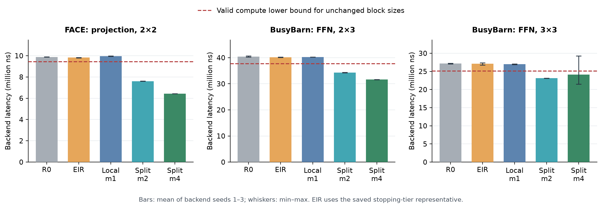

# EIR-Split：故障PE遗留计算块的局部拆分

2026-11-13，Codex。新增实现为 `post_fg_split.py`，协议 `post_fg_split_v1`。

## 方法

从A3h健康完整图识别MF6失效PE原有的全部Tensor/Vector任务。健康计算落点保持不变，Vector整体迁移，Tensor只沿输出N或batch-M轴拆成2/4片。原有FFN第二层的K部分和仍进入原来的16项向量归约，不新增K切分，也不省略归约。

输入片段来自行为/张量元数据，实际源位置取保存图中的活通信；这避免使用SA后未同步的DDR位置字段。N切分保留每个子块的完整A、拆B与bias；batch-M切分拆A、保留完整B与bias。消费者按需要的真实区域接收，每个区域覆盖检查通过；计算依赖在落点分离时变成真实数据通信。输出仍按照原布局收集，Vector等待全部所需子片。

新落点先最小化加任务后的最大计算负载，同父优先不同核，再按预估输入输出链路字节和稳定核ID取舍。改动通信使用确定性最短服务时间路径，保留全部不受影响的原路径。MF6仅删除Tensor/Vector设备，原路由器链路全部保留。权重继续从原活读取对应的DDR源恢复，不假设PE故障同时清空SRAM。

每案例分别构造N、M的合法输出划分，先比较实际grain取整FLOP，再比较完整图独占有向链字节，最后按N/M稳定顺序选轴。选择发生在后端运行前，代价记录同时计入两个候选的构造时间。m1使用相同放置与路由规则，是不拆分对照。

## 正确性与静态结果

小矩阵的M/N重组、bias与已有K部分和求和逐元素相等；三例m1指定原合法落点时，原事件顺序、字节、依赖、落点与路径完全一致。真实图核对了所有新消费者输入区域覆盖、有效FLOP守恒、健康计算移动数0、失败PE无计算，以及DAG无环。

| 案例 | 新图m1/m2/m4选轴 | Tensor峰值m1→m2→m4，百万ns |
|---|---|---|
| FACE投影 | — / M / M | 9.437184 → 7.077888 → 5.898240 |
| 2×3 FFN | — / M / M | 37.748736 → 31.444992 → 28.293120 |
| 3×3 FFN | — / N / N | 25.178112 → 20.975616 → 18.874368 |

三例两轴均合法，m2/m4的实际Tensor取整工作与父块之和相同。M选择指batch维16按2/4分片，不要求序列片段341或227可整除。Vector不按GEMM规则拆分。

统计同时保存消息逻辑字节、实际独占有向链字节（同一多播消息的共享前缀计一次）与按分支路径逐条求和字节。轴选择使用前者的链路占用表示；后者用于与采用分支和的历史表核对。DDR写入按实际接收端口计数。输入驻留量仅作为各接收核不同输入片段的总量上界，未把它写成实际峰值SRAM。

## 后端评估

27次新后端评估全部完成。下表旧R0/EIR使用F/G保存的后端种子1–3；EIR取原停止档的后端中位代表，和F/G正文五修复种子平均列分别定义。独立后端存在已知跨进程平局波动，逐种子数值和范围完整保留。

| 案例 | 方案 | 均值ns [最小,最大] | 相对R0 | 相对原EIR代表 | 所有种子低于刚性Tensor下界 |
|---|---|---|---:|---:|---|
| FACE_proj | m1 | 9,964,708.7 [9,932,928, 9,988,297] | +0.84% | +1.44% | 否 |
| FACE_proj | m2 | 7,608,370.3 [7,598,609, 7,614,005] | -23.01% | -22.55% | 是 |
| FACE_proj | m4 | 6,436,205.3 [6,433,614, 6,437,501] | -34.87% | -34.48% | 是 |
| G23_ffn | m1 | 40,272,861.7 [40,271,422, 40,275,741] | -0.35% | +0.30% | 否 |
| G23_ffn | m2 | 34,280,868.7 [34,220,968, 34,368,145] | -15.17% | -14.62% | 是 |
| G23_ffn | m4 | 31,626,181.0 [31,601,135, 31,642,815] | -21.74% | -21.23% | 是 |
| G33_ffn | m1 | 26,983,575.7 [26,861,665, 27,069,950] | -0.69% | -0.46% | 否 |
| G33_ffn | m2 | 23,131,984.7 [23,064,264, 23,170,059] | -14.87% | -14.67% | 是 |
| G33_ffn | m4 | 24,130,667.7 [21,465,367, 29,293,676] | -11.19% | -10.98% | 否 |

总延迟低于有效刚性计算下界时，可说明局部粒度调整达到固定块放置无法达到的时间；仅计算峰值下降的情况仍按实际后端收益报告。构图/选轴决策时间与本轮三个种子的评估成本分开列，后端墙钟来自这次服务器环境。

## 保存与复算

- [选轴比较](tables/split_axis_choices.csv)
- [数值、identity与完整图核对](evidence/split_graph_checks.json)
- [27项运行清单](manifest/split.json)
- 原始图、逐片映射、输入输出区域与服务时间：`out/split_prepare/graphs`、`out/split_prepare/metadata`。

```powershell
python -B e2e/post_fg_split_report.py
```

## 三个案例的五种方案



每根柱为后端种子1–3的均值，误差线为最小值到最大值。R0与EIR使用已有F/G样本，EIR为原停止档后端中位代表；Local-m1、Split-m2/m4使用本轮27项结果。红虚线是固定原块大小时的有效Tensor计算下界，三图分别使用各自纵轴。

| 案例 | 方案 | 均值ns | 最小ns | 最大ns | 有效刚性计算下界ns |
|---|---|---:|---:|---:|---:|
| FACE_proj | R0 | 9,881,936.3 | 9,867,812 | 9,889,140 | 9,437,184.0 |
| FACE_proj | EIR-representative | 9,823,569.3 | 9,800,013 | 9,836,641 | 9,437,184.0 |
| FACE_proj | Local-m1 | 9,964,708.7 | 9,932,928 | 9,988,297 | 9,437,184.0 |
| FACE_proj | Split-m2 | 7,608,370.3 | 7,598,609 | 7,614,005 | 9,437,184.0 |
| FACE_proj | Split-m4 | 6,436,205.3 | 6,433,614 | 6,437,501 | 9,437,184.0 |
| G23_ffn | R0 | 40,413,377.3 | 40,251,454 | 40,713,561 | 37,711,872.0 |
| G23_ffn | EIR-representative | 40,152,528.3 | 40,090,842 | 40,230,568 | 37,711,872.0 |
| G23_ffn | Local-m1 | 40,272,861.7 | 40,271,422 | 40,275,741 | 37,711,872.0 |
| G23_ffn | Split-m2 | 34,280,868.7 | 34,220,968 | 34,368,145 | 37,711,872.0 |
| G23_ffn | Split-m4 | 31,626,181.0 | 31,601,135 | 31,642,815 | 37,711,872.0 |
| G33_ffn | R0 | 27,171,190.0 | 27,075,207 | 27,219,221 | 25,104,384.0 |
| G33_ffn | EIR-representative | 27,107,667.0 | 26,744,944 | 27,366,091 | 25,104,384.0 |
| G33_ffn | Local-m1 | 26,983,575.7 | 26,861,665 | 27,069,950 | 25,104,384.0 |
| G33_ffn | Split-m2 | 23,131,984.7 | 23,064,264 | 23,170,059 | 25,104,384.0 |
| G33_ffn | Split-m4 | 24,130,667.7 | 21,465,367 | 29,293,676 | 25,104,384.0 |

导出：[PDF](figures/split_backend_main.pdf)、[SVG](figures/split_backend_main.svg)、[全部方案表](tables/split_all_methods.csv)。

## 结果解释与通信成本

三个案例的m2全部三个种子都低于原块大小下的有效计算下界，说明局部拆分已达到固定分片放置无法达到的总延迟。FACE与2×3 FFN的m4也都低于该下界；相对R0均值分别降低34.87%和21.74%。Local-m1仍在下界以上，收益主要来自粒度变化。

3×3 FFN的m2均值为23.132M ns、范围23.064–23.170M ns，相对R0降低14.87%。m4均值24.131M ns，种子1/2/3分别为29.294/21.465/21.633M ns：更细的块降低了计算峰值，同时服务顺序产生了长尾。本轮m2在三个案例的三种子范围均低于刚性下界；m4在3×3上同时出现两个更低值和一个长尾。

各方案有效FLOP和硬件grain取整后的FLOP逐项相同，健康计算移动数均为0。下面通信变化均相对Local-m1，以区分拆分增加的代价；独占有向链字节计多播共享前缀一次。

| 案例 | m | 有向链字节变化 | DDR读增加MiB | DDR读变化 | 权重输入增加MiB | 受影响激活输入增加MiB |
|---|---:|---:|---:|---:|---:|---:|
| FACE_proj | 2 | +0.192% | 9.001 | +0.223% | 9.001 | 3.000 |
| FACE_proj | 4 | +0.491% | 27.004 | +0.670% | 27.004 | 4.500 |
| G23_ffn | 2 | +0.113% | 36.003 | +0.361% | 36.003 | 0.000 |
| G23_ffn | 4 | +0.347% | 108.009 | +1.082% | 108.009 | 0.000 |
| G33_ffn | 2 | +0.096% | 42.562 | +0.363% | 0.000 | 74.625 |
| G33_ffn | 4 | +0.250% | 127.688 | +1.090% | 0.000 | 202.500 |

FACE与2×3采用M切分，需要复制B/bias；3×3采用N切分，B/bias按列划分，增加的是各子块所需完整A的读取与转送。三个案例DDR写入量保持相同。总链路字节增幅较小，但它本身不决定任务何时就绪、哪个计算先占用接收核。

### 3×3 m4种子1的长尾

已有trace显示，末端依赖链上的切块为 `(0, 0, 0, 0, 104, 90, 2)`，落在Tensor设备 `(3, 13, 0)`。种子1中，该块在1,381,301 ns已具备全部输入，在18,154,398 ns才开始，排队16,773,097 ns；种子2中它在765,479 ns开始。相同图、落点、FLOP和字节量下，接收核的服务次序不同。

种子1中，该切块比健康块12晚23 ns就绪，健康块12先占核；该核随后又服务了健康块92。切块结束后，其GELU与第二层块104继续执行，将末端结果推迟到29.294M ns。种子2中该切块首先被服务，种子3中它排在一个健康块之后。这里可直接看到输入就绪时刻、非抢占长计算及下游依赖如何放大一个较小的调度变化。

| 种子 | 核上服务顺序 | 输入就绪ns | 开始ns | 结束ns | 排队ns |
|---:|---|---:|---:|---:|---:|
| 1 | `(0, 0, 0, 0, 12)` | 1,381,278 | 1,381,278 | 9,786,270 | 0 |
| 1 | `(0, 0, 0, 2, 92)` | 9,662,792 | 9,786,270 | 18,154,398 | 123,478 |
| 1 | `(0, 0, 0, 0, 104, 90, 2)` | 1,381,301 | 18,154,398 | 20,246,430 | 16,773,097 |
| 2 | `(0, 0, 0, 0, 104, 90, 2)` | 765,479 | 765,479 | 2,857,511 | 0 |
| 2 | `(0, 0, 0, 0, 12)` | 1,189,565 | 2,857,511 | 11,262,503 | 1,667,946 |
| 2 | `(0, 0, 0, 2, 92)` | 9,681,165 | 11,262,503 | 19,630,631 | 1,581,338 |
| 3 | `(0, 0, 0, 0, 12)` | 922,151 | 922,151 | 9,327,143 | 0 |
| 3 | `(0, 0, 0, 0, 104, 90, 2)` | 940,633 | 9,327,143 | 11,419,175 | 8,386,510 |
| 3 | `(0, 0, 0, 2, 92)` | 9,817,631 | 11,419,175 | 19,787,303 | 1,601,544 |

该解释只使用已保存的事件时间、依赖和设备位置；没有增加仿真。证据：[三种子核上时间表](tables/split_g33_m4_core_order.csv)、[终点依赖与trace摘要](evidence/split_g33_m4_trace_diagnosis.json)、[通信与取整变化表](tables/split_cost_changes.csv)。

## 构图和选轴耗时

正式输入的 `build_seconds` 和 `axis_selection_seconds` 来自 Windows 本机准备图时的记录，后端作业会原样保留这两个字段。云端的构图成本在同一服务器上另行测量，使用独立目录 `out/split_cloud_timing`。

每个 m1 构造 N 轴候选；每个 m2/m4 分别构造 N/M 两个候选，再按预先确定的规则选轴。下表“全部候选”是候选构图时间之和，包含放置、路由、依赖重接、图检查和工作量统计；选中图这一列仅含最后选中的候选。

| 案例 | m | 轴 | 本机选中图s | 本机全部候选s | 云端选中图s | 云端全部候选s |
|---|---:|---|---:|---:|---:|---:|
| FACE_proj | 1 | N | 0.2740 | 0.2740 | 0.3356 | 0.3356 |
| FACE_proj | 2 | M | 0.1724 | 0.3632 | 0.3679 | 0.5473 |
| FACE_proj | 4 | M | 0.1998 | 0.4633 | 0.3866 | 0.5748 |
| G23_ffn | 1 | N | 0.2367 | 0.2367 | 0.2354 | 0.2354 |
| G23_ffn | 2 | M | 0.2717 | 0.6460 | 0.2661 | 0.8061 |
| G23_ffn | 4 | M | 0.2355 | 0.4901 | 0.2432 | 0.4841 |
| G33_ffn | 1 | N | 0.4610 | 0.4610 | 0.4413 | 0.4413 |
| G33_ffn | 2 | N | 0.4804 | 0.9875 | 1.0742 | 1.5192 |
| G33_ffn | 4 | N | 0.4134 | 1.1067 | 0.4080 | 0.8106 |

| 案例 | 读取s | 两个平台s | identity与健康统计s | 构图并选轴s | 图摘要核对s | 图写盘s | 案例全流程s |
|---|---:|---:|---:|---:|---:|---:|---:|
| FACE_proj | 0.2906 | 0.9006 | 0.1617 | 1.4684 | 0.1430 | 0.1970 | 3.1756 |
| G23_ffn | 0.0474 | 2.9774 | 0.1341 | 1.5574 | 0.1360 | 0.1597 | 5.0282 |
| G33_ffn | 0.4048 | 7.4045 | 0.2597 | 2.8145 | 0.2363 | 0.3152 | 11.4605 |

云端 Python 3.13.18，Linux-5.15.0-190-generic-x86_64-with-glibc2.35，128 个逻辑CPU；本项用一个进程。完整入口耗时 19.744 s，覆盖15次候选构图、9张所选图写盘、3次identity与输入读取、平台创建、一致性核对。案例全流程还包含元数据写盘；构图、核对与写盘分别计时。此次没有后端评估或SA。

9张图的规范化内容SHA-256逐项等于正式清单和已上传图，原清单与9个正式图文件SHA-256在复测前后保持一致。正式实验继续使用原输入图。

首次云端尝试在导入tensorcore时终止，尚未构图。服务器保存的是 `e2e/work/artifact`；新增Split入口随后通过 `f_config.artifact_root()`使用这份配置好的artifact。冻结源码保持原样，重测通过上述全部一致性检查。

证据：[云端计时](out/split_cloud_timing/timing.json)、[首次错误](out/split_cloud_timing/first_attempt_error.log)、[修正记录](out/split_cloud_timing/first_attempt_failure.json)、[下载核对](evidence/split_cloud_timing_download.json)。
